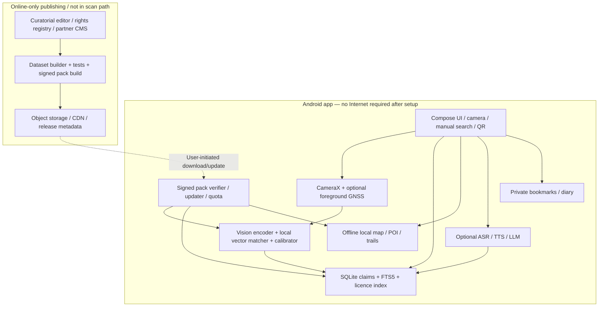
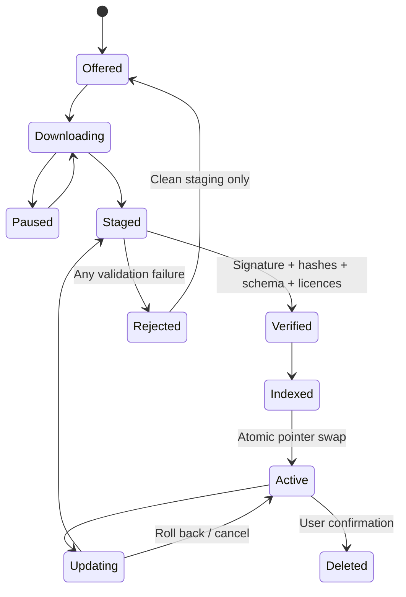
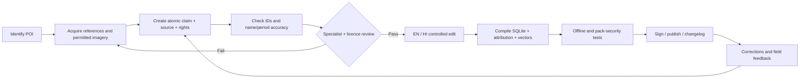

# TRUEWAY — FINAL MASTER BLUEPRINT

**Offline-first AI Heritage & Travel Companion**  
**Product requirements · AI and systems architecture · Verified research · Complete features · Content operations · UI/UX · Data models · Security · Evaluation · Budget · Roadmap · Launch strategy**

> **Product promise:** *Capture. Discover. Understand. Anywhere.* TrueWay helps travellers identify a **supported** place, discover historically sourced explanations and explore curated local heritage **after downloading the necessary region pack**, even when internet access disappears.
>
> **Non-negotiable truth:** The camera cannot identify every place. When evidence is weak or a site is not supported, TrueWay must say so rather than fabricate a name or history.

**Evidence labels used throughout**

- **[V] Verified external capability/fact:** backed by a primary source in the bibliography; verification is only as current as 10 October 2026.
- **[R] Reviewed suggestion:** appears in the submitted AI review material; a proposal, **not** independent proof of feasibility.
- **[D] Design decision:** this master plan's recommendation for TrueWay; implementation may change after testing.
- **[A] Planning assumption:** illustrative targets, budgets, footprint estimates or proposed experimental thresholds, not tested measurements.
- **[G] Release gate:** a requirement that must be demonstrated before its associated feature is released.

This document synthesizes **(1)** the founder's handwritten TrueWay note, **(2)** the earlier 29-page *TrueWay Deep Research & Technical Feasibility Report*, and **(3)** the three subsequent AI reviews: `Pasted text(2).txt`, `# TrueWay — Gap Analysis Extra Feat.txt`, and `Fix — verified technical correction.txt`. The external source bibliography independently checks material technical and regulatory claims. Some review suggestions are corrected, narrowed or deferred below; their numerical values are not treated as evidence.

**Important exclusions:** No TrueWay application, fine-tuned model, 50-place dataset, partner agreement, field trial, trademark clearance or production financial model has actually been completed. This is a detailed **build specification and research synthesis**, not a claim that those deliverables exist. It is not legal, safety or archaeological certification.

---

## Table of contents

1. Executive decision and precise product definition
2. What the reviews added, what changes, and what is rejected
3. Core design principles and measurable constraints
4. Market positioning, competitors and target personas
5. Product scope, priorities and full feature catalogue
6. User journeys and information architecture
7. Recognition science, ML experiments and inference contract
8. Reference architecture and technology stack
9. Offline regional pack system and signed manifest
10. Data model, schema, FTS search and geospatial index
11. Signed QR/NFC touchpoints and offline distribution
12. Offline map, GPS, trails, terrain and indoor navigation
13. Historical knowledge, provenance and editorial system
14. Grounded offline assistant, audio, OCR, voice and accessibility
15. Privacy, security and regulatory approach
16. Rights, licences, location restrictions and partner consent
17. Bihar pilot: site selection, field study and dataset plan
18. Evaluation methodology, thresholds and test matrix
19. Product UX specifications, copy and error states
20. Backend, pack builder, CMS and deployment operations
21. Financial plan and unit-economics scenarios
22. Monetization, partnerships, distribution and growth loops
23. 24-week delivery plan and the first 14 days
24. Epics, user stories and acceptance criteria
25. Project governance, staffing and risk register
26. Launch decisions, stop/go criteria and first 90 days after pilot
27. Advanced research roadmap: AR, BLE, visual relocalization
28. Sample machine-readable contracts and SQL
29. Comprehensive release acceptance tests
30. Open questions, assumptions register and decision log
31. References, review-source map and source-verification notes

---

# 1. Executive decision and precise product definition

## 1.1 Final recommendation

**Build an Android-first, camera-assisted, citation-first offline heritage guide—not a universal visual search engine or general-purpose AI travel super-app.** Start with a **15-landmark no-internet proof of concept**, expand to a **50–70 curated-POI Bihar pilot** if the model passes open-set recognition tests, then add partners and premium experiences. **[D]**

Five operating pillars:

1. **IDENTIFY** — photograph a supported landmark and receive ranked, calibrated candidates; alternatively choose by name, GPS-nearby, category, offline map, or verified QR/NFC code.
2. **UNDERSTAND** — read human-reviewed history, architectural observations, chronology, cultural context, contested interpretations and attached citations.
3. **EXPLORE** — access the downloaded POI directory, a licensed offline map, curated trails and dated visitor guidance.
4. **TRUST** — visually separate recorded fact, scholarly interpretation, religious tradition, unverified claim and operational information; expose sources, licence, review dates and ambiguity.
5. **KEEP CONTROL** — store travel photos and notes locally; make regional packs, voice models, media and large AI models optional; support verifiable deletion and updates.

**Signature interaction:** `Photo OR Search OR QR/NFC → place_id → verified claims → readable story + sources + next discovery`.

**Why this strategy wins:** Maps, offline encyclopaedias, audio tours and image search already exist. The differentiator is the **joined-up, genuinely local and evidence-aware journey**; not one technology by itself. **[V: S10–S13; D]**

## 1.2 Single-sentence product and messaging

- **Category:** Offline-first cultural/heritage discovery application with optional AI augmentation.
- **User promise:** “Know the story behind the place—even without internet.”
- **Suggested tagline:** “TrueWay — Places have stories. Find them offline.”
- **Pitch:** “TrueWay is a lightweight pocket heritage guide that matches supported places through photos, location, or signed QR touchpoints, then presents sourced historical stories from locally downloaded regional packs.”
- **B2B extension:** “A signed, rights-checked heritage-content and touchpoint publishing platform for museums, guides, universities and tourism agencies.”

The **TrueWay** brand/name is a working title; obtain trademark, domain, app-store and existing product conflict checks before commercial launch. **[G]**

## 1.3 Product boundaries

| TrueWay **will** offer | TrueWay **will not** promise at launch |
|---|---|
| Supported-POI visual recognition offline | Identify arbitrary buildings or every place worldwide |
| Manual search when camera is restricted | Work inside a site where devices themselves are prohibited |
| Curated facts with source references | Archaeological certainty for all disputed dates and narratives |
| Offline map tiles where rights permit | Current live traffic, opening times, closures, exchange rates, or weather |
| Optional voice/OCR/LLM modules | Reliable reading of Brahmi or every ancient script |
| Saved tours and emergency reference information | Emergency dispatch, guaranteed cellular calls, professional rescue or certified safe navigation |
| Signed pack verification | Guaranteed authenticity of an illegally replaced physical QR plate |
| Opt-in offline peer transfer with device radios on | P2P transfer with Wi-Fi and Bluetooth physically switched off |

## 1.4 Explicit success condition

A visitor who has installed the app and destination pack must, with **internet inaccessible**, be able to (a) locate one supported place by camera/search/QR, (b) read a meaningful source-backed explanation, (c) find another nearby place, (d) view content without a large generative model, and (e) understand when TrueWay is unsure. **[G]**

---

# 2. Review integration, corrections and final disposition

## 2.1 Major contributions from the three reviews

The reviews add valuable real-world ideas that the first report underspecified: **signed Tap-to-Story QR/NFC**, **peer-to-peer Pack Relay**, **offline essentials**, **battery-conserving scanning**, **Hindi voice questions**, **heritage passport and challenges**, **then-and-now archival photos**, **audience lenses**, **pronunciation recordings**, **seasonal planner snapshots**, **terrain/elevation**, **export/interoperability**, **gap-reporting with consent**, **community review**, **Pack Studio**, and optional **AR/BLE/museum tools**. **[R]**

Their best insight is that TrueWay must work when **camera access, permissions, battery, maps or GPS fail**, not only under the ideal photograph-and-recognize scenario.

## 2.2 Final integration decisions

| Review idea | Decision | Rationale and correction |
|---|---|---|
| **Signed QR/NFC `place_id` lookup** | **P0 resolver, P1 partner deployment** | Deterministic fallback; physical plate installation requires venue consent. A valid signature authenticates the payload's **publisher**, not the physical plate's placement. |
| **Pack Relay** | **P1 gated** | Official Nearby Connections supports device-to-device data transfer without internet, but Bluetooth/Wi-Fi and permissions are still required. Validate mixed-device throughput; do not promise 10–30 MB/s. **[V: S07]** |
| **Offline emergency/essentials** | **P0 concise data** | Include dated contacts, addresses, advisories; never imply a call will connect without a mobile network. |
| **Low-power scanner** | **P0** | Short camera sessions, inference throttling, background suspension, manual search fallback. |
| **Pack changelog** | **P0** | Historical correction and licence audit should be visible, not hidden. |
| **Heritage Passport / badges** | **P1** | Very low ML burden and strong field engagement, but must not distract from recognition accuracy. |
| **Audio tours + local pronunciation** | **P1** | Start with human-authored scripts and small clips; device TTS/SSML behaviour varies by engine—do not assume full SSML support. |
| **Then & Now archive slider** | **P1 selective** | Lower risk than speculative 3D reconstructions; archive imagery still needs item-level rights clearance. |
| **Hindi voice-first Q&A** | **P1 experiment** | Push-to-talk, transcript correction, locally installed ASR; no always-on microphone. Test noisy-site Hindi/Hinglish before release. |
| **OCR of modern signs** | **P1** | ML Kit supports Devanagari script; this does **not** establish ancient epigraphic transcription accuracy. **[V: S05]** |
| **Local LLM/RAG** | **P1 optional** | Benefits narration and questions; factual history lives in the database, not in model weights. |
| **AR timeline reconstruction** | **P2 research** | ARCore Depth is a supported depth/occlusion tool, **not** automatic alignment to a specific monument or archaeologically valid 3D reconstruction. **[V: S15]** |
| **BLE indoor location** | **P2 partner experiment** | No guaranteed sub-5 m accuracy; requires venue hardware, permission, signal calibration and accessibility plan. |
| **Community imagery / Pack Studio** | **P2** | Rights review and editorial independence must precede submissions or paid publishing. |
| **Opt-in gap beacon / calibration** | **P1 concept / P2 telemetry** | Coarse data plus user consent; merely waiting for k records on a device does **not** prove formal k-anonymity or differential privacy. |
| **Cross-site academic lens** | **P2** | Strong education value, but must be curated rather than speculative visual style assertions. |

## 2.3 Corrections to review assumptions that must not become public claims

1. **“Airplane mode” has two tests:** offline core functions require **radios off**; peer relay requires **no internet, radios available**, sometimes after manually re-enabling Wi-Fi/Bluetooth. Test separately.
2. **“Camera off inside Mahabodhi sanctum” is too narrow:** Bihar Tourism lists mobile phones, cameras and electronic gadgets as prohibited at the temple. Use the official notice for user-facing caution and never suggest use in a prohibited area. **[V: S14]**
3. **ARCore ‘Augmented Faces’ is not a landmark-reconstruction API.** Use properly anchored assets, with Depth only for supported occlusion. Anchoring needs its own field tests.
4. **“BLE triangulation gives <5 metres” is not a guarantee.** Measured field accuracy depends on anchors, interference, geometry, placement and calibration.
5. **“Android BLE requires no additional permissions” is false as a blanket statement.** Permissions vary by API level and feature; Nearby Connections documents Bluetooth, Wi-Fi and sometimes location/local-network permissions. **[V: S08]**
6. **“All old survey photos are public domain” is unsafe.** Every photograph has separate authorship, term, institution policy, licence and possible reproduction constraints. **[G]**
7. **“Android TTS supports SSML” cannot be assumed across engines.** Implement robust sentence pacing and audio script controls; experimentally test voice-specific markup support.
8. **“One-country pack” is not a mandatory download.** Users should install one city/circuit, then add optional layers. Huge global/model files are not an MVP requirement.
9. **“Historical answer with 100% factual correctness” cannot be guaranteed by prompting.** Validate retrieval, inspect citations, provide evidence text, abstain on unsupported questions, and audit expert samples.
10. **“100% of every sentence has a citation” is not an effective quality metric for marketing copy or UI labels.** All **substantial historical/operational claims** must be traceable; accessibility strings and ordinary UI controls are separate.
11. **“Transfer rate, voice WER, 200 ms inference or 4% battery drain” are design targets or hypotheses**, not benchmarked results, unless measured on target phones under a documented protocol.
12. **“Secure QR cannot be spoofed” is inaccurate:** a pasted, displaced or malicious external QR can still trick users. Use issuer signature checking, bounded deep links, approved plate serials/partner registers, tamper inspection and confirmation of site identity.

---

# 3. Product principles and measurable constraints

1. **Offline means usable, not merely launchable.** After complete setup, recognition, browse, history, source viewer, map/list, settings and journal may not require an internet request. **[G]**
2. **Unknown is an acceptable outcome.** A wrong confidently asserted monument is worse than a transparent abstention. **[G]**
3. **Sources and licences are first-class data.** Each curated factual record must carry claim type, citation, review date, editorial state and evidence link. **[G]**
4. **No mandatory heavyweight model.** The base experience must run on a defined entry-level reference Android device; all large LLM, ASR, media and map layers are optional. **[D]**
5. **Device and cultural privacy.** Camera frames and audio are processed locally by default, with no invisible upload; journaling is opt-in. **[G]**
6. **Graceful degradation.** Camera unavailable → name/category; GPS unavailable → manual area browse; no map → list; no TTS → text; no LLM → pre-authored Q&A; no language pack → show original/English/Hindi with disclaimer. **[G]**
7. **Field respect is part of UX.** Surface on-site permissions and avoid encouraging restricted photography, climbing, intrusive filming, sensitive rituals or interference with worship. **[G]**
8. **Correctability.** Historical edits, deprecated assets and temporary closures must be versioned with clearly visible ‘last checked’ dates. **[G]**
9. **Accessibility and no forced payment.** Manual lookup, basic factual summary, citations and key accessibility controls should remain free. **[D]**
10. **Smallest reliable release first.** Add a feature only if it provides field value, meets evidence/rights gates, works offline where promised, and has a deterministic fallback. **[D]**

### Definition of a 'fully offline' release test

Run core tests on a fresh device **after the pack and models have been installed** and then disable internet through Wi-Fi/mobile data and airplane mode as appropriate. Audit DNS, HTTP, telemetry and SDK behaviour. If Google Play services or vendor runtimes lazily download components, prepackage or explicitly prefetch them and verify offline readiness. A UI screen opening is not sufficient: content retrieval must succeed and produce zero unexpected egress.

---

# 4. Market position, competitors and personas

## 4.1 Competition

| Category/product | Existing strength | TrueWay's defensible proposition | Caveat |
|---|---|---|---|
| Google Maps | Downloadable map regions, standard place search | Curated, source-linked heritage explanations connected to offline camera/QR | Do not compete on live navigation breadth. **[S10]** |
| Google Lens | General-purpose image-based discovery | Device-local recognition inside downloaded heritage packs | Lens is generally a richer online ecosystem; do not claim global superiority. **[S11]** |
| Kiwix | Offline encyclopaedia bundles | Destination-specific visual and spatial access + story presentation | Reuse is subject to content licences. **[S12]** |
| izi.TRAVEL | Audio-first self-guided tours | Photo/QR identification, claim-level provenance, portable modular packs | Audio quality must be genuinely good. **[S13]** |
| VoiceMap | GPS-triggered guided tour experiences | Broader reference-linked knowledge, multimodal entry paths | GPS tours alone are not novel. **[S13]** |
| Human guides/museums | Nuance, interpretation, personal experience | On-demand convenience, accessibility, offline companion | Position as complementary, not a substitute for local knowledge-holders. |

**Competitive moat hypothesis [D]:** a trusted and rights-cleared local *heritage graph* + calibrated supported-place recognition + signed distribution + strong site relationships, not merely a model selection.

## 4.2 Primary personas and jobs-to-be-done

**P1 — Budget domestic traveller/pilgrim.** Unreliable connectivity, limited storage, perhaps limited English and sometimes camera restrictions. Wants concise history, appropriate etiquette and free offline search. Prioritise Hindi, clear source labels and a 3-minute “first value” experience.

**P2 — Architecture/archaeology/history student.** Wants accurate forms, typologies, dated interpretations, comparison images, references, annotated diagrams and saved field observations. Add Architecture Detective and Study Mode only with curated specialist content.

**P3 — International heritage traveller.** Needs understandable language, pronunciation, accessible maps, local restrictions and an audio guide. Language support must be explicitly preinstalled.

**P4 — Local guide/museum/heritage institution.** Needs trusted content authoring, visitor interpretation, partner touchpoints, analytics under consent and revised operational notices. B2B workflow should be built only once core content quality is established.

**P5 — Traveller group leader (derived from reviews).** Downloads a single region pack at accommodation and wants to share it offline with fellow travellers. Pack Relay is relevant, but requires radio/permission compatibility and verified data transfer.

## 4.3 Discovery research still needed

Conduct 15–25 qualitative interviews across domestic visitors, multilingual pilgrims, site staff, students and guides; observe actual behaviours at permitted areas. Research *when people prefer reading, audio, QR or manual location*, not merely whether they ‘like AI’. Follow with prototype usability and willingness-to-pay studies; a tourism arrivals count is **not** a TrueWay TAM estimate.

---

# 5. Feature catalogue and release scope

**Priority interpretation:** **P0** = first usable field pilot; **P0.5** = low-risk hardening before public beta; **P1** = post-core or selectively in pilot only if it does not delay release; **P2** = partner/research platform; **Reject** = intentionally not supported.

## 5.1 P0: indispensable features

| ID | Feature | Behaviour and important edge condition |
|---|---|---|
| F001 | Region onboarding | Search destination; inspect languages, assets, estimated storage, licence summary and offline-readiness status. |
| F002 | Camera capture/landmark ranking | Single-shot photo, blur hint, top-3 candidates and calibrated unknown state. |
| F003 | Search and category lookup | Local indexed names, aliases, transliteration, place type, nearby list and manual site selection. |
| F004 | Sourced historical card | Short summary, historical timeline, architecture, facts/tradition distinction, references, ‘reviewed on’ date. |
| F005 | Optional GPS location | Permission in context, coarse-to-precise flow, stale-location warning and browse-only fallback. |
| F006 | Pack lifecycle | Download → verify signature/hash → index → atomic activate; pause/resume/update/rollback/delete. |
| F007 | Lite journal/bookmarks | Save selected POIs and user-authored notes locally; photo optional; no account needed. |
| F008 | Offline nearby/list | Downloaded points and simple distance ordering; map view when map pack exists. |
| F009 | Camera/device restrictions | Pre-scan warnings; no-camera route remains prominent. |
| F010 | Trust/unknown UI | Explain ambiguity, show candidates, enable correction, never force a landmark name. |
| F011 | Basic essentials strip | Dated local emergency contacts, site etiquette, offline directions-to-known-address text; connectivity caveat. |
| F012 | Resource & low-battery controls | Pause camera/inference on background, release resources, choose low-power one-shot mode. |
| F013 | Pack content changelog | See newly added places, updated source claims, corrected dates and component download changes. |
| F014 | Signed QR resolver | Scan a valid site code and resolve from installed pack; no-camera fallback still available where phones are banned. |
| F015 | Help, accessibility, offline badge | Show what's downloaded, show why a feature is unavailable, change font size/language, delete data. |

**Scope restraint:** The P0 **QR resolver** is cheap relative to physical touchpoint partnerships; deploying QR/NFC plates is **not** a P0 prerequisite.

## 5.2 P0.5 field hardening

- Explicit offline readiness checklist, pack-repair flow, no-storage handler and zero-network test.
- Human-reviewed ‘best season’, visit-duration and permitted-photography snapshot with clear verification date (not real-time advice).
- Battery saver, short session timeout, corrupted image handling and safe retry.
- Signed manifests, secure archive extraction, rollback and revoked-publisher-key policy.
- Crash and accessibility checks on entry-level devices; on-site signage and guidance must remain readable without media assets.

## 5.3 P1 high-value expansions

| ID | Feature | Description | Gate/fallback |
|---|---|---|---|
| F101 | Curated audio guide | Scripts narrated with verified TTS or reviewed audio; subtitles; offline playback | Text if TTS/model missing |
| F102 | Hindi/English voice query | Push-to-talk ASR → editable transcript → FTS answers; local only | Typed search; field-noise WER evaluation |
| F103 | OCR/translation | Signboards and modern Devanagari/Latin scripts; model downloaded before travel | Original photo/text; ancient script not implied |
| F104 | Architecture Detective | Curated visual annotations for elements/materials; user crop with expert note | Standard architecture article |
| F105 | Trip planner | Duration, theme, mobility preference and curated stop graph; no fabricated travel times | Static curated route list |
| F106 | Audio stop triggers | Only while actively taking a guided walk; event-driven, battery measured | Tap-to-play stop list |
| F107 | Heritage Passport | Offline stamps, learner badges and visits with anti-misleading eligibility explanation | Local-only manual bookmark |
| F108 | Then & Now | Licensed historical photo compared with contemporary site image, provenance shown | Single archival image/card |
| F109 | Audience lenses | Child, first-time visitor, enthusiast and scholar versions authored during pack building | Default article |
| F110 | Pronounce place name | Short consented local-language recording and phonetic rendering | TTS/text |
| F111 | Pack Relay | Device-to-device transfer of signed pack under local radios and permissions | Ordinary download later |
| F112 | Terrain and heat notes | Curated hill trail profile, elevation sample and water/rest stop caveats | Text trail list |
| F113 | Local LLM Q&A | Optional model answers evidence-scoped historical questions with tested citations | Extractive response / FAQ |
| F114 | Place-card export | Small signed story card shared by local connection/file/QR where practical | In-app card |
| F115 | Gap Beacon | Explicit opt-in, coarse request to add unsupported region; sync only when online | Remain local, no analytics |
| F116 | Study Lite | Flashcards, chronology quiz, architectural elements from pack | Read-only article |
| F117 | Journal export | Select entries for GPX, GeoJSON, PDF or JSON, with location controls | Local view; explicit export dialog |

## 5.4 P2 experiments, partnerships and differentiation

- **AR era timeline:** explicitly distinguish surviving fabric, documented reconstruction and artist's hypothesis. Conduct on-site registration/occlusion trials.
- **Indoor BLE museum mode:** partner-installed beacons, device scanning permissions, labelled positional uncertainty and no safety-critical routing.
- **Opt-in community reference photographs and local-guide voices:** consent, rights grant, editorial moderation, no raw EXIF by default, attribution and withdrawal workflow.
- **Pack Studio:** partner CMS with editorial roles, licensing gate, export preview, validation and cryptographic publishing.
- **Cross-site scholar comparison:** curated elements, typology tables, side-by-side verified photos and source quotations.
- **Advanced archaeology OCR:** Brahmi/Prakrit/epigraphy as a specialist research collaboration, not generic OCR.
- **Visual re-localization/SfM:** research-only, device/site-specific with uncertainty; no promised 1-metre accuracy.
- **Institutional/education dashboards:** opt-in student exercises and content versioning; avoid intrusive movement surveillance.
- **International circuit marketplace:** only after multilingual rights/commercial compatibility is established.

## 5.5 Explicitly rejected initial features

- Mandatory multi-GB on-device LLM, always-on listening, forced cloud login, scraped/redistributed prohibited OSM tiles, unreviewed heritage facts, automatic off-device photo uploads, universal global identification, ‘live’ operational claims from stale packs, user-feed social network, AI-generated hypothetical reconstructions labelled as truth, guaranteed indoor safety navigation, guaranteed emergency SOS.

---

# 6. Critical user journeys and UX information architecture

## 6.1 Journey A — ideal supported landmark

`Install → choose region → download pack → verify offline-ready → arrive at site → check camera rules → open Scan → capture → see candidates → select correct place → view sourced history → explore architecture → save journal → see next nearby POI`.

User must see **exactly which pack and model were used**, confidence expressed as *likely / possible / unknown* unless probability calibration justifies percentages. Sources open locally.

## 6.2 Journey B — unsupported building or similar ruins

Camera matches common brickwork at two ancient sites but no candidate clears acceptance. Display **“No reliable match in your downloaded places”**; a separate section may say “Nearby places from your location” (not claimed to be recognized). Offer manual lookup and report a missing place **only with consent**.

## 6.3 Journey C — site with camera/electronic restrictions

Before access or where device use is permitted, show the site notice; visitor chooses text search, historical card, printable/exportable preparation or ‘read later’. If electronics are disallowed on-site, **do not suggest scanning a QR there**. On-site physical QR/NFC experiences require current operator permission and permitted device use. Mahabodhi Temple restrictions are documented by Bihar Tourism. **[V: S14]**

## 6.4 Journey D — travelling without GPS or map component

Display saved tour stops as a list, place aliases and helpful orientation text, avoiding a spurious blue dot. If the only available map is online, do not render a blank misleading map and call it ‘offline’. Show “Map pack not installed; history and nearby list still available.”

## 6.5 Journey E — local pack relay

Group leader has an active verified pack; companion requests via explicit pair flow; both enable necessary local radios; sender shows an ephemeral pairing session/verification code; receiver checks advertised pack name/version/size and free storage; chunks transfer; receiver independently verifies publisher signature and files; pack becomes active atomically. Failed/tampered transfers do not affect existing data.

## 6.6 Journey F — exam or architecture fieldwork

Student chooses scholar reading, cross-references brick bonding/plinth/shikhara/arch details, saves observations with self-authored photos only where legal, compares historical phases and exports a selected field worksheet. The app labels its architectural notes as sourced interpretations and does not infer style certainty solely from image appearance.

## 6.7 Screen architecture

```text
Home
├─ Explore
│  ├─ Search / categories / aliases
│  ├─ Nearby / region list
│  ├─ Offline map (when installed)
│  └─ Circuits / curated trail
├─ Scan
│  ├─ Camera permission and site-advisory gate
│  ├─ Photo capture / one-shot power saver
│  ├─ Candidate selection / unknown outcome
│  └─ QR or text alternative
├─ Place
│  ├─ Overview + fact classifications
│  ├─ Timeline / architecture / beliefs and interpretations
│  ├─ Sources / attribution / last review
│  ├─ Audio / photos / then & now (optional)
│  └─ Save / share / next discovery
├─ Saved
│  ├─ Journal / private notes / photos
│  ├─ Heritage Passport (optional)
│  └─ Data export / deletion
├─ Downloads
│  ├─ Region and language packs
│  ├─ Map / narration / vision model / optional LLM
│  ├─ Verification status / changelog
│  └─ Repair / update / delete
└─ Settings
   ├─ Privacy, permissions, consent
   ├─ Language, text size, accessibility
   ├─ Battery/data management
   └─ About, citations, help and issue reporting
```

**Navigation recommendation:** bottom navigation for Explore, Scan, Saved and Downloads; optional ‘Ask’ entry only if the local AI model is actually ready. **[D]**

---

# 7. Landmark recognition: science and experimental methodology

## 7.1 Problem formalization

This is **open-set, instance-level visual retrieval**, not generic scene classification. For a query photo `q`, active pack `P`, reference image embeddings `E_i`, geospatial context `g`, and quality score `b`, compute an ordered set of candidate place IDs with evidence and a calibrated abstention decision. The correctness target is **identity among covered POIs**; do not conflate “same architectural style” with “same physical place”.

## 7.2 Reference corpus design

- Pilot seed: **15 recognisable permitted sites/features** with at least 10–20 independently sourced viewpoints for feasibility; expand to **50–70 canonical POIs** only after taxonomy review. **[A]**
- For each POI, collect façade, 3/4 view, partial crop, daylight, shade, distance and moderate occlusion, where authorised.
- Avoid nearly identical user photos in train/test; split by **photographer, visit/day, camera viewpoint and site context** where possible.
- Separately curate **unknown**: modern shops, ordinary ruins, scaffolding, ticket booths, unrelated temples, generic pillars, market scenes, vegetation, close-up bricks and neighbouring monument lookalikes.
- Separate **parent sites** (Mahabodhi complex, Nalanda archaeological site) from **visually identifiable child structures**, to prevent inflated “accuracy” from generic large-site names.
- Every reference image needs an `asset_id`, creator, licence, use-rights record, collection date, named POI label confidence and review state.

Research starting point: Google Landmarks Dataset v2 covers about five million images, but the official repository distinguishes train, index and test licensing and explicitly warns that Google does **not** own rights to each image. Do not use it as a rights-free commercial asset source. **[V: S09]**

## 7.3 Baselines to benchmark (not pre-select)

| Variant | Main value | Limitation | Release role |
|---|---|---|---|
| **A. Compact MobileNet/EfficientNet class feature encoder** | Potentially small install and fast CPU/NNAPI delegate | Needs suitable fine-tuning and faithful mobile export | **P0 baseline candidate** |
| **B. EmbeddingGemma 2 Text-Vision (440M)** | Official multimodal image/text embedding example; listed **388 MB** in LiteRT-LM | Far too large to require for many entry-tier installs; benchmark RAM, battery and accuracy | Experimental optional candidate **[V: S01/S02]** |
| **C. Local geometric/local-feature verifier** | Helps distinguish similar detailed facades under good views | Computation and failure on textureless/occluded surfaces | P1 if A/B need re-ranking |
| **D. Gemma 4 E2B generative model** | Optional multimodal conversations; LiteRT-LM model listed ~**2.58 GB** | Not an efficient basic nearest-neighbour landmark recognizer | Optional P1 flagship QA, **never** mandatory **[V: S01/S03]** |

**Important clarification:** EmbeddingGemma 2's general model card describes **768-dimensional** embeddings for the 740M model; the exact exported Text-Vision model's output shape, quantization, compatibility and token/image pipeline must be inspected rather than assuming every variant is identical. **[V: S02; G]**

## 7.4 Recommended recognition pipeline

```text
User-initiated capture
    │
Image normalization (orientation, resize, blur/quality hint)
    │
On-device encoder → query vector + model_version
    │
Retrieve plausible reference vectors from installed pack(s)
    ├── Optional GNSS as a **soft prior** using accuracy & age
    ├── Compare cosine similarities / normalized distances
    └── Aggregate several reference images into place-level scores
    │
Optional geometric verification on strongest confusing pairs
    │
Calibration gate from held-out known + unknown examples
    ├── RELIABLE → top candidate with source-backed card + alternatives
    └── UNCERTAIN → explicit abstention + nearby/manual search
```

**Do not** hard-exclude all places outside a 5–15 km radius. Location can be stale, manipulated, denied, inaccurate or intentionally absent; use it as a **soft prior** and record whether the result was based mainly on visual or location evidence. **[D]**

## 7.5 Initial scoring design [D]

For each image reference `r_j` with known `place_id`, calculate `sim(q, r_j)`. Aggregate each place's strongest reference similarities (e.g., robust top-2 mean) plus optional quality and geolocation features. Fit a calibrator (logistic/temperature/isotonic as appropriate, validated on withheld sites/visits) to estimate acceptance reliability. The precise fusion weights, score margin and thresholds are **learned from data**; no arbitrary value such as cosine ≥ 0.80 is a valid universal rule.

Keep the following diagnostics: best match score, second-best margin, photographer/session split, motion blur, geo radius, candidate population, inference backend and decision reason. Do **not** expose a percent confidence to consumers until calibrated probabilities are validated.

## 7.6 Metrics and experiments

- `Top-1 known accuracy = known queries whose highest-ranked POI is correct / all known queries`.
- `Top-3 recall = known queries whose correct POI occurs among top 3 / all known queries`.
- `False accept rate (open set) = unknown queries incorrectly accepted as a supported POI / all unknown queries`.
- `Accepted-set precision = correct accepted identities / all accepted identities`.
- `Coverage = known queries accepted / all known queries`.
- `Abstention rate = queries marked unknown / all queries`, partitioned known vs unknown.
- `P50/P95 latency = elapsed capture-to-card seconds`, reported by phone tier.
- `Error per class` and worst-site confusion, not only micro-averaged accuracy.

**Suggested pilot gates [A/G]:** ≥85% known-set top-1, ≥95% top-3, ≤5% false accepts on a realistically hard unknown set, 100% correct refusal on deliberately out-of-pack scripted edge cases subject to the test corpus, P50 <2.5 s and P95 <6 s on a named baseline phone. Final thresholds require risk review; a stricter false-accept requirement may justify lower coverage. Benchmarks **have not been run**.

---

# 8. Reference architecture and technology stack

## 8.1 Logical diagram



**Failure boundary:** no online dependency may enter the recognition, source reading, journaling or manual search critical path. The backend exists to **prepare and distribute** content, not to answer users in the field.

## 8.2 Proposed stack

| Layer | Choice [D] | Alternative/consideration |
|---|---|---|
| Platform | Kotlin Android-first | Flutter/React Native later only if native camera/AI constraints justify |
| UI | Jetpack Compose | Maintain TalkBack and minimum contrast requirements |
| Camera | CameraX, lifecycle-bound | Single-shot default rather than uninterrupted live frames |
| AI runtime | LiteRT / supported runtime under benchmark | ONNX Runtime Mobile/TFLite as benchmark candidates |
| Vision index | Flat immutable vector table for small packs | HNSW/FAISS-like strategy only if scale/latency proves necessary |
| Data | SQLite (Room) + FTS5 | R-Tree for bounding boxes if needed |
| Maps | MapLibre Android using **already downloaded** local PMTiles assets | Test minimum supported MapLibre build and storage paths **[S04]** |
| OCR | ML Kit Text Recognition v2, offline bundled/preinstalled models | Limit to supported scripts **[S05]** |
| Offline translation | ML Kit on-device model packs after pre-download | Human-reviewed editorial translation preferred **[S06]** |
| Speech input | Optional Vosk / sherpa-onnx candidate | Bench noisy Hindi/Hinglish and CPU/thermal **[S16]** |
| TTS | Android TTS installed voices or small pre-rendered clips | Voice availability is OEM-dependent |
| Optional LLM | LiteRT-LM with measured compatible model | Use extractive text when absent **[S01]** |
| Pack server | Python + FastAPI + background build workers | Small object store/CDN for signed immutable releases |
| CI/CD | GitHub Actions or analogous CI, reproducible builds | Separate data and code quality gates |
| Observability | Local debug metrics; strict opt-in aggregation | Never upload raw photos/audio by default |

## 8.3 Device tiers and feature negotiation

- **Tier E (entry):** curated text, FTS search, QR resolver, nearby, compact vision model if benchmarked, low-res images, journal; no local generative model.
- **Tier M (middle):** same + audio, optional OCR/translation, trails, some light model options after thermal checks.
- **Tier F (flagship):** all supported + optional large local QA model and richer media.

The **device-capability screen** should list installed models, supported instruction set/delegate, free storage and estimated download size. Never silently trigger a 388 MB or ~2.58 GB model download.

## 8.4 Repository boundaries

```text
trueway/
  android/                     # Compose UI, services, persistence, tests
  ml/                          # feature extraction, quantization, evaluation
  content/                     # typed claims, rights, bibliography, translations
  pack-builder/                # canonical manifest, compression, signing
  server/                      # distribution, release metadata, opt-in reports
  site-partners/               # contracts/templates; no credentials committed
  tests/                       # golden queries, known/unknown images, offline tests
  docs/                        # ADRs, privacy, content policies, release checklists
```

---

# 9. Offline regional packs and secure lifecycle

## 9.1 Pack architecture [D]

TrueWay downloads **destination content independently from software/models**, because each changes at a different rate:

| Layer | Content | Indicative city/circuit size **[A]** | Mandatory? |
|---|---|---:|---|
| **Lite** | IDs, source-backed short text, language strings, basic POI positions, licence records, QR resolver | 5–25 MB | At least one region pack for regional history |
| **Heritage** | Deeper articles, images, reference vectors, optional alternate translations, chronology | 25–120 MB | Recommended for photo scanning; may be layered over Lite |
| **Maps** | Separately licensed **local** PMTiles/vector roads, POI overlays and relevant trail data | 25–200 MB | No; list view works without it |
| **Media** | Audio, illustrations, optional archival photos/3D | 30–250 MB additional | No |
| **Vision shared model** | Device-compatible encoder and metadata | Determine by model benchmark | Required only for camera matching |
| **Optional ASR/translation/TTS** | Language-specific runtime assets | Measure by language and runtime | No |
| **Optional LLM** | Text/multimodal model | Official 2.58 GB Gemma 4 E2B example | Never mandatory **[S01]** |

These figures are **planning ranges, not verified archive sizes**. A 500-POI, 3-language photographic pack might materially exceed a 50-POI city pack. Actual ZIP size must be measured in CI.

## 9.2 Pack topology and geography

- `world_index` is an optional compact names/coverage index, **not** a full world offline map.
- Country → state/province → city/circuit → site/POI collections. Let circuits cross administrative boundaries without cloning sources.
- Stable POI IDs are globally unique and **not** tied to the current English name.
- Shared image and audio assets are content-addressed by hash to prevent duplicate bytes where permitted by licence.
- Users can install only English/Hindi, only one destination, only a walk, or only a map layer; storage display must reflect exact dependency graph.
- Keep translation versions distinct from fact versions to avoid accidentally reverting corrected history.

## 9.3 State machine



**Operational invariants [G]:**

- Check `bytes_free > compressed_size + estimated_unpacked_size + rollback_buffer` with conservative buffer; never trust manifest paths/sizes blindly.
- Pin trustworthy publisher public keys in app or signed trust-store updates; check key IDs and revocation/rotation plan.
- Sign canonical manifest bytes with Ed25519; verify detached signature *before* trusting any listed digests. Each file receives SHA-256 and declared size; avoid “signature string inside the signed object” circularity.
- Restrict ZIP paths to normalized directories, reject absolute paths, `..`, symlink escapes, zip bombs, unexpectedly high decompression ratios, executable payloads and unsupported schema versions.
- Stage import in a temporary directory, validate SQL, index and source references, then atomically flip the active-version pointer; preserve the prior known-good version until confirmed usable.
- Every update carries `release_version`, `source_snapshot_at`, `last_reviewed`, component sizes and a **plain-language changelog**.
- Prevent unsandboxed app-code execution from packs. Data and reviewed media only.

## 9.4 Reference pack contents

```text
trueway-in-bihar-buddhist-circuit-2026.10.1.twpkg
  manifest.cjson                      # canonical JSON signed separately
  manifest.ed25519                    # detached signature
  notices/README.txt
  content/places.sqlite
  content/citations.json
  vision/reference-vectors.bin
  vision/reference-index.json
  images/thumbs/*
  translations/en/*
  translations/hi/*
  maps/bihar_circuit.pmtiles          # optional licensed map component
  audio/hi/*                          # optional media component
  ATTRIBUTIONS.json
  LICENSES.json
  CHANGELOG.md
```

A whole pack may be a custom ZIP or separate content-addressed component archives; `manifest.cjson` names only installed components and required dependencies. Treat filenames and formats as design proposals, not a fixed public standard.

## 9.5 Update and recovery strategy

- **Hard-fail:** invalid signature, unknown publisher, file checksum mismatch, unlicensed embedded asset, unsupported schema, malicious archive path.
- **Warn but operate:** pack out of date, operational snapshot older than freshness policy, missing optional thumbnail/audio/translation, low GNSS confidence.
- **Recover automatically:** interrupted transfer, index failure after download, low storage when staging, absent map resource; restore active pack and present targeted repair.
- **Peer transfer:** verification identical to CDN download. Origin `peer` must not grant a trust shortcut.
- **Content recall:** a source/licence revocation mechanism must disable/remove implicated assets on next update; offline copies cannot be centrally erased instantly, and the app should acknowledge this limitation.

---

# 10. Data model, knowledge graph and local search

## 10.1 Entity model and design rules

**Separately identify**: `place_id` (physical/administrative POI), `asset_id` (photograph/audio/model resource), `claim_id` (atomic editorial claim), `source_id` (publication), `touchpoint_id` (physical signed plate), `pack_id` (destination release), `trail_id` and `journal_entry_id`. A source can support many claims; a place can have multiple alternate names, translations, parent-site relations and historical phases. **[D]**

Primary entities:

- `places`: stable ID, canonical display name, category, point/bounds, parent POI, status, accessibility/site advice, last reviewed.
- `place_aliases`: language, script, transliteration, alternate spellings, alias type.
- `claims`: individual fact/interpretation/tradition/contested/operational statement, era, language, cited sources, confidence category, editor.
- `sources`: bibliographic details, version, URL/DOI/permalink, publisher, licence/terms, local citation anchor, accessed/reviewed date.
- `claim_sources`: many-to-many link with page, paragraph or archival record anchor and reviewer decision.
- `assets`: creator, original URL, licence, permitted uses, SHA-256, descriptive alt text, capture-permission status, consent record.
- `reference_embeddings`: asset reference to model/version/dimension/normalized vector blob; index not canonical truth.
- `trails`, `trail_stops`, `operational_notices`: walking route and dated field snapshot with uncertainty.
- `touchpoints`, `pack_releases`, `pack_components`, `pack_change_events`: versioning and signed distribution.
- `journal`, `visits`, `achievements`, `consent`: **local private database** separate from publisher content.

## 10.2 Content version / timestamp semantics

**Do not confuse:**

- `published_at`: when the source material was published.
- `source_accessed_at`: when content was fetched/read by editor.
- `reviewed_at`: last editor verified this claim with evidence.
- `effective_from/to`: when a dated rule or operational notice applies.
- `pack_built_at`: when bundle was compiled.
- `installed_at`: when user installed local copy.

History paragraphs can age slowly, whereas prices, opening conditions, contact numbers, festival dates and route restrictions require shorter revalidation windows. Operational text always displays a last-checked date even if the pack itself was recently built.

## 10.3 SQLite local indexing [D]

At pilot scale, use B-tree and FTS5 indexes plus a flat vector matrix. For a few thousand vectors, measure brute-force first. Implement an R-Tree only when spatial bounds use cases merit it. Search ranking should support name exact-match > alias exact-match > FTS similarity > proximity and never silently use GPS to change a selected user result.

**Offline FTS example** (illustrative, with normalized search table populated by pack builder):

```sql
CREATE VIRTUAL TABLE IF NOT EXISTS place_search USING fts5(
  place_id UNINDEXED,
  display_name,
  aliases,
  body,
  tokenize = 'unicode61 remove_diacritics 2'
);
-- Romanized Hindi aliases should be stored explicitly; do not assume FTS
-- tokenization transliterates Devanagari automatically.
SELECT place_id, display_name, bm25(place_search) AS rank
FROM place_search
WHERE place_search MATCH :safe_query
ORDER BY rank
LIMIT 20;
```

**Input safety:** sanitize/parameterize FTS queries; never interpolate raw voice transcripts into arbitrary SQL. For accented, regional and code-mixed names, normalize Unicode but preserve original forms, and explicitly maintain transliteration aliases.

## 10.4 Historical fact typology

| Claim type | Example presentation | Editorial proof requirement |
|---|---|---|
| `DOCUMENTED` | “UNESCO lists the Mahabodhi Temple Complex as World Heritage.” | Confirm current listing and cite source **[S18]** |
| `INTERPRETATION` | “The surviving brick temple is generally dated to the 5th–6th centuries CE.” | Attribute chronology and uncertainty **[S18]** |
| `TRADITION` | “According to Buddhist tradition, enlightenment is associated with this location.” | Attribute to a religious tradition, distinguish from independently established event **[S18]** |
| `CONTESTED` | “Scholars differ in how they date this building phase.” | Cite at least two responsible interpretations or present as insufficiently resolved |
| `OPERATIONAL` | “Photography/electronic-device rules as listed by Bihar Tourism; checked on DATE.” | Authority, last verified, expiration/re-check policy **[S14]** |
| `HYPOTHESIS` | “Artist's illustrative reconstruction of this missing upper structure.” | Visual disclaimer, author/source, confidence boundaries and version |

**Source is not the same as licence.** A fact can be accurately sourced while the underlying paragraph/photo is not redistributable under the intended terms. This is why rights metadata lives at the asset level.

---

# 11. Signed QR/NFC touchpoints, place cards and Pack Relay

## 11.1 Tap-to-Story: why it matters

A partner-approved QR/NFC plate near a **permitted** viewpoint encodes a compact signed claim that links to a curated POI ID. The app validates signature and expiry/publisher and resolves `place_id` against local installed packs. This is an effective **zero-visual-misidentification route**, particularly at lookalike structures and viewpoint signs. It is not a substitute for respecting camera/electronic restrictions. **[D/R]**

**Two independent products:**

1. **QR resolver in app (P0):** read a known QR/NFC format and display a local matching card, if present.
2. **Institutional touchpoint service (P1 partner pilot):** issue, provision, place, inspect, revoke and maintain authorized physical signs/plates.

**Important security model:** signatures prove an approved issuer signed the contained `place_id`; a sticker with a legitimate signed QR could be moved or replaced. Include human-readable place name and site photo, a printed serial, partner inventory, revocation and a mismatch report. No unknown Web URL should be executed from signed payload data.

## 11.2 Suggested QR payload contract

- Scheme/version `tw://place/v1` (or equivalent recognized compact binary payload).
- `issuer_id`, `key_id`, `touchpoint_id`, `place_id`, `pack_id`, `issued_at`, optional `expires_at`, optional site serial.
- Deterministically canonicalize bytes before signing; use Ed25519 and a detached Base64URL signature.
- Offline verifier has the appropriate **trusted issuer key(s)**; if unknown, show “Cannot verify this code offline.”
- Expired/invalid/unsupported issuer → **reject lookup as authenticated**, allow the ordinary typed/manual search.
- Absent pack → show name/pack suggestion only if verified safe index exists; do not invent remote metadata or promise instant download offline.
- QR/NFC deployment requires site operator/ASI/management permission where applicable and suitability of visitor device use.

## 11.3 Place-card exchange [P1/P2]

A small shareable card can contain signed `place_id`, title, 1–3 fact IDs, licence/attribution metadata and optional thumbnail; it can be much smaller than a complete pack (**few kilobytes is a target, not a guaranteed size**). Receiver verifies signature, displays verified-at-source date and invites optional download when connected. Avoid exchanging creator photographs automatically.

## 11.4 Pack Relay [P1 gated]

**Verified capability:** Nearby Connections can exchange file payloads via Bluetooth/Wi-Fi between nearby devices without requiring Internet. **[V: S07]**

**Not equivalent to “all radios off”:** in airplane mode, Bluetooth/Wi-Fi behaviour varies by OS/device settings. Test ‘internet disconnected, local radios enabled’ separately from the core ‘all radios off’ acceptance suite.

**Flow:**

```text
Sender (active signed pack)                Receiver (storage checked)
  Create short-lived session invite  ──►  Scan invitation / confirm matching code
  Advertise pack metadata            ──►  Show name, version, bytes, publisher
  Encrypted peer channel             ⇄    User permits transfer
  Chunk index + checksums             ──►  Resume/retry from last good chunk
  Transfer complete                   ──►  Verify publisher signature and all files
  Retain source pack                       Atomic local activation / source displayed
```

Security requirements: protect against malicious advertised filenames, resource exhaustion, connection downgrade, unexpected permissions, session hijacking and forged peer identity. Partner license terms must permit the **redistribution of bundled material**, not merely use on one device.

**Benchmarks [A/G]:** a 120 MB test pack should transfer and verify in a practicable user-acceptable window across at least 20 mixed-device pairs; measure P50/P95, interruption resume, receiver memory, percent completion and power use. The review proposed ≤5 minutes and ≥95% completion; **treat as test hypotheses**, not guarantees. **100% of deliberately tampered manifests/files must be rejected in the designed security test suite**.

## 11.5 Group-tour growth consideration

Pack Relay is a natural feature for buses, school groups and pilgrim cohorts, but on-device compatibility, Android/iOS parity, OEM permission policies and radio availability may make it more expensive than expected. **Ship it only if field transfer quality beats simply downloading on accommodation Wi-Fi.**

---

# 12. Maps, positioning, terrain and indoor exploration

## 12.1 Technical map facts

- **[V]** OpenStreetMap geographical **data** is ODbL with attribution/share-alike conditions for appropriate database uses; its public `tile.openstreetmap.org` **tile service** explicitly prohibits bulk/offline prefetch downloads. These are different things. **[S17/S19]**
- **[V]** MapLibre Android's `pmtiles://file://` path can read **already available local PMTiles archives** (supported from MapLibre Android 11.7.0 according to current docs); it does **not** itself perform PMTiles offline downloads/caching. The TrueWay Pack Manager must fetch/stage the file using compliant source rights. **[S04]**
- **[D]** For early pilot, build offline vector tiles only for a bounded geographic corridor, with lower zoom levels unless detailed navigation requires more. Maintain a POI list if map files are absent.

## 12.2 GNSS and location confidence

GNSS can operate without internet, but signal acquisition may be slow and localization weak in courtyards, covered museums and dense markets. Track location age, approximate accuracy, timestamp, source and user-permission state. Never display estimated walking time as ground truth without a map graph, validated pedestrian routing, terrain and access information. Support manually selecting a destination and showing only labelled straight-line distance if routing data is unavailable.

## 12.3 Trails and trip planner

**P1 deterministic algorithm:** start with curated site visits and `visit_minutes`, `opening_snapshot`, `accessibility_notes`, `segment_length`, `segment_grade`, `permitted_route`, `water_stop` and `visitor_interest_tags`. User supplies available time, interests and walking tolerance. Select a feasible chain of stops under constraints, then display **estimated** durations and ‘verify locally’ advisory. If exact open times/route closures are unavailable, do not create rigid schedules or guarantee access.

**Objective example [D]:** maximise `sum(interest_reward_i)` subject to `total_visit_time + total_walk_time ≤ available_time`, route accessibility constraints and optional user-selected mandatory stops. A greedy insertion heuristic is adequate for a small pilot; exact routing optimisation is unnecessary unless measured complexity requires it.

### Walking tour content

- Guided route overview, total approximate distance, elevation summary if available, accessible-path caveat, shade/water/rest points, religion/site etiquette, stopping points and narrated notes.
- **Stop-based narration** should prefer explicit playback or location checks during a user-initiated active session; avoid continuous background location by default. Android documents separate location permission semantics and additional restrictions for background use. **[S20]**
- In hot/steep zones, offline seasonal hazard text is generic awareness, **not a live weather window** or certified safe trail condition.

## 12.4 Terrain dataset and rights review

SRTM/ASTER-like elevation models can support a compiled profile, but check the selected product's exact licence, resolution, voids and vertical accuracy. Small elevation diagrams must include `source`, `date/version`, `sampling resolution` and a disclaimer about stairways, steps and inaccessible paths not captured by the terrain grid.

## 12.5 BLE museum positioning [P2]

BLE beacon accuracy depends on measured signal propagation, device hardware, attenuation, site floor plans, beacon placement, calibration and crowded conditions. Proposed museum workflows require negotiated permission to deploy beacons and clear notices for Bluetooth permissions. Do not promise sub-five-metre navigation, emergency evacuation guidance or continuous path supervision. Trial one designated museum gallery only after a signed partner agreement.

## 12.6 Offline visual re-localisation [research]

A 3D feature map or SfM reference per selected site might improve local positioning in repetitive courtyards, but **must** pass significant data capture, licensing, runtime and positional uncertainty evaluations. Keep it behind a research feature flag; do not include in marketing or safety functions before benchmarking.

---

# 13. Historical content operations and source governance

## 13.1 Why content quality is a product system

The main model's confident style could make a fabricated historical narrative especially harmful. TrueWay's answer should be **a query over approved evidence**, rendered as short, useful language. A museum curator must be able to correct a claim without retraining an LLM or redeploying the app.

## 13.2 Editorial source hierarchy [D]

1. **Primary/institutional**: UNESCO WHC, published archaeological reports, ASI, state museums, peer-reviewed archaeology, conservation documents and originals where available.
2. **Scholarly**: peer-reviewed articles, credible books, named historians and architects with identifiable arguments, dates and editions.
3. **Discovery scaffolding**: Wikidata identifiers (CC0 structured data), Wikipedia background and region-specific travel material; independently check important historical claims. **[S21]**
4. **Community**: use only after editorial review and rights checks; a local oral history may be valuable but must be labelled as recollection/tradition, not independently verified archaeology.

## 13.3 Ingestion to release workflow



**Editorial entry requirements:** date period formatting, transliteration review, precise distinction between source date and monument period, licence-compatible image crop and derivative policies, cultural respect review, conservation condition descriptions and versioned claim corrections.

## 13.4 Sample fact card: Mahabodhi

> **Mahabodhi Temple Complex — Bodh Gaya**  
> **Documented history:** UNESCO describes the present temple as dating to the **5th–6th centuries CE** and attributes the first temple at the site to Emperor Ashoka in the **3rd century BCE**. **[S18]**  
> **Religious association:** According to Buddhist tradition, this site is associated with the Buddha's attainment of enlightenment; that attribution is a religious-historical context, not a laboratory-verifiable claim. **[S18]**  
> **Visitor notice:** Bihar Tourism lists **mobile phones, cameras and other electronic gadgets as prohibited** at the temple; consult current on-site authority notices before visiting. **[S14]**  
> **What to look for:** surviving brick temple massing, ritual landscape, votive stupas; any feature descriptions need verified photo/architectural source references.

Do **not** collapse Ashokan structures, Gupta-period standing fabric and later conservation intervention into a fictional single construction date.

## 13.5 Corrections policy

A changed claim triggers: source-review ticket → impact analysis (language variants, screenshots, audio scripts, generated answers, cards) → editor sign-off → pack semantic version → human-readable change summary → signature → QA smoke test. If a source's licence is revoked or disputed, block new affected builds and seek a lawful remediation path.

## 13.6 Community photo and audio contribution [P2]

- Require explicit **permission to contribute and distribute** under terms compatible with all intended uses; a blanket ‘CC BY-SA’ checkbox is not enough where the photographer lacks permission at the venue or identifiable people appear.
- Remove or separately ask consent for sensitive EXIF/precise geolocation by default.
- Track speaker's recording consent, compensation terms, attribution preference and withdrawal policy for local-guide oral history.
- Keep contributor submissions outside published reference index until identity, rights, quality and cultural appropriateness are reviewed.
- Revenue share with local guides and institutions is a policy/business question, not a technical fact.

---

# 14. Offline intelligence, multilingual experience and accessibility

## 14.1 Grounded history Q&A

**Keep facts in content packs, not LLM weights.** Image matching returns a `place_id`; local structured retrieval returns relevant claims and source anchors; an optional local model can summarize those passages. A model's eloquent unsupported statement is **not** proof.

```text
Question → select current place or explicitly chosen places
         → FTS5/structured search over local, approved claims
         → 3–6 evidence passages + claim/source IDs
         → if no evidence: “Not covered by downloaded sources”
         → if supported LLM installed: generated draft
         → factual validator verifies cited IDs exist and correspond
         → if validation fails: deterministic extractive answer
```

**Uncertainty language:** “The source reports…”, “A common interpretation is…”, “According to tradition…”, “These sources disagree…”, “Not in your downloaded records.” Do not manufacture authority with a fake scholarly citation.

**Post-generation checks [D]:** ensure cited IDs exist among retrieved sources; compare numeric years/dates and named entities to inputs where practicable; quote exact source titles/anchors from DB rather than hallucinated free-text; enforce response length and no unsupported live operational assertions. For heavily contested facts, return curated passages instead of free-form narrative.

## 14.2 Model/LLM policy

- **Baseline:** pre-authored short and long summaries, facts and frequent-question answers.
- **Opt-in intermediate:** small text model only if measured acceptable on a supported device; use same local retrieval.
- **Opt-in high-end:** Gemma 4 E2B example (~2.58 GB) through LiteRT-LM, subject to app/model compatibility and thermal/RAM measurement. **[V: S01/S03]**
- **Never train LLM to memorize source facts as the update channel.** Workstation fine-tuning may be used for narrow style/routing tasks after measured benefit, not to replace evidence.
- **Prompt safety:** treat OCR results, crowdsourced notes, websites and packs as untrusted input. Display source content; never obey embedded “instructions” that request privileged operations, downloads, data export or changing factual guardrails.

## 14.3 Hindi voice-first query

1. User explicitly presses to talk, app explains local microphone processing.
2. Preinstalled ASR model receives audio in memory, not cloud; stop capture on release/timeout.
3. Show **editable Hindi/English/Hinglish transcript**, with re-record option.
4. User confirms, then `search local FTS` and obtain evidence-backed answer.
5. Speak result only with installed, tested voice; always provide captions/text.

**Candidate frameworks:** Vosk provides documented offline ASR including Hindi support; compare with sherpa-onnx or quantized Whisper **only after** build/device/licence validation. **[V: S16]**

**Proposed voice gate [A]:** noisy field set ≥100 Hindi + 100 English utterances from varied speakers; report WER, code-mix performance, dialect breakdown and false trigger; proposed ≤25% Hindi / ≤15% English WER **are experimental targets from the review, not supported measurements**. Confirmed-transcript top-3 search target ≥80%; P50 end-of-utterance-to-card target <4 s on named reference phone. Delay voice if those are not met.

## 14.4 OCR and inscription reading

ML Kit Text Recognition v2 supports **Devanagari and Latin scripts**, which is useful for modern Hindi/English information boards. **[V: S05]** OCR accuracy on weathered stone and historic scripts needs separate curated test images; recognising Sanskrit written in modern Devanagari is not identical to deciphering ancient Brahmi writing or translating Prakrit inscriptions. Phase by difficulty:

- **P1:** modern signboard OCR + text copy, citation not automatically inferred.
- **P1:** offline translation only after required models installed; Google ML Kit documentation indicates its translation models may download on first use unless managed in advance. **[S06]**
- **P2:** epigraphic partners for specialist transcription, palaeographic labels and reviewed translation; no automated interpretation promise.

## 14.5 Audio-tour production model

Three modalities: (a) simple on-device TTS from reviewed script; (b) curated pre-recorded human voices as optional assets; (c) locally generated narrative only for supporting devices after source validation. Add `narration_script_id`, `text_locale`, `voice_locale`, `source_ids`, `duration`, `speaker_consent_id` and `audio_license` to media metadata.

**Narration beats:** location orientation → verified historic context → architectural observation → respectful prompt to look or listen → next stop. Scripts should avoid “there is a monument to your left” unless viewpoint and orientation are grounded. Local playback controls: pause/skip, captions, speed, replay; no forced GPS/microphone access.

## 14.6 Audience lenses

Precompile several versions of the **same verified claims**, not separate factual truths:

- **Quick view:** 50–90 words, 30 seconds, source badge.
- **First-timer:** 150–300 words, plain language and glossary.
- **Architecture/Scholar:** 300–700 words, form/period/structural observations, claim anchors, bibliography.
- **Child/student:** age-appropriate reading, quiz based on verified facts; do not profile children or serve targeted ads.
- **Pilgrim/contextual:** tradition and etiquette appropriately attributed without flattening religious diversity.

## 14.7 Accessibility requirements

TalkBack support, clear focus order, large type and contrast, screen reader labels for timelines and maps, no essential icon-only action, captioned narration, adjustable pace, accessible touch target sizes, left-to-right and Hindi rendering checks, offline subtitles, and text alternative to any 3D/AR. UX research must include low-literacy and first-time smartphone participants. These must not be premium-only.

---

# 15. Privacy, security and regulatory approach

## 15.1 Privacy by data flow [D/G]

| Data | Default handling | Optional external action | Risk control |
|---|---|---|---|
| Camera frame | In RAM only for scan, dropped after response | Save image to private journal; separately consented contribution | No default upload; remove EXIF for export by default |
| Location | Foreground user-initiated request; no continuous default tracking | Coarse gap beacon or selected journal export | Accuracy/age shown; minimise retention |
| Voice audio | Push-to-talk memory processing | None by default; explicit feedback upload only if separately designed | No always-on wake word; clear buffer |
| Journal | Private device storage | Selected manual export | Clear/delete, encryption where needed |
| Partner touchpoint tap | Resolve locally | Aggregated opt-in metrics later | Default no identity or passive visitor analytics |
| Pack transfer peers | Ephemeral local pairing | No social graph sync | Minimise retention; delete history |
| Crash/performance metrics | Local diagnostic | Opt-in aggregate upload when online | Strip images/precise coordinates; finite retention |

**Data minimisation by design:** offline users should not need an account. Sensitive voluntary medical notes in an emergency card are not required for the MVP; if implemented later, store encrypted and avoid accidental backup/export.

## 15.2 Indian regulatory baseline

India's DPDP Act 2023 and DPDP Rules 2025 have **phased** commencement under Gazette notifications dated **13 November 2025**: certain sections/rules commenced immediately, other provisions follow 12-month and 18-month dates under the notifications. This matters to release obligations and should be reviewed by qualified counsel immediately before launch. **[V: S22/S23]**

Specific requirements vary with what TrueWay actually collects, user ages, organization role, consent and stage of commencement. Do **not** infer that privacy obligations can be ignored until a later phase. Prepare clear notices, purpose-limited opt-in handling, deletion/withdrawal design, incident response, storage limits, grievance/contact mechanisms and vendor contracts before any off-device personal-data flow.

## 15.3 Security threat model

| Threat | Example attack | Control |
|---|---|---|
| Pack tampering | Modified facts in shared/downloaded package | Ed25519 trusted publisher signature, SHA-256, immutable version, rollback |
| Supply-chain compromise | Malicious unverified AI model or archive | Model hash pinning, provenance, licensing, sandbox, controlled update |
| Archive exploit | Path traversal or decompression bomb | Canonical paths, ratios, size caps, type validation, secure extraction |
| Signed plate relocation | Valid QR physically moved to wrong monument | Approved partner inventory, printed ID/name, on-screen context, tamper checks |
| Social engineering QR | Malicious URL replaces TrueWay tag | Parse only known scheme, never automatic browser/permission prompt |
| Photo/location exposure | Unexpected cloud telemetry with EXIF | Local processing, explicit export, SDK egress test, scrub metadata |
| Prompt injection | OCR sign text says ‘ignore safety rules’ | Retrieved material is untrusted data, no tool execution from document text |
| Dataset poisoning | Contributor submits mislabeled façade | Curatorial identity verification, duplicate analysis, holdout integrity |
| Model misidentification | Similar neighbouring monuments appear identical | Calibrated abstention, parent/child taxonomy, alternatives |
| Offline-stale data | Changed access rule, closed site, emergency details | Reviewed dates, warnings, expiration, correction updates |
| Partner conflict | Paid institution wants a disputed claim stated as fact | Editor independence, claims policy, commercial disclosures |
| Replay / version downgrade | Attacker shares older signed pack | Signed version, key state and security minimum version; user-facing outdated warning |

## 15.4 Telemetry reality check

The reviews suggest geohash aggregation and k-anonymity. Storing coarse geohash cells and waiting until `k` events is **not sufficient** to claim k-anonymity or differential privacy; linkage across time, sparse cells and device metadata can reidentify people. The initial product should function with **zero telemetry**. A future statistics design needs threat modelling, time bucketing, minimum reporting populations, server aggregation controls, consent management, deletion and possibly formal differential privacy where appropriate. **[D]**

## 15.5 Secure defaults checklist

- No runtime background location for normal operation.
- No forced cloud account or silent raw-data upload.
- Android permissions requested only in feature context.
- No unreviewed advertisements or sponsored manipulation of historical ranking.
- Signed releases with integrity validation independent of transfer channel.
- User-readable data deletion and export, retention definitions and tested backup implications.
- Privacy policies localised in at least English/Hindi; partner and developer audit logs controlled by role.

---

# 16. Rights, attribution, heritage-site operations and trust

## 16.1 Licences are not interchangeable

| Material type | Key condition and TrueWay implication |
|---|---|
| **Wikidata structured data** | Structured data available under **CC0**; excellent for candidate IDs, names and coordinates, but not automatically accurate. **[V: S21]** |
| **OpenStreetMap data** | ODbL database licence, attribution and possibly share-alike obligations for derived databases; confirm build/distribution model with counsel. **[V: S17]** |
| **OSM public tile service** | **Not** an offline tile distribution source; bulk or prefetch violates service policy. Self-host/partner with rights-cleared provider. **[V: S19]** |
| **Wikimedia Commons photos** | Per-image author/licence and attribution; do not assume platform-wide CC0 or permission to film a restricted physical site. |
| **Wikipedia articles** | Reuse requires applicable Creative Commons attribution/share-alike compliance, notice of changes and relevant licence terms; do not silently strip source obligations. |
| **UNESCO descriptions/data** | Rights differ across WHC text, UNESCO datasets and images, and may require attribution/share-alike under the specific stated licence. Record item-specific terms; **do not infer all UNESCO assets have one licence**. **[S18/S24]** |
| **GLDv2 photographs** | Official dataset supplies attribution/license records but disclaims ownership/licence warranty for individual images. Obtain individual permissible images where used. **[S09]** |
| **Model weights** | Follow model card, licence plus associated acceptable/prohibited-use policy; preserve notice and distribution restrictions. **[S02/S03]** |
| **Guide narration** | Speaker/voice recording rights, script authorship, venue recording rules, consent and compensation terms. |
| **AR 3D reconstruction** | Rights to the generated 3D asset, rights to survey photography, venue permissions, archaeologists' review and transparent reconstruction uncertainty. |

**Publishing rule [G]:** missing creator, licence, original URL/record or permission status must block affected asset from a public pack. Never distribute assets merely because they are available online.

## 16.2 Archaeological and religious-site restrictions

The Mahabodhi Temple's official Bihar Tourism page explicitly lists **mobile phones, cameras and electronic gadgets prohibited**. **[V: S14]** Check current primary on-site notices and rules before publishing a pack or installing partner plates. Site authorities may distinguish gate/perimeter, museum, sanctum, official ceremonies, professional shoots and commercial production; never extrapolate permission across zones. Seek formal consent for physical QR plates, 3D survey, research photography and public datasets where required.

**Trust design:** user-facing notices must state source, last verified date, and a practical action: “Please follow current site notices; use TrueWay before entry or only where device use is allowed.”

## 16.3 Attribution UX

- Show attribution/source section offline from local metadata even when original web link cannot open.
- Photos present creator, original, licence version and edits when applicable; allow long-form attribution from settings.
- Historical claims show source title, author/institution, year, chapter/page/permalink and claim classification.
- Operational claims show *last checked*, expiry/revalidation rule and a warning if stale.
- Partner co-branding never overrides provenance or hides contested interpretation.

---

# 17. Bihar heritage pilot: content and fieldwork program

## 17.1 Why Bodh Gaya–Rajgir–Nalanda?

This corridor offers internationally significant Buddhist and historic sites, distinctive architecture, domestic and international visitor groups, varied outdoor environments, and authentic problems around photography, connectivity, heat and route planning. UNESCO has separate listings for the Mahabodhi Temple Complex and Nalanda Mahavihara. **[V: S18/S24]**

**Final pilot scale [D/A]:** begin with **15 landmark cards** in a reproducible offline demonstration, then **50–70 curated canonical POIs** across three clusters plus deliberately difficult negative imagery. Do not artificially count every brick wall or minor monument detail as a separately visually recognisable class. Some meaningful sub-features should be **sub-place articles** under a parent identity rather than independent scan targets.

## 17.2 Proposed geographic clusters (candidates, not an audited final list)

### A. Bodh Gaya — target ~20–25 canonical/sub-place content records [A]

Candidates: Mahabodhi Temple Complex (parent), Bodhi Tree context, Vajrasana, surviving temple towers and registered architectural elements (as part of parent), documented votive stupa zones, Animesh Lochan Chaitya, Mucalinda Sarovar/Lotus Pond, Great Buddha statue, and selected legally accessible international monasteries/cultural locations. **Curators must resolve whether specific structures are independently photographable, identifiable, distinct and publicly accessible** before final labels. Where device rules prohibit use, emphasize search and prepared tour cards. **[S14/S18]**

### B. Rajgir — target ~15–20 records [A]

Candidates for factual verification and field access checks: Griddhakuta/Vulture's Peak, Venu Vana, sections of the Cyclopean Wall, historic caves/traditional associations, modern Vishwa Shanti Stupa complex and curated walking/viewpoint stops. Some claimed historical identifications (e.g., traditional jail/cave attributions) must carry explicit `TRADITION` or `CONTESTED` labels if source status is uncertain.

### C. Nalanda — target ~15–25 records [A]

Candidates: Nalanda Mahavihara archaeological site (parent), Temple 3/stupa features where properly identified, excavated monastery ranges, halls and drainage features where independently mapped and verified, archaeological site museum where partner access permits, and other separately documented nearby educational/commemorative locations. UNESCO documents Nalanda as an archaeological site with stupas, shrines and viharas. **[S24]**

**Do not use this candidate list as final coordinates, opening-status, route plan or legal permission.** Conduct source/authority verification and a POI survey. Reference imagery from restricted zones cannot be assumed available for TrueWay collection.

## 17.3 50–70 POI creation rubric

A POI enters the pilot if it passes all of the following:

1. A stable `place_id` and resolvable location or spatial boundary exist.
2. A knowledgeable editor can identify what **exactly** the term refers to (whole complex vs structure vs artifact vs viewpoint).
3. At least one reliable source supports a meaningful historical explanation, with licence recorded for any reproduced content.
4. Permissions/visitor restrictions and whether camera matching is appropriate are classified.
5. If offered as a **scan target**, sufficiently varied lawful images exist for reference and separately held-out testing.
6. It has a meaningful value to travellers/students and is not a trivial name padding the class count.
7. A local-language alias and bilingual overview can be reviewed by a human editor.
8. Source and media rights gates pass the pack builder.

Tag POI modality as `PHOTO_SUPPORTED`, `SEARCH_ONLY`, `QR_PARTNER`, `TRAIL_STOP`, `TEXT_REFERENCE_ONLY`; a single site can support multiple modes.

## 17.4 Baseline dataset target [A]

| Set | Proposed size | Purpose |
|---|---:|---|
| Initial proof-of-concept | 15 POIs × 10–20 lawful reference photos | Check viability of visual retrieval and mobile inference |
| Pilot support set | 50–70 POIs with 10–30 suitable references each *where permitted* | Train/index/curate supported sites; exclude search-only from scanner denominator |
| Unknown/background | ≥1,000 diverse corridor-specific scenes as a data collection target | Fit open-set rejection; include near misses |
| Held-out recognition set | Unseen visits, photographers and conditions for every visual-supported class | Prevent reference leakage |
| Expert claim audit | Representative sample reviewed independently by at least two qualified reviewers | Discover erroneous statements or unsound attribution |
| Real visitor UX | At least 15–25 discovery interviews, then field task sessions | Observe usefulness and accessibility |

These counts come from synthesized reviews and planning; **no corpus is confirmed collected**. Field imagery involving people requires rights/privacy risk review. Prefer permitted publicly reusable images before organising original shoots.

## 17.5 Data capture field sheet template

```yaml
place_id: in-bihar-nalanda-temple-03
canonical_name: "Temple 3 (illustrative label; verify with curator)"
parent_place_id: in-bihar-nalanda-mahavihara
geo:
  lat: null              # enter validated position only
  lon: null
  accuracy_m: null
visitor_mode: "PHOTO_SUPPORTED | SEARCH_ONLY | QR_PARTNER"
site_authority: "to be verified"
permission_checked_on: null
visual_distinctiveness: "not evaluated"
viewpoints: []
reference_image_asset_ids: []
historical_claim_ids: []
architecture_claim_ids: []
languages: [en, hi]
source_status: "DRAFT | REVIEWED | PUBLISHED"
editor_id: null
rights_status: "PENDING"
notes: "No coordinates, dates or permissions may be inferred from this example."
```

## 17.6 Fieldwork route and safety protocol

Conduct walking or transport journeys only after confirming operational conditions and permits. Test at moderate daylight, harsh backlight, shade and crowd levels; allow a user to choose manual lookup at restricted sites; use device-appropriate privacy notices; obtain venue and contributor consent for documentation. For each test: capture anonymised task result (not necessarily image), response category, latency, error, source visibility and user's explanation of trust. Avoid live trial designs that require participants to ignore venue rules.

## 17.7 Key historical anchors to curate first

- **Mahabodhi:** UNESCO documents Ashokan initial temple and 5th–6th century standing temple; separate living tradition and archaeological dating. **[S18]**
- **Nalanda:** UNESCO describes the wider archaeological site as evidence of monastic, scholastic and Buddhist institutional development. **[S24]**
- **Rajgir:** use independently verified government/archaeological references for each precise POI; do not assume every tourist brochure attribution is established fact.

---

# 18. Evaluation framework and staged release gates

## 18.1 Evaluation is multidimensional

The system can succeed at model Top-1 accuracy and still fail users if it (a) hides source evidence, (b) runs out of storage, (c) violates site restrictions, (d) exhausts battery, (e) blocks low-end devices or (f) gives outdated visitor operational advice. Maintain separate scorecards for **model quality, knowledge quality, offline reliability, performance, safety and user experience**.

## 18.2 Pilot gates (all numbers proposed, not observed)

| Area | Metric | Target **[A]** | Blocking? |
|---|---|---|---|
| Recognition | Top-1 known accuracy | ≥85% | Yes if scan marketed |
| Recognition | Top-3 known recall | ≥95% | Yes if scan marketed |
| Recognition | False accept rate on hard unknowns | ≤5%; lower preferred | Yes |
| Trust | Source coverage for material curated historical claims | 100% have locally inspectable anchors | Yes |
| Trust | Source-type distinction comprehension | ≥85% in moderated comprehension exercise | Proposed |
| Offline | Core tasks after pack readiness with all data radios unavailable | 100% scripted scenarios | Yes |
| Security | Pack signature, tampering, path attack cases | 100% blocked in curated suite | Yes |
| Device | P50 photo→card | <2.5 seconds on designated reference mid-tier phone | Proposed |
| Device | P95 photo→card | <6 seconds on designated reference mid-tier phone | Proposed |
| Usability | First useful answer after app start, **pack already installed** | <3 minutes | Proposed |
| Usability | Unassisted task completion | ≥80% moderated pilot | Proposed |
| Privacy | Undisclosed raw photo/audio upload | 0 observed egress | Yes |
| Stability | Crash-free target | Define after device/usage sample | Yes release-risk review |
| Power | 15-minute guided walk / scan session | Set battery and thermal envelope after baselines | Yes if overheating |
| Voice P1 | Noisy Hindi/English WER and search success | Measured across varied speakers; initial review thresholds exploratory | Feature-specific |
| Relay P1 | Interrupted/tampered transfer | Correct resume and deterministic rejection | Feature-specific |
| Touch P1 | Valid/invalid plate resolve | Valid opens local card; invalid safely rejected | Feature-specific |

Do **not** advertise 85% or 95% performance in marketing until a representative test corpus and reproducible protocol substantiate it.

## 18.3 Recognition evaluation matrix

**Axes:** place class; lighting; near/far; front/side; partial occlusion; crowd; landmark vs similar adjacent structure; photo quality; GNSS on/off/stale; pack present/absent; camera permitted/not; device tier; language; model quantization. Record metrics by axis to avoid misleading average scores.

**Split protocol:** group all photos from one capture session/photographer near-identical cluster together; use withheld sessions for test, held-out examples for threshold calibration and a separate final test. Do not repeatedly tune on the final test. Consider external second-region or unseen-POI probes to assess transfer/generalisation.

## 18.4 Knowledge and translation quality

- Review samples for untraceable claims, mistaken eras, architecture classification, belief-vs-fact conflation, cultural inaccuracy and citation mismatch.
- Bilingual review by people competent in historical terminology, not only generic machine translation or LLM rephrasing.
- For any generated answer, count **factual claims not supported by retrieved passages**; report as hallucination/unsupported assertion rate.
- For OCR, separately report character error rate, word error rate, signage legibility, ancient-script unsupported cases and translation edit distance only if valid ground truth exists.

## 18.5 Security and update verification

Use malicious fixture packs with incorrect signature, forged key ID, altered SQLite records, truncated vector file, ZIP traversal, oversized payload, malicious metadata and downgrade attempt. Test rollback with abrupt process termination and insufficient storage. Verify no partial pack reaches `ACTIVE` and no corrupted update deletes previous data.

## 18.6 Usability study tasks

1. Install a circuit pack and explain what is available without internet.
2. Find a supported place from a photo.
3. Find the same place using text without camera.
4. Explain why the app says “unknown” on a shop or ordinary wall.
5. Locate the source of a historical date.
6. Distinguish a documented fact and a religious/traditional interpretation.
7. Delete one pack and recover storage.
8. Save and remove a private journal item.
9. At a prohibited-device site scenario, choose a compliant path.
10. Find dated operational advice and identify its freshness caveat.

Evaluate with real first-time users; collect task completion, time, errors, comprehension and qualitative feedback. Avoid collecting raw personal footage without explicit research consent.

---

# 19. UX design specification and exact microcopy

## 19.1 Visual style and identity [D]

- **Brand feel:** calm, trustworthy, culturally respectful and knowledgeable, not “AI magic”.
- **Tone:** concise factual statements first; elegant history narrative second; source-visible rather than citation-spam.
- **Colour concept:** stone/ivory backgrounds, deep indigo/charcoal reading text, subtle terracotta/saffron heritage accent; always meet WCAG-relevant mobile contrast expectations.
- **Typography:** multilingual Unicode font coverage (Devanagari testing essential), readable long-form body, consistent numbered source indicators.
- **Camera experience:** full-screen photo preview with viewfinder and explicit shutter; not a constantly running recognition loop unless deliberately enabled/benchmarked.
- **History card layout:** title → likely match badge → concise verified paragraph → claim chips (documented/interpretation/tradition) → architecture/story → sources → nearby.

## 19.2 Home layout

```text
┌─────────────────────────────────┐
│ TRUEWAY           ✓ Offline ready│
│ Bihar Buddhist Circuit          │
│ [Scan landmark]  [Find by name]  │
│                                 │
│ Your discoveries                │
│ [Mahabodhi] [Nalanda] [Rajgir]  │
│                                 │
│ Near you (GPS optional)         │
│ • Saved sites / browse regions  │
│                                 │
│ [Explore] [Scan] [Saved] [Packs]│
└─────────────────────────────────┘
```

## 19.3 Language examples and safe error messages

| State | Recommended copy | User action |
|---|---|---|
| Supported match | “Likely match: [place]. Compare with two alternatives.” | Confirm/read |
| Unknown image | “We couldn't reliably match this photo to your downloaded places.” | See nearby/search |
| Outside downloaded region | “This area isn't in your offline pack yet.” | Browse installed content or add pack online |
| No GPS | “Location unavailable. You can still search all places in this pack.” | Manual search |
| Site restricted | “The listed site rules prohibit cameras/electronic devices. View this guide only where devices are allowed.” | Read later/off-site |
| Stale hours | “Opening information was last checked on [date] and may have changed.” | Check on-site |
| Unverified QR | “This code could not be verified. You can search the place by name instead.” | Manual search |
| Missing voice model | “Offline speech isn't installed. Type your question or download the voice pack when connected.” | Type |
| Optional AI unavailable | “Your history guide still works. Conversational AI is optional.” | Read curated article |
| Signed pack corrupt | “The downloaded pack failed integrity checks and wasn't activated. Your previous pack is safe.” | Retry/repair |
| Emergency strip | “Numbers and addresses are saved for reference. Calling may still require mobile network coverage.” | Copy/view |

## 19.4 Onboarding consent design

Do not request camera/location/microphone/storage/network/nearby permissions in one screen. Explain each at the point of use; refuse gracefully. Show per-pack component sizes and “usable without LLM” label, let the user select text-only on weak connections. Provide accessibility settings before the first landmark card.

## 19.5 Offline readiness UI

The downloads screen must show:

- Destination: `Bihar Buddhist Circuit` — Version `2026.10.1` (illustrative).
- Text and source coverage: ready / incomplete.
- Scanner: model installed; reference index available; supported POI count.
- Local map/audio/ASR/LLM: individually installed/optional.
- Last content update/operational notice verification.
- Estimated unpacked size, free device storage and delete button.
- “Test offline” action that launches a known stored reference card without network.

---

# 20. Backend, pack production, partner CMS and operations

## 20.1 Backend boundaries

At the pilot stage, backend exists for content editing, reviews, rights registry, pack compilation, immutable release distribution and **explicit** user-initiated online feedback. It is **not** a dependency for on-site inference. Suggested implementation: FastAPI, PostgreSQL/content store for editorial workflows, object storage for signed packs, CI for build tests; avoid building a full travel-booking platform. **[D]**

## 20.2 Pack builder services

1. **Import:** ingest POIs/source records and legally cleared images with metadata.
2. **Normalize:** map aliases, resolve duplicate external IDs, standardize dates and coordinate reference.
3. **Validate content:** block unsupported claim type, missing sources, rights and editor sign-off.
4. **Compile:** generate SQLite, FTS, thumbnails, precomputed embedding index and optional map/media components.
5. **Reproducibility:** pin model weights/hash, tokenizer, preprocessing and vector schema.
6. **Test:** database foreign keys, language coverage, licence compliance, random source-to-claim checks, image retrieval baseline and offline fixture playback.
7. **Sign:** canonicalize manifest and issue detached Ed25519 signature from secure publishing key.
8. **Publish:** immutable versioned destination with metadata/index; support key rotation and version revocation.
9. **Observe:** track only server operational delivery costs by default; no hidden per-user location collection.

## 20.3 Partner Pack Studio [P2]

Roles: `AUTHOR`, `TRANSLATOR`, `HERITAGE_EDITOR`, `RIGHTS_REVIEWER`, `PUBLISHER`, `AUDITOR`. Every history/asset edit logs author, timestamp, source change, before/after wording and review outcome. Publishing must fail on unresolved rights, unreviewed claims or invalid coordinates. Partner can submit hours/notices but cannot promote an unsourced statement into `DOCUMENTED` by commercial authority alone.

## 20.4 CMS workflow spec

```text
Draft source/POI/claim → Licence screen → Identity and chronology check
      → Second reviewer → Translation QA → Rights gate
      → Build preview → Offline smoke → Signed release
      → Changelog + revalidation task scheduling
```

Partner operational updates may be shipped as small signed delta components **only** if dependency versions match; otherwise require a full component update. A delta must be able to roll back independently and must not leave half-applied database migrations.

## 20.5 Sample publishing API (planning contract)

```http
GET  /v1/regions?lang=en
GET  /v1/regions/in-bihar-buddhist-circuit/releases/latest
GET  /v1/packs/{pack_id}/{version}/manifest.cjson
GET  /v1/packs/{pack_id}/{version}/{component_name}
GET  /v1/keys/publishers                  # signed trust-store response only
POST /v1/feedback/coverage                # explicit opt-in; no raw photo
POST /v1/feedback/correction              # curated moderation queue
```

Avoid user-upload APIs at first launch unless proper consent, storage security and editorial review are in place. HTTP/TLS, rate limits, authentication, audit logs, encryption at rest and least-privilege service accounts still matter for publishing even though core app is offline.

## 20.6 CI release pipeline


**Rollback protocol:** invalid release → stop index publication → publish signed revocation/correction metadata → preserve working content where safe → issue replacement pack. Devices disconnected for extended periods cannot receive real-time recall; use appropriate stale/review warnings.

---

# 21. Financial plan and operating economics

**All figures are scenario inputs, not vendor quotations or established market prices. All values INR unless explicitly noted.** The earlier 29-page report supplied a representative 24-week staffed pilot budget; it remains a useful *baseline*, but the new features increase potential scope and therefore need a separate change budget.

## 21.1 Original staffed 24-week baseline [A]

| Cost item | Calculation | Estimated lakh INR |
|---|---|---:|
| Android engineer | 6 months × ₹1.00 lakh | 6.00 |
| ML/retrieval engineer | 6 months × ₹1.20 lakh | 7.20 |
| Heritage editor/researcher | 5 months × ₹0.60 lakh | 3.00 |
| UX/user research | 2 months × ₹0.70 lakh | 1.40 |
| Field QA | 3 months × ₹0.50 lakh | 1.50 |
| Compute/devices/software | Pilot allowance | 1.00 |
| Travel/permits/content preparation | Pilot allowance | 1.50 |
| Legal/IP/licence review | Pilot allowance | 0.80 |
| **Subtotal** | | **22.40** |
| **15% contingency** | | **3.36** |
| **Original staffed-pilot total** | | **₹25.76 lakh** |

This is an illustrative resource plan, not a promise that all P0/P1/P2 ideas can fit in six months. Founder time, hardware procurement, significant partner licensing, deeper Hindi audio, AR and BLE partner work may change totals.

## 21.2 Three realistic project scenarios [A]

| Scenario | Cash planning envelope | Deliverable expectation | Key trade-off |
|---|---:|---|---|
| **Founder/student demonstration** | ₹1.5–5 lakh + substantial unpaid founder time | 15–30 POIs; curated text, offline scan prototype, no broad assurance | Narrow devices, limited field/content review |
| **Professional focused pilot** | ₹15–30 lakh baseline band | 50–70 curated POIs, tested P0, bilingual history, field evaluation | Requires disciplined scope; no guaranteed AR/voice/relay |
| **Multi-region public product** | ₹40 lakh+ | Multiple city packs, scalable content operations, localization and ongoing QA | Content maintenance and partner costs grow |

**Specific additional scope allowances [A, not bids]:** QR resolver and changelog may be low relative effort after pack design; peer-to-peer relay, offline voice, multilingual audio, museum CMS and AR are distinct epics with integration/test cost. Obtain bottom-up quotes **after** 15-place measurements and partner discussions, not before.

## 21.3 Storage and network economics

Formula: `egress_GB = installs × pack_size_MB / 1000` (decimal approximation); `CDN_cost = egress_GB × effective_contract_rate + request/storage/compute charges`.

Illustrative from original report: **10,000 × 80 MB = ~800 GB** regional content; at an *assumed* ₹12/GB, ~₹9,600 egress. Conversely, **10,000 × 2.58 GB = ~25.8 TB** optional large-model transfer before caching or fees. **These are illustrations, not cloud vendor prices.** More important cost drivers may be heritage review, photo licensing, audio and translations.

## 21.4 Content per-POI unit costs

Track independently:

- Research and source capture time per POI.
- Image/media rights clearance and processing.
- Expert editing + second review.
- Hindi translation + term validation.
- Reference image annotation and embedding QA.
- Periodic operational/fact refresh, correction handling and legal support.
- Storage and CDN bytes per component.

For financial planning, model **variable cost per new approved POI**, **fixed platform cost**, **monthly content-revalidation cost**, and **partner onboarding**. Do not claim the business has negligible marginal cost merely because on-device inference avoids cloud AI tokens.

## 21.5 Unit economics and sensitivity model

Let `D` = downloads, `a` = first-use activation rate, `p` = paying conversion, `r` = net revenue per payer, `c_d` = acquisition/distribution cost per download, `c_s` = average support/review variable cost. Then:

`Net contribution ≈ D × a × p × r − D × (c_d + c_s) − fixed editorial/engineering/platform costs`.

Measure conversion and retention before deciding between one-time packs, annual subscription, B2B service or free institutional sponsorship. A ₹99 price point without actual willingness-to-pay data is an experiment, not a valuation argument.

---

# 22. Business models, partners, ethical monetization and growth

## 22.1 Revenue hypotheses (to test, not confirmed demand)

| Route | Potential customer | Research price band **[A]** | What buyer gets | Risk |
|---|---|---:|---|---|
| **Freemium circuit content** | Travellers | ₹99–299 per optional enhanced circuit | Audio, special thematic guide, deep media | Cultural knowledge expected free |
| **Annual premium** | Frequent travellers | ₹799–1,499/year | Expanded guided content and convenience | Intermittent travel; subscription resistance |
| **Tap-to-Story institution programme** | Museums/tourism offices | ₹15,000–50,000/site/year (review hypothesis) | Signed partner-licensed QR/NFC system + content/update service | Procurement, plate permission, maintenance |
| **Pack Studio** | Heritage institutions | ₹1–3 lakh/organisation/year (review hypothesis) | Curated authoring, rights workflow, signed publishing | Need content and software support capacity |
| **Education license** | Universities/field schools | ₹0.5–2 lakh/institution/year (review hypothesis) | Study mode, curated references, worksheets, admin licence | Academic adoption and site agreements |
| **Co-branded circuit** | Local guide/operator partner | ₹99–299 test band with negotiated revenue share | Verified locally authored circuit | Editorial independence and licence splits |

**Do not treat these ranges as observed competitor pricing, accepted partner quotes or confirmed unit economics.** Review suggests hardware-light plates; final installation and maintenance cost depends on supplier, weatherproofing, mounting rules, vandalism and venue approvals. Avoid saying physical plates cost ₹500 everywhere.

## 22.2 Buyer and participant validation

Interview **5–10** prospective institutions (Bihar tourism stakeholders, archaeology museums, university departments, heritage NGOs, local guides) and ask concrete procurement questions: who can authorize content/plates, who maintains notices, who owns submitted media, how attribution is displayed, whether pilot evaluation requires legal clearance, which analytics are acceptable, and whether budget exists this fiscal year.

**Partner pilot [D]:** 2–3 permissioned venues/viewpoints with a small number of approved QR touchpoints; measure awareness, scans/taps, verified-card completion, installation conversion and qualified repeat use. Avoid instrumenting visitors without proper consent.

## 22.3 Growth loops that fit the product

1. **Site discovery:** visitor sees properly authorised TrueWay plate or local guide recommendation → checks story card → downloads correct pack.
2. **Group sharing:** a visitor with a downloaded pack offers a verified copy to another traveller using nearby radios (only if relay gates pass).
3. **Learning:** architecture student exports a sourced field card, which links to the canonical `place_id`, not a fabricated generic AI answer.
4. **Contributor content:** local scholars/guides voluntarily submit researched additions → rights and expert review → signed pack update → visible contributor credit.
5. **Correction trust:** pack changelog shows an improved historical date or source and explains why the new edition is more reliable.

**Guardrails:** never pay to outrank verified history, never bury citations behind a subscription, keep basic search/accessibility free, do not profile children or silently monetise precise travel traces, and never let museums edit historical conclusions without editorial provenance.

## 22.4 North-star metric and measurement

**North-star (proposed):** *Verified offline discoveries per active travel day* — a user reaches an accepted/confirmed supported POI and opens source-backed content. Distinguish verified **QR/manual** lookup from ML visual match in metrics; no fabricated activation events.

Product funnel: `pack acquired → offline ready → first valid discovery → source opened → second POI/trail → return on another day → optional referral or paid upgrade`.

Metrics to instrument only under appropriate consent if transmitted: pack completion/repair, manual vs visual discovery, abstention reason counts, attribution taps, source complaint counts, storage churn, retention by trip, voice abandonment, QR invalid rate, relay failure causes. Avoid raw personal paths.

---

# 23. Delivery roadmap: 24-week pilot and first 14 days

## 23.1 Delivery philosophy

**24 weeks is a coordinated staffed pilot planning horizon [A].** Dependencies and site permissions may extend it. Scope freeze: ship P0 and P0.5 first, selectively add P1 only after technical and content gates pass. Advanced AR, BLE, broad ASR and community tools must **not** delay first credible beta.

## 23.2 Stage-by-stage milestones

| Period | Product/engineering | Content/research | Hard exit gate |
|---|---|---|---|
| **Weeks 1–3 — define and scaffold** | Kotlin app shell, camera proof, SQLite schema, first QR resolver fixture | Source/rights registry, 15 legal demo POIs, target phone matrix, user interviews | Working navigation and audited starter corpus |
| **Weeks 4–7 — vision baseline** | Embedding candidates, calibration, identity-vs-background testing, nearest-neighbour benchmark | Diverse photos, permission classification and negative dataset | Reproducible top-1/top-3/open-set report; correct abstention path |
| **Weeks 8–11 — offline engine** | Signed pack importer, FTS, lightweight map/POI list, journal, changelog, low power | Bilingual place cards, pack content checks | All core paths offline; malicious pack rejected |
| **Weeks 12–15 — trustworthy UX** | Source viewer, no-camera flow, accessibility, error states, operational notices | Finalize 50–70 approved POIs; specialist source reviews | Rights checklist and content sign-off; basic audit pass |
| **Weeks 16–20 — field pilot** | Permitted onsite test, thermal profiling, hard unknown cases, store/performance tuning | Bodh Gaya/Rajgir/Nalanda observations, translations and revisions | Documented metrics vs gates and issue register |
| **Weeks 21–24 — harden and beta** | Regressions, secure release, crash fixes, app-store policy, rollback drill | Changelog, freshness review, partner-ready content | Beta release checklist passed or publish explicit defer decision |

**P1 experiments may run in parallel** on a branch (voice, relay, audio, QR venue deployment) but are not merged without separate readiness gates and resource budget.

## 23.3 First 14-day implementation sprint

| Days | Engineering milestone | Definition of done |
|---|---|---|
| 1–2 | Repo, Compose navigation, CameraX and explicit permission gate | Capture preview and photo on 1–2 physical devices; camera released on background |
| 3–4 | SQLite schema and 10 verified records | `place_id`/`claim_id`/`source_id` joins and local source UI work |
| 5–6 | 15 demonstrator POIs; permitted images and licence registry | References and authorship linked; no unknown-licence image packaged |
| 7–8 | Workstation embedding baseline and negative cases | Repeatable CSV metrics, confusion list, first abstention threshold study |
| 9–10 | Encoder/index on Android; CPU/delegate profiling | Real-device inference timings, memory, ANR/crash logs recorded |
| 11–12 | Signed pack import, QR fixture and no-network integration | Tampered pack fails; source cards open with radios disabled |
| 13–14 | Five-person moderated usability test and sprint review | Usability issues prioritized, next 4-week plan selected |

The 14-day result is **a feasibility demonstrator**, not a ready-for-public-release tourism app. If legal reference imagery is unavailable, use an appropriately permitted substitute corpus to test infrastructure while content acquisition proceeds.

## 23.4 What to cut first if behind schedule

Cut optional voice, relay, media, achievements, rich maps, AI chat and QR physical deployment; **never** cut source traceability, abstention, manual fallback, pack integrity, safety notices, deletion or offline regression. Keep P0 packs bounded so content QA can be completed.

---

# 24. Build-ready epics, user stories and acceptance criteria

All epics use the same contract: **offline behaviour**, **fallback on missing capability**, **source/rights validation**, **device performance budget**, and **automated test references**.

## Epic SCAN — trustworthy visual recognition (P0)

**Story:** As a visitor who is permitted to use a camera, I want to photograph a supported place and see trustworthy candidates so I can learn about it without internet.

**Acceptance:**
- Scanner never requires a network call after offline-ready setup.
- Three candidate places maximum in the main card; if no calibrated acceptance, explicit unknown state.
- Camera resources stop promptly on background/power saver mode.
- User can edit/correct selection without logging the photo externally.
- The answer records model version, active region/pack version and candidate source internally for QA, without exposed fake confidence percentages.
- Scanner cannot surface a place absent from active pack as a confirmed identification.

## Epic SEARCH — find without a camera (P0)

**Story:** As a traveller at a restricted site, I need name, alias, category and nearby search that does not launch camera.

**Acceptance:** works with denied camera/GPS; regional aliases searchable; appropriate site advisory; no hidden internet dependency; user can browse all supported locations manually.

## Epic KNOW — source-backed history and architecture (P0)

**Story:** As a user, I need the place's significance, architecture and historical context, with enough evidence to judge reliability.

**Acceptance:** claim/source deep link is locally available; important dates labelled by type; operational rules dated; same content readable without LLM; text sourced to editorial review; corrections can be published without rewriting base model.

## Epic PACK — install, update and delete (P0)

**Story:** As a traveller with limited data/storage, I choose only the useful destination pack and can trust it after download.

**Acceptance:** sizes disclosed, storage check performed, pause/resume supported, detached signature verified, hashes verified, dangerous archive rejected, old pack retained on failure, deletion and changelog visible.

## Epic TRUST — integrity and uncertainty (P0)

**Story:** As a learner, I need to know what is documented, interpreted, traditional, contested or operational.

**Acceptance:** claim badges correct according to structured claim type, citations open offline, image rights visible, unknown states are not disguised as accepted identity, stale operational notices warned.

## Epic TOUCH — authenticated local lookup (P0 resolver / P1 partner)

**Story:** As a visitor at an approved viewpoint, I want a signed code to show the intended story without relying on visual recognition.

**Acceptance:** trusted issuer signature verified, valid local `place_id` resolves, untrusted code rejected, missing pack gives honest guidance, plate serial check supported, camera restrictions respected, installation only with permission.

## Epic PRIVACY / ESSENTIALS (P0)

**Story:** As a traveller, I want private notes and saved emergency reference numbers, without unwanted tracking.

**Acceptance:** no off-device photo/audio uploads, clear consent controls, one-tap delete, no hidden account, essential numbers show verification date/network caveat, and core use does not require background location.

## Epic TRAIL / PASS (P1)

**Story:** As a curious traveller, I want a curated route and a record of places explored without being continuously tracked.

**Acceptance:** route assumptions displayed, local stops and achievements work disconnected, no overstated walking-time accuracy, passive GPS recording off by default, passbook export explicit.

## Epic VOICE (P1 gated)

**Story:** As a Hindi/English-speaking visitor, I can speak a question and confirm a transcript before retrieving a locally supported answer.

**Acceptance:** push-to-talk only, raw audio not persisted by default, transcript editable, offline model state visible, typed fallback, benchmark thresholds evaluated on field data.

## Epic RELAY (P1 gated)

**Story:** As a group leader, I transfer an installed verified region pack to another nearby Android device without internet.

**Acceptance:** required local radios and permissions explained, explicit pairing, transfer resume, storage check, receiver verifies all signatures/hashes independently, tamper rejection, on-device version metadata and no network promise misrepresentation.

## Epic STUDIO / COMMUNITY / AR (P2)

**Story:** As an authorized institution, I submit and review rich content while preserving rights and archaeological uncertainty.

**Acceptance:** editorial roles, independent rights gate, visible creator/reviewer attribution, safety/camera permits, zero unsourced published claims, clear reconstructed vs documented distinctions.

---

# 25. Team, governance and delivery risks

## 25.1 Recommended roles

| Owner | Responsibilities | Staffing concept **[A]** |
|---|---|---|
| Founder / PM / architect | Vision, priorities, sprint gates, partner research, financial decisions | 0.5–1 FTE |
| Android developer | Camera/Compose, permissions, storage, maps, security/CI integration | 1 FTE |
| ML/retrieval engineer | Reference dataset, feature encoder, calibration, device profiling | 1 FTE |
| Heritage historian/curator | POI taxonomy, source confidence, cultural sensitivity, corrections | 0.5–1 FTE |
| Rights/editorial coordinator | Photo and content licence tracking, permission workflow | Part-time / combined role only if capacity allows |
| Language specialist | Hindi terminology/translation QA, voice scripts | Part-time initially |
| UX/accessibility researcher | Onboarding, low-literacy flows, first-use tests, accessible UI | Part-time |
| QA/security/field | Device matrix, pack attacks, offline tests, partner-site sessions | Part-time with specialist reviews |

One person may cover multiple roles in a student prototype, but **independent historical and legal reviews should not be self-certified** simply to cut expense.

## 25.2 Decision ownership (compact RACI)

- Product scope and cancellation of feature: **Founder accountable**.
- Recognition/abstention thresholds: **ML owner responsible**, QA and PM approve release.
- Historical material: **heritage editor accountable**; cannot be overruled by sales on factual provenance.
- Copyright/venue permission: **rights lead responsible**, legal/site authority consulted.
- Pack signing/revocation and incident response: **technical lead responsible**, founder accountable.
- Privacy/consent disclosure: **PM + privacy/legal lead**.
- Partner pricing or institutional deal: **founder/BD** after readiness gates.

## 25.3 Primary risk register

| Risk | Probability / impact (qualitative) | Early warning | Mitigation / stop condition |
|---|---|---|---|
| Landmark lookalikes raise false accept rate | High / High | Mislabels adjacent Nalanda brick ruins | Fine-grained taxonomy, calibrated abstention, correctable manual flow; postpone photo feature if gate fails |
| Reference photos inaccessible/rights unclear | High / High | Image licence register incomplete | Ship search-only POIs; do not package dubious images |
| Device too weak for chosen AI | High / High | Memory/heat/ANR on entry phone | Evaluate smaller encoder, one-shot capture, no LLM requirement |
| Camera prohibited in flagship site | Known concern / High | Site authority denies capture/use | No-camera mode, previsit content; do not install plates without permission |
| Historic claim contested or politically/culturally sensitive | Medium / High | Reviewer disagreement | Source stratification and contested note; require editorial sign-off |
| Slow pack downloads/storage exhaustion | Medium / High | Abandoned setup | Lite mode, transparent bytes, pause/resume, quota and repair |
| Platform API changes | Medium / Medium | Model delegate/MapLibre/SDK release incompatibility | Pin tested versions and have fallback |
| Outdated operational information | High / Medium | Complaints about hours or access | Visible verified dates, planned refresh and warning |
| Unsafe pack relay/QR handling | Medium / High | Invalid signature accepted | Independent cryptographic validation and threat tests |
| No paying demand | High uncertainty / High | Strong free use but poor conversion | Test B2B/education before large commercial spend |
| Ongoing editorial costs exceed revenue | Medium / High | High review backlog | Limit geography, price premium services based on maintenance economics |
| Location/audio privacy concerns | Medium / High | Permission refusal / trust complaints | Consent minimisation, local-first data, independent security review |

## 25.4 Definition of Done for each release

A feature is done only if: **code** merged with tests; **offline behaviour** reproduced; **source/rights and privacy** verified; **accessibility** checked; **device performance** measured; **failure fallback** demonstrated; **owner/reviewer** sign-off recorded; **documentation/changelog** updated. “Works in developer demo on Wi-Fi” is not Done.

---

# 26. Go/no-go criteria, launch sequence and 90-day post-pilot plan

## 26.1 Gate A — 15-place proof-of-concept

**Go if:** at least one compact model runs locally on reference phone, reproduces baseline metrics, can identify supported POIs while abstaining on unknowns, and displays retrieved sourced text from a valid signed pack. **No-go:** app needs cloud image recognition or fails to separate unknown places.

## 26.2 Gate B — 50–70-POI curated private pilot

**Go if:** tested place taxonomy and image permissions, all material claims referenced, reasonable unknown false-accept, Hindi/English summaries reviewed, camera-restricted site fallback and all-radio-off operation proven. **No-go:** serious sources are fabricated/unlicensed, destructive pack bug, consistent wrong identifications of lookalikes, or privacy leakage.

## 26.3 Gate C — closed public/beta

**Go if:** device matrix and accessibility pass, offline readiness clear, crash/thermal budget accepted, privacy and venue rules reviewed, operational data labelled as snapshots, support and correction channels staffed. **No-go:** cannot supply ongoing editorial corrections, unresolved high-risk legal issue, inability to revoke compromised signing key, or release acceptance test failures.

## 26.4 Gate D — P1 partner expansion

**Go if:** actual users value accurate offline stories; partner touchpoints legally approved; QR/relay/voice experiments independently pass; field indicators support partner spending or demonstrable learning outcomes. **No-go:** marketing relies on unsupported recognition scope, source/editorial work diverted to novelty modes, partner contracts demand misleading archaeological claims.

## 26.5 First 90 days after a qualifying beta [D]

**Days 1–30:** prioritize fixable user errors (wrong identity, no-camera confusion, broken pack updates), inspect support tickets, patch stale/contested claims, publish clear changelog, hold fortnightly editor review. Measure pack completion and first sourced discovery.

**Days 31–60:** evaluate repeat use and heritage coverage gaps, conduct first local-guide/museum partner interviews, test audio/pronunciation and one heritage passport trail; keep optional model experiments private if underperforming.

**Days 61–90:** decide whether to expand to another region, deepen existing Bihar content, or pause growth to address quality. Run small willingness-to-pay tests and venue-permitted QR pilot. Publish a transparent recognition coverage/status page rather than unqualified AI marketing claims.

**North-star gate:** do not scale geography until the system makes a trustworthy, useful **first offline discovery** consistently for the initial corridor.

---

# 27. Advanced differentiation research roadmap

## 27.1 Then & Now (P1, preferred over AR first)

An archival photograph can be compared with a contemporary **licensed/permitted** image via manual visual alignment slider. Field exposure and photo metadata vary, so offer a low-tech swipe comparison before any live AR overlay. Each archival asset carries acquisition archive, creator, publication date, licence, alterations and how confidently the viewpoint is matched.

**Pass condition:** archives and publication rights legally cleared; chronology captions verified by curator; alignment errors do not mislead users about what survives today. Show “archival image” and “illustrative reconstruction” as separate media types.

## 27.2 AR historical timeline (P2)

A user moves a slider over historically reconstructed phases. Building blocks:

1. Survey or academically sourced geometry; site ownership and filming/photogrammetry permissions verified.
2. Distinct artefact layers: measured surviving remains / scholarly inferred building fabric / artist's illustrative completion.
3. Anchoring and viewpoint registration to actual site geometry (hard problem).
4. Occlusion and device-specific performance via ARCore Depth where available. **ARCore Depth enables depth images/occlusion; it is not an automatic historic-site reconstruction or stable anchoring mechanism. [V: S15]**
5. Explicit time period, uncertainty, contributor credit and comparison with current surviving fabric.
6. Lightweight 3D/media pack independent of base regional history.

**Phase labels example (research concept, not finalized animation):** Ashokan initial-period association → later standing Gupta-era temple → documented conservation/restoration views. Never draw missing historical elements as factual without cited basis.

## 27.3 Museum indoor BLE (P2)

Pilot one physically permitted installation under an institutional agreement. Baseline: floor-plan click/search and QR touchpoints; experiment: BLE RSSI/fingerprint positioning. Measure 50th/95th percentile location error against surveyed ground truth at varied crowd states and phone models. Do not make BLE a dependency of emergency wayfinding or public access features.

## 27.4 Architecture Detective and comparative learning

Curate annotation polygons/callouts in authoritative reference photos for arches, plinths, stupas, masonry, structural systems and conservation repairs. Only label element type where reviewed by an architectural historian. Use a crop-then-retrieve UI to find **curated** annotation IDs; if uncertain, say “element not identified”. Cross-site comparisons are assembled by taxonomies and editorial notes, not open-ended unconstrained visual claims.

## 27.5 Epigraphy research

A separate program is needed for ancient scripts: script classification → rights-cleared photography → specialist text ground truth → OCR benchmarking → transliteration with uncertainty → expert translation → source anchor and public presentation. Avoid hallucinated inscriptions under all circumstances. Collaborate with qualified epigraphists and archaeologists; record damaged/illegible characters rather than producing confident full text.

## 27.6 Responsible community layer

A community can enrich less-known heritage but introduces defamation, incorrect attributions, venue violations and copyright issues. Begin with simple **report a factual error**, then **submit a photo for review**. Only after editorial and security capacity is established should users contribute oral-history recordings or publicly share passport/trail stories. Keep local knowledge-holder attribution and compensated partnerships central.

---

# 28. Reference machine-readable contracts and SQL

All code in this chapter is **illustrative starter specification**, not audited production code. A production implementation needs formal schemas, migration discipline, generated fixtures, hardware tests and cryptographic library review.

## 28.1 Suggested canonical signed manifest (v3 concept)

**Do not include the signature itself inside signed bytes.** Canonical serialization (for example, a well-specified deterministic JSON canonicalisation) is an implementation detail that must be identical in writer and verifier. The detached signature belongs in `manifest.ed25519`.

```json
{
  "format": "trueway.pack",
  "schema_version": 3,
  "pack_id": "in-bihar-buddhist-circuit",
  "release_version": "2026.10.1",
  "publisher_id": "trueway.editorial",
  "signing_key_id": "pubkey-2026-q4",
  "built_at": "2026-10-10T00:00:00Z",
  "source_snapshot_at": "2026-10-09T00:00:00Z",
  "min_app_version": "0.1.0",
  "content_locales": ["en", "hi"],
  "components": [
    {"id": "knowledge", "required": true},
    {"id": "vision-references", "required_for": ["scan"]},
    {"id": "map-tiles", "required": false},
    {"id": "audio-hi", "required": false}
  ],
  "place_count": 0,
  "files": [
    {
      "path": "content/places.sqlite",
      "component_id": "knowledge",
      "bytes": 0,
      "sha256": "REPLACE_WITH_64_LOWERCASE_HEX"
    }
  ],
  "licence_index_path": "LICENSES.json",
  "attribution_index_path": "ATTRIBUTIONS.json",
  "changelog_path": "CHANGELOG.md",
  "update_policy": {
    "atomic_activate": true,
    "minimum_safe_release": "2026.10.1"
  }
}
```

**Warning:** `place_count: 0`, `bytes: 0` and placeholder SHA-256 are synthetic example values. **Never publish this manifest as a real signed pack**. Actual key IDs, region source and release version need authoritative values. Schemas must reject placeholders and unsatisfied dependencies. The detached signature and verified publisher trust chain are mandatory for activation.

## 28.2 Sample signed QR payload

```json
{
  "scheme": "trueway.touchpoint",
  "version": 1,
  "issuer_id": "trueway.editorial",
  "key_id": "touch-issuer-key-1",
  "touchpoint_id": "demo-site-01-entry",
  "place_id": "in-bihar-bodhgaya-mahabodhi",
  "pack_id": "in-bihar-buddhist-circuit",
  "issued_at": "2026-10-10T00:00:00Z",
  "expires_at": null,
  "human_label": "Mahabodhi Temple Complex"
}
```

Signature is separate in an encoded envelope. A valid issuer signature does not verify a physical plate's location. Expiry, certificate/key revocation and clock skew must be defined; never trust arbitrary embedded URLs.

## 28.3 SQLite publication database (simplified but executable structure)

```sql
PRAGMA foreign_keys = ON;

CREATE TABLE places (
  place_id TEXT PRIMARY KEY,
  parent_place_id TEXT REFERENCES places(place_id),
  canonical_name TEXT NOT NULL,
  category TEXT NOT NULL,
  latitude REAL CHECK(latitude IS NULL OR latitude BETWEEN -90 AND 90),
  longitude REAL CHECK(longitude IS NULL OR longitude BETWEEN -180 AND 180),
  visitor_mode TEXT NOT NULL CHECK(visitor_mode IN
    ('PHOTO_SUPPORTED','SEARCH_ONLY','QR_PARTNER','TRAIL_STOP','TEXT_REFERENCE_ONLY')),
  visitor_notice TEXT,
  last_reviewed_at TEXT NOT NULL,
  editorial_state TEXT NOT NULL CHECK(editorial_state IN ('DRAFT','REVIEWED','PUBLISHED'))
);

CREATE TABLE place_aliases (
  alias_id TEXT PRIMARY KEY,
  place_id TEXT NOT NULL REFERENCES places(place_id),
  language_tag TEXT NOT NULL,
  alias_text TEXT NOT NULL,
  alias_kind TEXT NOT NULL
);

CREATE TABLE sources (
  source_id TEXT PRIMARY KEY,
  title TEXT NOT NULL,
  author_or_publisher TEXT,
  publication_year TEXT,
  source_url TEXT,
  rights_id TEXT,
  accessed_at TEXT,
  archived_anchor TEXT
);

CREATE TABLE claims (
  claim_id TEXT PRIMARY KEY,
  place_id TEXT NOT NULL REFERENCES places(place_id),
  claim_type TEXT NOT NULL CHECK(claim_type IN
    ('DOCUMENTED','INTERPRETATION','TRADITION','CONTESTED','OPERATIONAL','HYPOTHESIS')),
  locale TEXT NOT NULL,
  claim_text TEXT NOT NULL,
  era_start TEXT,
  era_end TEXT,
  reviewed_at TEXT NOT NULL,
  reviewer_id TEXT NOT NULL,
  editorial_state TEXT NOT NULL CHECK(editorial_state IN ('DRAFT','REVIEWED','PUBLISHED'))
);

CREATE TABLE claim_sources (
  claim_id TEXT NOT NULL REFERENCES claims(claim_id),
  source_id TEXT NOT NULL REFERENCES sources(source_id),
  page_or_anchor TEXT,
  PRIMARY KEY (claim_id, source_id)
);

CREATE TABLE assets (
  asset_id TEXT PRIMARY KEY,
  place_id TEXT REFERENCES places(place_id),
  media_type TEXT NOT NULL,
  original_url TEXT,
  creator TEXT,
  licence_id TEXT NOT NULL,
  rights_review_state TEXT NOT NULL CHECK(rights_review_state IN
    ('PENDING','APPROVED','REJECTED')),
  sha256 TEXT NOT NULL,
  reviewed_at TEXT NOT NULL
);

CREATE TABLE reference_embeddings (
  asset_id TEXT NOT NULL REFERENCES assets(asset_id),
  model_id TEXT NOT NULL,
  model_version TEXT NOT NULL,
  dimensions INTEGER NOT NULL CHECK(dimensions > 0),
  vector BLOB NOT NULL,
  PRIMARY KEY (asset_id, model_id, model_version)
);

CREATE TABLE operational_notices (
  notice_id TEXT PRIMARY KEY,
  place_id TEXT NOT NULL REFERENCES places(place_id),
  notice_kind TEXT NOT NULL,
  text TEXT NOT NULL,
  authority_source_id TEXT REFERENCES sources(source_id),
  last_verified_at TEXT NOT NULL,
  expires_at TEXT
);

CREATE TABLE touchpoints (
  touchpoint_id TEXT PRIMARY KEY,
  place_id TEXT NOT NULL REFERENCES places(place_id),
  issuer_id TEXT NOT NULL,
  key_id TEXT NOT NULL,
  site_serial TEXT,
  approved_location_note TEXT,
  last_inspected_at TEXT,
  status TEXT NOT NULL CHECK(status IN ('DRAFT','ACTIVE','SUSPENDED','REVOKED'))
);

CREATE TABLE pack_releases (
  pack_id TEXT NOT NULL,
  release_version TEXT NOT NULL,
  schema_version INTEGER NOT NULL,
  manifest_sha256 TEXT NOT NULL,
  publisher_key_id TEXT NOT NULL,
  source_snapshot_at TEXT NOT NULL,
  PRIMARY KEY (pack_id, release_version)
);

CREATE TABLE pack_change_events (
  event_id TEXT PRIMARY KEY,
  pack_id TEXT NOT NULL,
  release_version TEXT NOT NULL,
  change_type TEXT NOT NULL,
  human_summary TEXT NOT NULL,
  previous_claim_id TEXT,
  editor_id TEXT,
  FOREIGN KEY (pack_id, release_version)
    REFERENCES pack_releases(pack_id, release_version)
);

CREATE INDEX idx_places_parent ON places(parent_place_id);
CREATE INDEX idx_places_coords ON places(latitude, longitude);
CREATE INDEX idx_alias_place ON place_aliases(place_id);
CREATE INDEX idx_claim_place_locale ON claims(place_id, locale, editorial_state);
CREATE INDEX idx_asset_place ON assets(place_id);
CREATE INDEX idx_notice_place ON operational_notices(place_id);

-- Index built from PUBLISHED and REVIEWED content at pack-compilation time.
CREATE VIRTUAL TABLE place_search USING fts5(
  place_id UNINDEXED,
  display_name,
  aliases,
  body,
  tokenize='unicode61 remove_diacritics 2'
);
```

**Publication rule:** do not export DRAFT, rights-PENDING or rights-REJECTED content; references/claims must have correct `place_id`. Some POIs have multiple valid visitor modes—production should use a separate `place_modalities` many-to-many table rather than the single simplified `visitor_mode` used above.

## 28.4 Separate private journal database

```sql
CREATE TABLE journal_entries (
  entry_id TEXT PRIMARY KEY,
  place_id TEXT,
  created_at TEXT NOT NULL,
  user_note TEXT,
  local_photo_uri TEXT,
  include_location_on_export INTEGER NOT NULL DEFAULT 0,
  local_only INTEGER NOT NULL DEFAULT 1
);

CREATE TABLE achievement_defs (
  achievement_id TEXT PRIMARY KEY,
  name TEXT NOT NULL,
  criteria_json TEXT NOT NULL
);

CREATE TABLE achievement_events (
  achievement_id TEXT NOT NULL REFERENCES achievement_defs(achievement_id),
  unlocked_at TEXT NOT NULL,
  evidence_entry_id TEXT REFERENCES journal_entries(entry_id),
  PRIMARY KEY (achievement_id, unlocked_at)
);

CREATE TABLE consent_choices (
  consent_id TEXT PRIMARY KEY,
  purpose TEXT NOT NULL,
  granted INTEGER NOT NULL CHECK(granted IN (0,1)),
  changed_at TEXT NOT NULL
);
```

Do not assume `user_id` or server account needed for offline achievements. Avoid duplicate achievement definitions stored inconsistently in `achievements` and `user_achievements` tables. Journal and shared content use separate DB files so deleting a downloaded region does **not** silently delete private notes; use placeholder `place_id` and show missing content if necessary.

## 28.5 Recognition result contract

```kotlin
sealed interface RecognitionResult {
    data class Identified(
        val placeId: String,
        val packId: String,
        val modelVersion: String,
        val alternatives: List<Candidate>,
        val evidenceKind: EvidenceKind
    ) : RecognitionResult

    data class Uncertain(
        val reason: UnknownReason,
        val alternatives: List<Candidate>,
        val suggestedActions: List<SuggestedAction>
    ) : RecognitionResult
}

// Scores are diagnostic until externally validated for calibration.
data class Candidate(
    val placeId: String,
    val rawScore: Float,
    val matchingReferenceAssetIds: List<String>
)

enum class EvidenceKind { VISUAL_ONLY, VISUAL_AND_LOCATION, VERIFIED_TOUCHPOINT }
enum class UnknownReason { NO_CANDIDATES, LOW_VISUAL_SCORE, AMBIGUOUS_LOOKALIKES,
                           BAD_PHOTO, PACK_NOT_INSTALLED }
enum class SuggestedAction { SEARCH, BROWSE_NEARBY, RETAKE_WHERE_ALLOWED,
                             INSTALL_RELEVANT_PACK_LATER }
```

## 28.6 Recognition engine pseudocode

```kotlin
fun identifyOffline(
    image: Image,
    localLocation: TimedLocation?,
    pack: ActivePack,
    installedModel: VisionModel
): RecognitionResult {
    if (!pack.supportsVision(installedModel.version)) {
        return Uncertain(PACK_NOT_INSTALLED, emptyList(), listOf(SEARCH))
    }
    val quality = imageQuality(image)
    if (quality.isTooPoor) return Uncertain(BAD_PHOTO, emptyList(), listOf(SEARCH, RETAKE_WHERE_ALLOWED))

    val q = installedModel.embed(normalize(image))
    val rankedRefs = pack.vectorIndex.topK(q, k = 30)
    val placeCandidates = aggregateByPlace(rankedRefs)
    val ageAndAccuracyAwareLocation = validOptionalLocation(localLocation)
    val reranked = applySoftGeoPrior(placeCandidates, ageAndAccuracyAwareLocation)
    val verified = optionalGeometricVerification(reranked, image, pack)
    val policy = pack.calibrationPolicyFor(installedModel.version, quality.bucket)
    val decision = policy.decide(verified)

    return if (decision.accepted && decision.placeId != null) {
        Identified(decision.placeId, pack.id, installedModel.version,
                   verified.take(3), decision.evidenceKind)
    } else {
        Uncertain(decision.reason, verified.take(3), listOf(SEARCH, BROWSE_NEARBY))
    }
}
```

Geometric verification, calibrated scoring and model integration are intentionally abstract. **Do not copy this as compilable production Kotlin.** The critical design invariant is that a failing calibrator cannot convert into a forced identity.

## 28.7 Evidence-scoped Q&A contract

```python
def answer_local_question(place_id, question, knowledge_db, llm=None):
    evidence = knowledge_db.search_approved_claims(place_id, question, limit=6)
    if not evidence:
        return {
            "status": "not_in_downloaded_sources",
            "text": "Your downloaded sources do not cover this question.",
            "source_ids": []
        }
    if llm is None:
        return knowledge_db.render_extractive_answer(evidence)

    draft = llm.generate_with_context(question, evidence, policy="cite_only_supplied")
    if not citations_exist_and_support_statements(draft, evidence):
        return knowledge_db.render_extractive_answer(evidence)
    return {
        "status": "supported_generated_answer",
        "text": draft.text,
        "source_ids": draft.source_ids,
        "model_id": llm.model_id
    }
```

The `citations_exist_and_support_statements` validator requires its **own fact-support evaluation**; comparing source IDs alone cannot establish semantic correctness. Where semantic support cannot be reliably checked, default to extractive source text.

## 28.8 Security operations checklist for publisher signing

1. Generate/hold Ed25519 private key in a protected signing environment, not in mobile binary or repository.
2. Canonicalize, hash and sign the exact release manifest bytes.
3. Bundle verified publisher key IDs into app/trust store under a defined rotation/revocation procedure.
4. Check `pack_id`, schema and compatible model before applying downloaded data.
5. Verify all digests, permitted MIME/content types, safe archive paths and SQLite integrity.
6. Activate by atomic state transition and keep previous safe release until new one passes a real local read.
7. Include emergency signed revocation/replacement policy for a compromised publisher key.
8. Maintain release attestations, human editor identifiers and rights audit logs outside public mobile private data.

---

# 29. Acceptance-test catalogue (engineering and field)

**Protocol:** unless a test explicitly requires online download or local P2P exchange, load required packs/models, then remove Internet access. For tests marked **RADIO-OFF**, disable mobile data, Wi-Fi and Bluetooth; tests marked **NO-INTERNET/P2P** keep required Bluetooth/Wi-Fi enabled but isolate them from the Internet. Test radio state must be recorded in reports.

## 29.1 Core P0 acceptance suite

| ID | Scenario | Pass condition |
|---|---|---|
| **OFF-001** | Supported photo after setup, RADIO-OFF | Ranked candidate/result appears from local model/index; no request to network |
| **OFF-002** | Manual lookup, RADIO-OFF | Place title, aliases, full approved summary and source IDs load |
| **OFF-003** | No GPS permission | Manual search and all-pack list remain fully functional |
| **OFF-004** | No map component | POI list/search works; map labelled unavailable, not blank |
| **OFF-005** | No optional LLM/audio models | Historical narrative from curated database accessible without AI installation |
| **OFF-006** | No destination pack | App states coverage missing and does not hallucinate local stories |
| **ML-007** | Held-out known visual set | Top-1/Top-3 thresholds met **on pre-registered evaluation set** |
| **ML-008** | Held-out ordinary surroundings/lookalikes | Open-set false acceptance within approved threshold |
| **ML-009** | Blurry/backlit/occluded photograph | Quality hint/uncertainty instead of fabricated landmark |
| **ML-010** | Known place with nearby GNSS wildly wrong | Soft geo prior allows recovery or explicit ambiguity, not forced nearby wrong identity |
| **ML-011** | Same class, new photographer/visit | Evaluate without train/test duplicate leakage |
| **ML-012** | Scanner opens then app backgrounds | Camera and inference released; no silent capture |
| **TRUST-013** | View material historic fact | Locally inspectable cited source and claim type |
| **TRUST-014** | Contested historical chronology | View shows competing claims/uncertainty rather than exact unsupported date |
| **TRUST-015** | Source removed or revoked from build | Affected asset excluded, publication blocked or explicit remediation |
| **SEARCH-016** | Alternate spelling/Hindi transliteration | Known alias finds correct place without internet |
| **SEARCH-017** | Camera denied/prohibited | Manual search reachable without re-requesting camera |
| **SITE-018** | Mahabodhi restricted-device notice in pack | Warning and previsit/manual option visible without encouraging prohibited use |
| **ESS-019** | View offline emergency contacts | Last verified date and network-call caveat visible |
| **PACK-020** | Valid signed pack installed | Correct integrity/schema checks, atomic ACTIVE state and source reader succeeds |
| **PACK-021** | Wrong or unknown signing key | Pack rejected and prior pack retained |
| **PACK-022** | Corrupt file after download | Checksum mismatch rejected |
| **PACK-023** | ZIP `../` traversal and decompression bomb | Extract rejected without filesystem escape, storage exhaustion or partial activation |
| **PACK-024** | Low storage midway through update | User informed; no deletion of active pack; staging cleaned |
| **PACK-025** | App crash/power loss during import | On restart old active pack usable and incomplete staging repairable |
| **PACK-026** | User deletes region pack | Space reclaimed; private journal entries preserved unless explicitly deleted |
| **PACK-027** | Correction/version upgrade | Human changelog shows fact change and reviewed date |
| **PRIV-028** | One-shot scan | No unintended off-device photo/EXIF/audio transmission |
| **PRIV-029** | Journal note creation/deletion | Note is local; can be deleted; export requires selection |
| **DEV-030** | Entry-tier reference phone, repeated short scans | No ANR, memory leak or thermal-critical runaway; pre-agreed battery budget met |
| **A11Y-031** | TalkBack, large font and Hindi | Core navigation, source text and critical warnings are readable |
| **UX-032** | User asked whether content is live | Correctly understands that offline operational info can be stale |

## 29.2 New P1/P2 acceptance suite integrating the reviews

| ID | Scenario | Pass condition |
|---|---|---|
| **TOUCH-033** | Valid signed QR at authorised permitted site, active pack | Local place card opens with correct place and source without image model |
| **TOUCH-034** | Forged signature, unknown issuer or wrong scheme | Unverified warning; safe manual search; no arbitrary URL execution |
| **TOUCH-035** | Valid signed QR, destination pack missing | Honest missing-pack screen; no claim that stored content exists |
| **TOUCH-036** | Genuine signed plate moved elsewhere in simulated test | On-screen intended place/site context and “report mismatch” route, demonstrating physical spoofing caveat |
| **RELAY-037** | Two Android devices, NO-INTERNET/P2P | Device pair transfers pack locally and receiver independently verifies manifest/files |
| **RELAY-038** | Receiver runs RADIO-OFF instead of local radios | Clear explanation of radio requirement; no false ‘transfer without radios’ claim |
| **RELAY-039** | Interrupted transfer | Resume or clean abort without corrupting an active pack |
| **RELAY-040** | Corrupt one payload chunk | Hash verification detects and rejects; old pack intact |
| **RELAY-041** | Receiver insufficient storage | Before transfer or before unpack activation, warn and stop safely |
| **RELAY-042** | Sender carries revoked/old version | Version policy applied; date/changelog shown; no silent downgrade |
| **VOICE-043** | Hindi push-to-talk in crowded environment | Audio processed locally; transcript shown and editable; answer sourced or abstains |
| **VOICE-044** | ASR absent/unsupported phone | Type search remains within one user action; no crash or forced download |
| **VOICE-045** | Noise/silence causes speech hallucination | No confident unsupported answer without transcript confirmation |
| **OCR-046** | Modern readable Hindi sign, installed OCR | Text extracted and user can edit; no invented heritage history |
| **OCR-047** | Brahmi/unknown historic script | Shows unsupported/uncertain, not a made-up translation |
| **LENS-048** | Child/first-time/scholar content viewed offline | All lenses refer to consistent underlying claims and sources |
| **PRON-049** | Local-name pronunciation clip | Plays, displays approved speaker/source credit, optional fallback works |
| **AUDIO-050** | 15-minute walking audio itinerary | Pauses/resumes and respects power/location permissions and caption availability |
| **THEN-051** | Archival slider | Shows photo source, licence and date; hypothetical reconstruction explicitly distinguished |
| **PASS-052** | Offline heritage circuit completion | Eligibility derived from local record; no passive server tracking |
| **STUDY-053** | Student chronology quiz | Questions grounded in curated claims, local score saved and removable |
| **EXPORT-054** | User exports selected journal entries | Destination preview shows exact files/location fields, nothing extra leaves device |
| **GAP-055** | User requests future coverage, revokes consent | Only explicitly selected coarse request synced; revocation handled according to stated retention policy |
| **TERRAIN-056** | Hill trail with incomplete DEM | Elevation data limitation visible; walking accessibility not falsely guaranteed |
| **BLE-057** | Museum beacon experiment | Error measured and reported; permissions/partner approval recorded; manual floor-plan fallback |
| **AR-058** | Reconstruction with uncertain upper structure | “Illustrative hypothesis” label, sources and supported-device checks displayed |
| **STUDIO-059** | Partner tries to publish photo with unknown licence | Publishing blocked with specific missing-rights error |
| **COMM-060** | Submitted community photo contains EXIF/private info | Explicit consent and metadata scrubbing policy applied before publication |
| **SEC-061** | Cross-feature memory pressure: relay + voice | No crash, app degrades predictably, user can stop tasks |
| **SEC-062** | Prompt-injection instructions in OCR text | App treats text as data; does not execute instructions or upload journal |

## 29.3 Physical-device matrix [D]

Choose at least **one entry-tier**, **two mid-tier**, and **one high-end** Android device representative of the target audience, with RAM/storage/API/SoC recorded. Include one no-Google-services environment **only if it is part of the declared market**. Test under 20% battery, hot ambient field conditions, airplane mode, location denied, camera permission denied, language model absent, partial pack and actual full reference dataset.

**Benchmark reporting template:** model ID+hash, quantization, app version, Android/API level, CPU/GPU/NPU delegate, median and P95 latency, peak PSS/RSS memory, battery percentage/energy measurement method, device temperature/thermal state, number of accepted/unknown cases, external data state and test timestamp. Report the phone and sample size with each claim.

---

# 30. Open decisions, assumptions register and final prioritization

## 30.1 Decisions that experiments, not further brainstorming, must answer

1. **Model selection:** Which 50–150 MB-class (target only) or otherwise efficient visual encoder gives the best accepted-match precision and latency per joule on actual intended devices? Does a 388 MB embedding model improve performance enough to justify optional download?
2. **Granularity:** Which monument substructures are distinguishable as separate camera classes vs parent-site search articles?
3. **Coverage:** How many legally reusable reference photos per POI exist, in practical permitted viewpoints?
4. **False identity tolerance:** How conservative should the model be, given interpretive cultural risks and visitor usability?
5. **Device floor:** What minimum RAM, Android API, usable storage and chip performance are justified by actual visitor devices?
6. **Map rights and size:** How small can a useful vector route layer be built from appropriately licensed data?
7. **Value of optional AI:** Do tourists prefer fast curated facts and audio over a 2.58 GB chatbot? At what cost/storage trade-off?
8. **Hindi voice:** Does offline code-mixed ASR meet acceptable field accuracy on noisy, affordable phones?
9. **Group distribution:** Is offline peer relay easier than hot-spot/hotel downloads in actual circuits? Are radios and device permissions usable?
10. **Camera restrictions:** Which venues will approve content, QR plates and permitted field images, and exactly where?
11. **Operational updates:** Who maintains hours, access rules and safety notices, and at what interval?
12. **Price/partner willingness:** Will institutions pay for verified touchpoints/pack authoring, and will travellers pay for richer interpretation?
13. **Source rights:** What UNESCO/ASI/museum/licensed image materials can be reproduced commercially and under which conditions?
14. **Multilingual depth:** Which languages beyond English/Hindi are genuinely necessary for pilot users?
15. **Launch obligations:** What exact DPDP requirements and vendor responsibilities apply to the planned data flows on release date?

## 30.2 Assumptions register

| Ref | Assumption, **not fact** | Impact if false | Validation owner/time |
|---|---|---|---|
| A01 | 15-POI sample can prove retrieval concept | Fundamental product viability | ML weeks 1–7 |
| A02 | 50–70 Bihar POIs can be editorially cleared in 24 weeks | Pilot schedule/content scope | Heritage editor weeks 1–15 |
| A03 | Lite city-pack size approximately 5–25 MB | Low-end adoption | Pack team benchmark weeks 8–11 |
| A04 | Heritage content size approximately 25–120 MB | Downloads/storage | CI actual compression tests |
| A05 | ≥85% known Top-1, ≥95% Top-3 and ≤5% unknown false accepts are feasible | Public scanner claim | ML withheld set weeks 4–20 |
| A06 | P50 capture-to-card <2.5 s on selected phone | UX | Physical benchmark |
| A07 | Hindi ASR WER and speech latency can pass review's suggested gates | Voice priority | Voice spike after P0 |
| A08 | Nearby transfers reliably handle ~120 MB pack for groups | Relay priority | 20 device-pair trial |
| A09 | ₹25.76 lakh baseline reflects a viable staffed pilot | Financing | Obtain local quotes after scope freeze |
| A10 | ₹99–299 enhanced circuit pack has paying demand | Monetization | Surveys/conversion test |
| A11 | Institutions will approve QR hardware/signage and pay service fees | B2B growth | Partner interviews and signed pilot |
| A12 | Curated local guides will participate in ethical compensation/content sharing | Content moat | Field partnership/consent research |
| A13 | Geospatial DEM profile sufficiently represents hill walk difficulty | Safety/UX | Route spot checks and user testing |
| A14 | Small talk models give enough improvement over authored explanations | Storage/thermal | A/B user and device benchmarks |

## 30.3 Final ranked build order

1. **Foundational trust/data:** `place_id`, claims, sources, rights registry, bilingual editorial structure, pack manifest.
2. **Proof of utility:** fast search, reliable camera matching, top-3/unknown path, source-backed card.
3. **True offline:** signed packs, install/update/delete, offline map-or-list, no-camera mode, privacy, battery.
4. **Essential field value:** notices, emergency reference strip, changelog, manual/QR resolver, journal.
5. **Enrichment after proof:** audio, audience lenses, trails, pronunciation, study/passport.
6. **Distribution and accessibility experiments:** QR partner plates, pack relay, OCR/voice, then-and-now.
7. **Heavy AI/venue experiments:** large local LLM, AR reconstruction, BLE, Pack Studio/community partnerships.

**Final strategic answer:** build a **reliable and inclusive heritage data product first**, with lightweight AI as an interface to trustworthy local knowledge. Build the richer immersive platform only once the core has been empirically validated.

---

# 31. Research sources, supplied-review traceability and verification notes

## 31.1 How to read these citations

All `[Sxx]` markers point to external references. A reference establishes an **external platform fact, legal text, source licence or site description**; it does **not** prove TrueWay's future recognition accuracy, performance, partner agreements, budgets or user demand. URLs can change. Current source-verification snapshot is **10 October 2026**. A `[R]` tag in the document denotes suggested ideas taken from the uploaded AI reviews, not new independent verification.

## 31.2 Primary technical and public sources

**[S01] Google AI Edge — LiteRT-LM overview, embedding model and Gemma model size/runtime lists.**  
https://developers.google.com/edge/litert-lm/overview  
Verified implication: EmbeddingGemma 2 Text-Vision listed **388 MB**, Gemma 4 E2B listed **2,583 MB**. Google example latencies are device-specific, **not** TrueWay benchmarks.

**[S02] Google AI for Developers — EmbeddingGemma 2 model card.**  
https://ai.google.dev/gemma/docs/embeddinggemma/model_card_2  
Verified implication: documented modalities and embedding architecture; appropriate terms/use policies apply. Model-specific exported configuration must still be checked.

**[S03] Google AI for Developers — Gemma 4 model card.**  
https://ai.google.dev/gemma/docs/core/model_card_4  
Verified implication: multimodal models and Apache 2.0-labelled model card; follow actual licensing and acceptable-use requirements, not just licence short names.

**[S04] MapLibre Native — Android PMTiles local-file guide.**  
https://maplibre.org/maplibre-native/android/examples/data/PMTiles/  
Verified implication: local `pmtiles://file://` is supported in documented Android releases; PMTiles source support is **not an offline downloader/caching mechanism**.

**[S05] Google ML Kit — Text Recognition v2 supported scripts/languages.**  
https://developers.google.com/ml-kit/vision/text-recognition/v2/languages  
Verified implication: Devanagari/Latin recognition exists; ancient-epigraphy performance is not guaranteed.

**[S06] Google ML Kit — On-device translation with language model management.**  
https://developers.google.com/ml-kit/language/translation/android  
Verified implication: language-model downloads must be managed/preinstalled for offline guarantee and are not equivalent to human historical translation review.

**[S07] Google — Nearby Connections overview.**  
https://developers.google.com/nearby/connections/overview  
Verified implication: encrypted nearby peer exchanges can operate without internet via Bluetooth/Wi-Fi; radios are required.

**[S08] Google — Nearby Connections Android permissions/setup.**  
https://developers.google.com/nearby/connections/android/get-started  
Verified implication: version-dependent Bluetooth/Wi-Fi/location/local network permission requirements; receiver/sender must explicitly consent.

**[S09] Google Landmarks Dataset v2, official repository.**  
https://github.com/cvdfoundation/google-landmark  
Verified implication: large landmark recognition/retrieval benchmark, metadata/image licensing qualifications; the repository disclaims ownership of every image.

**[S10] Google Maps Help — offline areas and limitations.**  
https://support.google.com/maps/answer/6291838?hl=en-IE  
Competitor baseline; only a limited comparison, not a full market share or current release audit.

**[S11] Google Search Help — Google Lens image-based search.**  
https://support.google.com/websearch/answer/1325808?hl=en-IN  
Competitor baseline; do not compare against unsupported imagined offline Lens features.

**[S12] Kiwix offline reading platform.**  
https://get.kiwix.org/en/solutions/applications/kiwix-reader/  
Verified general capability: packaged offline knowledge reader; does not itself validate a TrueWay recognition pipeline.

**[S13] Self-guided tour competitor documentation — izi.TRAVEL and VoiceMap.**  
https://izi.travel/en/faq  
https://support.voicemap.me/how-does-a-voicemap-tour-work/  
Existing tour/GPS-audio experience context; commercial feature sets may change.

**[S14] Bihar Tourism — Mahabodhi Temple.**  
https://tourism.bihar.gov.in/en/destinations/gaya/mahabodhi-temple  
Verified implication as of review: site listing states “Mobile, Camera, Electronic Gadgets Prohibited”; exact rules must be reconfirmed on site.

**[S15] Google ARCore — Depth API and supported-device considerations.**  
https://developers.google.com/ar/develop/depth  
https://developers.google.com/ar/develop/java/depth/developer-guide  
Depth supports occlusion and scene depth on compatible devices, not automatic heritage-site anchoring or historical authenticity.

**[S16] Vosk offline ASR project.**  
https://github.com/alphacep/vosk-api  
Verified implication: Android-oriented offline speech recognition and multiple languages including Hindi; no TrueWay field-WER evidence.

**[S17] OpenStreetMap — copyright and ODbL.**  
https://www.openstreetmap.org/copyright  
Database licensing and attribution details differ from tile-service terms.

**[S18] UNESCO World Heritage Centre — Mahabodhi Temple Complex at Bodh Gaya.**  
https://whc.unesco.org/en/list/1056  
History, listing context and period attribution; any verbatim text/photo reuse must follow separately stated licence.

**[S19] OpenStreetMap Foundation — public raster-tile usage/offline prohibition.**  
https://operations.osmfoundation.org/policies/tiles/  
Verified implication: bulk/offline tile prefetch from OSMF's public service prohibited; self-host or licensed offline provider.

**[S20] Android Developers — location permissions and foreground/background behaviour.**  
https://developer.android.com/develop/sensors-and-location/location/permissions  
Verified implication: background location is distinct and tightly permissioned; location access minimization recommended.

**[S21] Wikidata — structured data licensing.**  
https://www.wikidata.org/wiki/Wikidata:Licensing  
Verified implication: CC0 structured entities, but content accuracy and ID-to-place resolution still require editorial work.

**[S22] Government of India eGazette — DPDP Act commencement notification G.S.R. 843(E), 13 Nov 2025.**  
https://egazette.gov.in/WriteReadData/2025/267647.pdf  
Official text establishes phased commencement of DPDP Act provisions; confirm later amendments before launch.

**[S23] Ministry of Electronics and Information Technology — DPDP Rules G.S.R. 846(E), 13 Nov 2025.**  
https://www.meity.gov.in/static/uploads/2025/11/53450e6e5dc0bfa85ebd78686cadad39.pdf  
Official notification establishes phased commencement of rules; verify applicable law and obligations with counsel.

**[S24] UNESCO World Heritage Centre — Archaeological Site of Nalanda Mahavihara.**  
https://whc.unesco.org/en/list/1502  
Official description, site and chronology context; individual photos/secondary references need rights review.

**[S25] Wikimedia Commons: licensing and reusing media.**  
https://commons.wikimedia.org/wiki/Commons:Licensing  
Per-file licence, author credit and restrictions may differ; physical shooting permission is separate.

**[S26] Android ARCore Augmented Images guide.**  
https://developers.google.com/ar/develop/java/augmented-images/guide  
Clarifies what tracked **reference images** can do; not a general solution for reconstructing a 3D ancient monument from a tourist scene.

**[S27] India Cine Hub — filming permission guidance for monuments.**  
https://indiacinehub.gov.in/filming-permissions/filming-monuments  
A research lead for commercial filming/site permissions; site authority and current legal texts must govern actual operations.

**[S28] Google — ML Kit language identification/optional module availability.**  
https://developers.google.com/ml-kit/language/identification/android  
Some language support can involve on-demand model installation; offline readiness test is mandatory.

**[S29] Google ML Kit — Text Recognition v2 overview.**  
https://developers.google.com/ml-kit/vision/text-recognition/v2  
OCR function scope and script constraints.

**[S30] Google Landmarks Dataset v2 paper / reference baseline.**  
https://arxiv.org/abs/2004.01804  
Benchmark research motivation; benchmark ranking numbers must not be transferred to TrueWay without its own evaluation.

## 31.3 Local files and review origin mapping

- **[B00] Original handwritten founder concept:** `IMG_20261010_020800.jpg` — defining requirements: offline-first traveller app, camera image identification, on-device AI and modular regional/country download.
- **[B01] Earlier baseline report:** `TrueWay_Deep_Research_Product_Technical_Report_2026.pdf` — 29-page prior study, 24-week roadmap, illustrative ₹25.76 lakh staffed budget, original source catalogue, product baseline and architecture.
- **[R01] Review:** `Pasted text(2).txt` — expanded field features (AR timeline, BLE, achievements, essentials, voice/audio, smart planner, partner/community layer) and pilot assumptions.
- **[R02] Gap analysis:** `# TrueWay — Gap Analysis Extra Feat.txt` — signed QR/NFC, relay promotion, story cards, Gap Beacon, audience lenses, pronunciation, archival slider, planner snapshot, passport, terrain, Pack Studio, acceptance tests and pricing hypotheses.
- **[R03] Technical correction/review:** `Fix — verified technical correction.txt` — open-set recognition, no-camera mode, cited micro-RAG, modular packs, provenance-based claims, SQLite baseline, 14-day proof and 24-week pilot structure.

**How conflicts were resolved:** The founder's core brief establishes *what* TrueWay must do; the earlier report and reviews suggest *how* to achieve it; external official documentation controls claims about APIs, site restrictions, licences and law; actual device and field benchmarks will control claims about accuracy, speed, storage and revenue. This document makes **[D] decisions** where neither attachment nor third-party documentation proves a final engineering answer.

## 31.4 Verification ledger of consequential corrections

| Claim from previous brainstorm/review | Final evidence-backed status |
|---|---|
| **EmbeddingGemma 2** is a current on-device option | **Confirmed** official LiteRT-LM listing for Text-Vision 388 MB. Practical phone viability still unmeasured **[S01/S02]** |
| **Gemma 4 E2B** 2.58 GB | **Confirmed** example model size; no basis to require it for app to work **[S01/S03]** |
| **Brahmi ancient OCR** works because ML Kit supports Devanagari | **Not supported**; script recognition and historic decipherment are different tasks **[S05]** |
| **Offline maps from public OSM tiles** can simply be downloaded | **Incorrect** due to explicit tile-service policy; acquire permissible data/tiles **[S17/S19]** |
| **MapLibre PMTiles** automatically manages offline packs | **Incorrect**; local file read supported, download/cache not part of PMTiles source support **[S04]** |
| **Nearby offline sharing** works in airplane mode with radios completely disabled | **Incorrect framing**; no internet is required but local wireless and device permission are **[S07/S08]** |
| **Mahabodhi inner sanctum only** has camera restriction | **Too narrow**; Bihar Tourism listing states devices/cameras prohibited at temple, precise areas/rules need authority confirmation **[S14]** |
| **ARCore Depth** makes historical reconstruction accurate and aligned | **Incorrect**; Depth supports geometry/occlusion but content/registration/permissions remain hard **[S15/S26]** |
| **BLE beacons guaranteed <5m** | **Unverified assumption**; controlled site study necessary |
| **Signed QR physically cannot be spoofed** | **Incorrect**; signature authenticates digital payload, not sticker location |
| **Android TTS universally supports SSML** | **Unverified portability assumption**; test voice/engine and provide authored pauses |
| **k-anonymous aggregation** from local coarse geohashes | **Not proven** by simple client batching; independent privacy analysis required |
| **DPDP rules fully effective on one date** | **Incorrect**; Gazette establishes phased commencement **[S22/S23]** |
| **Budgets / image sizes / WER / transfer speeds** | **Planning assumptions**, not vendor quotes or measured product performance |

## 31.5 Final sign-off statement

TrueWay should proceed to engineering **only as a bounded, independently testable offline heritage product**. Its strongest differentiation is a trustworthy relationship between **real places, permitted local images, cited historical claims and accessible offline user experiences**. Cameras, AI, peer exchange, AR and local language models are tools serving that foundation. They must never weaken the fundamental promises: **offline utility, uncertainty honesty, source transparency, licence compliance, cultural respect and user privacy**.

---

## Final one-page executive handoff

**Build:** Android Kotlin + local source-linked SQLite + compact vision retrieval + signed modular region packs + manual/QR search + private saved discoveries.

**Prove first:** 15 demonstrator landmarks with permitted reference photographs, strong negative images, calibrated unknown outcome and complete airplane-mode flow.

**Expand next:** 50–70 curated Bodh Gaya–Rajgir–Nalanda POIs; English/Hindi editorial content, visible site restrictions and operational snapshot dates, permissioned field tests and an audited legal/rights register.

**Add conditionally:** local audio, trails, audience lenses, archival slider, heritage passport, QR institution pilot and peer relay; evaluate offline voice, OCR and optional large LLM on device tiers.

**Defer:** global recognition, ancient inscription decipherment, public AI archaeological reconstruction, BLE indoor navigation, visual re-localisation and open community publishing until each has dedicated rights, evidence, engineering and field validation.

**Commercial test:** preserve free basic discovery and citations; pilot partner QR/Pack Studio hypotheses and optional premium guided circuits; do not mistake speculative prices for demand.

**Ship only after:** open-set model gate, 100% tested core offline flows, pack signature/security gates, claim attribution/rights review, user-permission/privacy checks, physical-device performance and site-compliance review.

**Decision:** **Proceed with the 14-day proof of concept and a 24-week *conditional* Bihar pilot. Do not market global all-place identification or any unmeasured AI accuracy.**

*End of TrueWay Master Blueprint — version 2.0, research snapshot 10 October 2026.*
