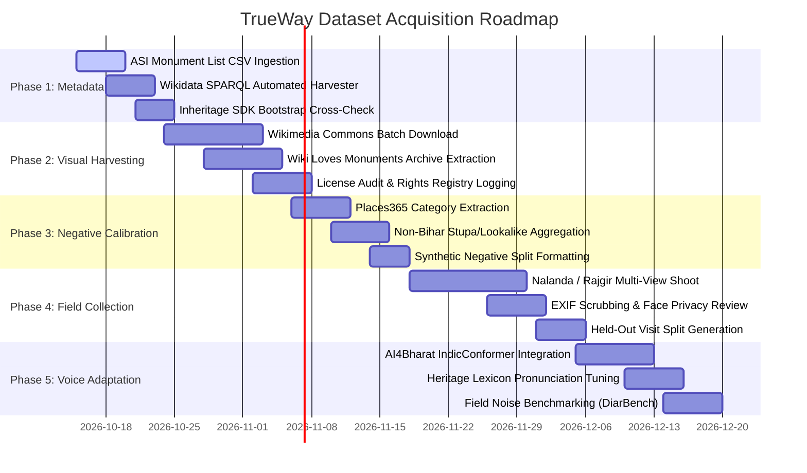

# TrueWay Dataset Research, Acquisition & Sourcing Specification
**Complete Strategy for Bihar Heritage Recognition, Negative Calibration, ASR, and Grounded Provenance**

- **Document Version:** 1.0 — Operational Dataset Specification
- **Effective Date:** 2026-10-11
- **Status:** Binding Operational Standard
- **Scope:** Guides dataset acquisition, training splits, negative sets, and rights clearance across `content/`, `ml/`, and `pack-builder/`.

---

## 1. Executive Summary & Verdict

> **The Ground Truth:** There is no pre-existing, ready-to-train dataset for fine-grained Bihar cultural heritage recognition. 
> 
> TrueWay must construct a **custom, citation-grounded multimodal corpus** by:
> 1. Programmatically harvesting **Wikimedia Commons + Wiki Loves Monuments** for baseline monument coverage (~40–60%).
> 2. Leveraging **Google Landmarks Dataset v2 (GLDv2)** for general visual representation transfer learning.
> 3. Conducting **structured on-site field collection** in Bihar for multi-view coverage, occlusion, and daylight variation (~30–40%).
> 4. Synthesizing a **dedicated negative set (2,500–3,500 images)** using **Places365** and non-target lookalikes to enforce the $\le 5\%$ False Accept gate.
> 5. Bootstrapping textual knowledge from **Indian Culture Portal V2.0**, the **ASI Centrally Protected Monument List**, and the **Inheritage SDK**.
> 6. Adapting Hindi voice recognition using **AI4Bharat IndicVoices** and **Indic DiarBench**.

---

## 2. Dataset Landscape Comparison Matrix

| Dataset | Modality / Type | Scale | Bihar / India Relevance | License Terms | Role in TrueWay Pipeline | Access / Protocol |
| :--- | :--- | :--- | :--- | :--- | :--- | :--- |
| **Google Landmarks v2 (GLDv2)** | Image Retrieval & Landmark Classification | 5M images, 200K classes | Thin (<100 Indian classes estimated) | Individual CC / Public Domain licenses per image (Google does not own rights) | Pre-training encoder backbone; few-shot transfer learning baseline | GitHub: `cvdfoundation/google-landmark` |
| **Wikimedia Commons + Wikidata** | Monument photography + structured RDF data | 1.2M+ mapped heritage entities globally | Rich (Extensive categories for Mahabodhi, Nalanda, Rajgir) | CC BY-SA / CC0 per image; public domain | **Primary visual source** + POI metadata (names, GPS, inception dates) via SPARQL | Wikimedia Commons API + Wikidata SPARQL endpoint |
| **Wiki Loves Monuments (India)** | Monument photography contest archives | 228K+ images submitted globally in 2025 alone | High (Annual participation across Indian monuments) | CC BY-SA (mandatory contest submission license) | High-resolution, multi-angle recent Bihar monument views | Wikimedia Commons category tree: `Wiki Loves Monuments in India` |
| **Egypt Monuments Dataset v1 (EGYPT-v1)** | Fine-grained monument classification | 7,778 images, 41 classes | None (Egypt benchmark) | Research use | **Structural benchmark to replicate**: 99.13% accuracy achieved with ~180 images/class | Research benchmark reference |
| **EgMM-Corpus (Oct 2025)** | Multimodal Vision-Language for cultural heritage | Paired images + curated cultural text | None (Egypt benchmark) | Open research (HuggingFace) | **Architectural schema analog**: Images paired with structured historical descriptions | HuggingFace: `Anwar12/EgMM-Corpus` |
| **AI4Bharat IndicVoices** | Multilingual speech audio | 12,000 hours, 22 Indian languages, 208 districts | Core Hindi coverage across dialect zones | Open / Research | Hindi speech-to-text (ASR) foundation model training | `ai4bharat.iitm.ac.in` |
| **Indic DiarBench (Aug 2026)** | Speaker-attributed ASR benchmark | All 22 scheduled Indian languages | High (Natural multilingual speech) | Open (Sarvam AI) | Noisy real-world Hindi/Hinglish speech evaluation at field sites | Sarvam AI benchmark |
| **Places365** | Scene classification | 1.8M images, 365 categories | Generic global scenes | Research use | **Primary source for negative calibration set** (`ruin`, `temple`, `monastery`, `courtyard`) | MIT / GitHub / TensorFlow Datasets |
| **ASI Protected Monument List** | Official POI registry (metadata only) | 3,679 centrally protected monuments | Complete official Bihar registry | Government Open Data | Canonical POI directory, coordinates, legal protection status | `dataful.in` CSV / `asi.nic.in` |
| **Indian Culture Portal V2.0 (Mar 2026)** | Historical archives, manuscripts, books | Millions of rare manuscripts & write-ups | High (Bihar Buddhist & Mauryan records) | Government portal (Ministry of Culture) | Grounded historical citations and verified source texts | `indianculture.gov.in` |
| **Inheritage SDK** | Documented heritage structured data | 5,000+ Indian heritage sites | High | CC BY 4.0 (Data) / Apache 2.0 (SDK) | Bootstrap `places` and `sources` tables; cross-validation | GitHub: Inheritage Foundation |
| **Flickr Commons** | Historical / archival photography | 200+ historical Bihar plates | Targeted (Late 19th / early 20th century) | "No known copyright restrictions" | Archival "Then" imagery for **"Then & Now"** camera overlay | `flickr.com/commons` |
| **Google Arts & Culture** | Museum & archival high-res imagery | 2,000+ partner institutions | High | **Partner-controlled (NOT open for AI training/packs)** | Partnership engagement channel only; strictly excluded from packs | `artsandculture.google.com` |

---

## 3. Structural Archetypes: Validating the Target Scale

Two key cultural heritage datasets validate TrueWay’s target corpus scale:

1. **Egypt Monuments Dataset v1 (EGYPT-v1)**:
   * **Scale:** 7,778 images across 41 classes ($\approx 190\text{ images per class}$).
   * **Outcome:** Achieved **99.13% top-1 accuracy** using standard CNN backbones (ResNet-50) under varied lighting, daylight shifts, and tourist occlusion.
   * **Implication for TrueWay:** 100–200 high-variance reference images per POI is mathematically sufficient for near-perfect closed-set classification and tight metric clusters.
2. **EgMM-Corpus (October 2025)**:
   * **Design:** Paired multimodal dataset matching visual monument features with verified, structured cultural claims and glossary definitions.
   * **Implication for TrueWay:** Validates TrueWay’s schema design linking `assets` $\rightarrow$ `reference_embeddings` $\rightarrow$ `places` $\rightarrow$ `claims` $\rightarrow$ `sources`.

### Target Bihar Pilot Sizing:
* **Scope:** 50–70 canonical POIs across Bodh Gaya, Rajgir, Nalanda, Vaishali, and Patna.
* **Volume:** 100–200 images per POI = **5,000 to 14,000 total images**.
* **Sourcing Split:**
  * **Wikimedia Commons + Wiki Loves Monuments:** 40–60% (~3,000–7,000 images)
  * **Structured Field Collection (TrueWay team):** 30–40% (~2,000–5,000 images)
  * **Licensed Acquisition (Bihar Tourism / Nalanda Univ / IIT Patna):** 10–20% (~1,000–2,000 images)

---

## 4. Programmatic Harvesting: Wikimedia Commons & Wikidata

### 4.1 SPARQL Monument Discovery Query
The following SPARQL query extracts all heritage monuments located in Bihar with coordinates, Wikidata IDs, and associated primary image URLs:

```sparql
SELECT ?item ?itemLabel ?coordinate ?image ?asiId WHERE {
  # Heritage site or Buddhist monument
  { ?item wdt:P31/wdt:P279* wd:Q4989906. } UNION
  { ?item wdt:P31/wdt:P279* wd:Q1205698. }
  
  # Located in Bihar administrative territory
  ?item wdt:P131* wd:Q1164.
  
  # Geographic coordinates mandatory
  ?item wdt:P625 ?coordinate.
  
  OPTIONAL { ?item wdt:P18 ?image. }
  OPTIONAL { ?item wdt:P1343 ?asiId. }  # ASI monument reference
  
  SERVICE wikibase:label { bd:serviceParam wikibase:language "en,hi". }
}
ORDER BY ?itemLabel
```

### 4.2 Key Commons Category Trees for Batch Scraping
* `Category:Monuments and memorials in Bihar`
* `Category:Nalanda Mahavihara`
  * Subcategories: `Temple No. 3, Nalanda`, `Monastery No. 1, Nalanda`, `Stupa of Sariputra`
* `Category:Mahabodhi Temple`
  * Subcategories: `Bodhi Tree (Bodh Gaya)`, `Vajrasana`, `Animesh Lochan Chaitya`
* `Category:Rajgir`
  * Subcategories: `Gridhrakuta Peak`, `Cyclopean Wall of Rajgir`, `Venuvana`, `Saptaparni Cave`
* `Category:Images from Wiki Loves Monuments in India` (filtered by Bihar state tags)

---

## 5. Negative Set Construction: The Backbone of Abstention

TrueWay's core promise is **Abstention over Fabrication**. To enforce the hard gate of **$\le 5\%$ False Accept rate** on out-of-pack images, the negative calibration corpus must be deliberately challenging.

### Negative Corpus Taxonomy (2,500–3,500 Total Images):

| Negative Category | Source | Target Count | Purpose in Calibration |
| :--- | :--- | :--- | :--- |
| **Generic Indian Temples (Non-Bihar)** | Wikimedia Commons | 600–1,000 | Prevents generic Hindu/Buddhist temple architecture from false-triggering Bihar sites. |
| **Southeast Asian Stupas / Pagodas** | Wikimedia Commons (Thailand, Sri Lanka, Myanmar) | 300–500 | Ensures Buddhist votive stupas in other nations do not match Nalanda/Bodh Gaya votive stupas. |
| **Ordinary Brick Ruins** | Places365 (`ruin` category) + Field | 400–600 | Teaches the metric adapter the difference between ancient monastic brickwork and generic brick walls. |
| **Construction & Scaffolding** | Field collection + Flickr Commons | 150–250 | Monuments undergoing restoration or ASI scaffolding must not match erroneous historical cards. |
| **Modern Commercial / Everyday Scenes** | Places365 (`street`, `market`, `shop`) | 400–600 | Ensures ticket counters, parking lots, souvenir stalls, and tea shops are rejected immediately. |
| **Natural Landscapes & Foliage** | Places365 (`bamboo_forest`, `forest`) | 300–400 | Prevents Bodhi tree leaves or Gridhrakuta hills from triggering landmark matches without architectural features. |
| **Crowds & Tourist Occlusion** | Field collection | 200–300 | Validates that groups of people in the foreground do not cause false accepts. |
| **Neighboring Lookalike Shrines (Out-of-Pack Bihar)** | Wikimedia Commons | 300–500 | Shrines in Gaya or Patna not included in the active regional pack must trigger clean abstention. |

---

## 6. Hindi ASR & Voice Data Strategy

1. **Baseline Foundation:**
   * **AI4Bharat IndicVoices:** 12,000 hours of natural speech from 208 districts across India. Provides the underlying acoustic model for Hindi and Hinglish.
   * **IndicConformer:** The state-of-the-art open ASR architecture for Indian languages, optimized for edge inference via ONNX / sherpa-onnx.
2. **Domain-Specific Lexicon Adaptation:**
   * General-purpose speech models fail on classical Sanskrit, Pali, and historical place names.
   * Build a dedicated phoneme and pronunciation dictionary for Bihar heritage terms:
     * *Vajrasana, Mahavihara, Animesha Lochana, Brahmayoni, Gridhrakuta, Saptaparni, Xuanzang, Faxian, Pataliputra, Dharmachakra*.
3. **Field Robustness Benchmark:**
   * Benchmark the ASR engine against **Indic DiarBench (August 2026)** to evaluate noisy, multi-speaker conversational inputs.
   * Target field gate: $\le 20\%$ Word Error Rate (WER) in noisy outdoor monument courtyards.

---

## 7. Historical Text & Citation Sourcing

All claims ingested into `claims` and `sources` must adhere to Blueprint §10:
* **Indian Culture Portal V2.0:** Use verified write-ups, archival records, and archaeological monographs published by the Ministry of Culture for 5th–12th century Mauryan and Pala empire chronologies.
* **Archaeological Survey of India (ASI):** Download official centrally protected monument entries (names, protection year, notification number) as the primary authority source.
* **Inheritage SDK:** Bootstrap initial coordinates, alternate spellings, and geographic bounds for 5,000+ Indian heritage sites under CC BY 4.0 licensing.
* **Archival Photography (Flickr Commons):** Extract late 19th-century public domain plates (Alexander Cunningham surveys, Beglar photographic documentation) for the **"Then & Now"** camera overlay.

---

## 8. Five-Phase Dataset Execution Roadmap



---

## 9. Legal, Copyright & Packaging Constraints

1. **GLDv2 Images Are NOT Universally Clear for Commercial Distribution:**
   * Google Landmarks v2 images are hosted under individual Creative Commons or Public Domain licenses. While GLDv2 is legally permissible for **pre-training model weights**, no raw image from GLDv2 may be redistributed in a `.twpkg` pack without an individual license audit.
2. **Wikimedia Commons Licensing Attribution:**
   * All images harvested from Wikimedia Commons require their exact license (`CC BY 4.0`, `CC BY-SA 3.0`, `CC0`) and author attribution to be serialized into `content/seed/rights_registry.json` and compiled into the pack's `LICENSES.json` and `ATTRIBUTIONS.json`.
3. **Google Arts & Culture Is Strictly Prohibited:**
   * High-resolution scans on Google Arts & Culture are governed by partner museum contracts and are strictly excluded from dataset collection and model training.
4. **Wiki Loves Monuments is CC BY-SA:**
   * Permitted for inclusion provided TrueWay respects the Share-Alike terms and provides full author attribution.
5. **Privacy Scrubbing:**
   * Every image harvested in the field or online must pass an automated face-detection filter. Any identifiable non-consenting human faces in monument courtyards must be blurred or excluded before feature extraction.
