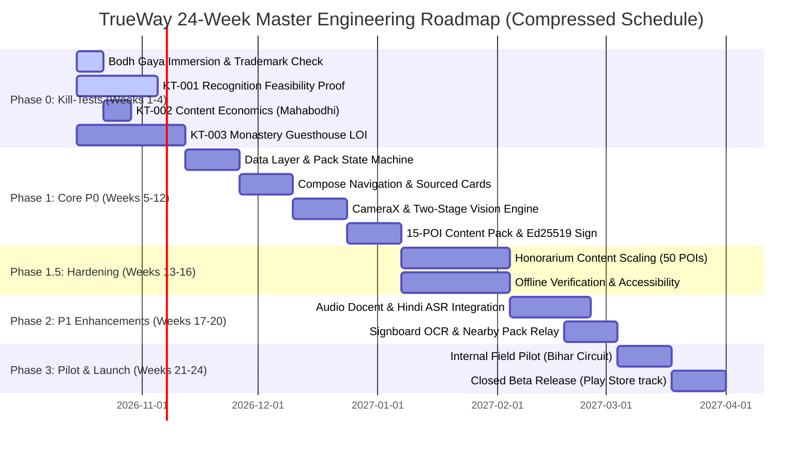

# TrueWay: Complete CTO-Level Project Plan & Multi-Agent Development Strategy

**Core Philosophy: AI agents write code; humans own decisions, reviews, and domain truth. The project succeeds or fails on the quality of human-defined constraints, not the volume of agent-generated code.**

- **Document Version:** 1.0 — Master Operational & Execution Plan
- **Effective Date:** 2026-10-11
- **Status:** Approved CTO Execution Baseline
- **Scope:** Governs orchestration of specialized AI agents, human-in-the-loop gates, sprint pacing, risk mitigation, and 24-week resource allocation across TrueWay.

---

## I. Development Philosophy & Agent Strategy

### 1.1 Why Multi-Agent?
A single AI coding assistant accelerates typing. A **team of specialized agents** accelerates *shipping*. TrueWay requires concurrent, non-interfering progress across distinct engineering and domain disciplines: Android native runtime, computer vision / metric learning, historical content curation, and cryptographic pack distribution.

Industry data from 2026 shows that **~40% of agentic automation projects fail to meet ROI targets** due to structural failures: missing orchestration layers, automating low-value tasks first, skipping human-in-the-loop review, and lack of strict architecture boundaries. TrueWay eliminates these failure modes through strict role specialization and immutable quality gates.

**The Operational Model:**
* **Git Worktrees:** Isolate each agent's file workspace, allowing 3–5 parallel Claude Code sessions without merge collisions.
* **Claude Squad / TUI Orchestration:** Visual status and terminal multiplexing for concurrent agent execution.
* **Dynamic Effort Scaling:** Claude Opus 4.5 for high-complexity architectural and security decisions; Claude Sonnet 4.5 for routine implementation and test generation.

### 1.2 Agent Architecture

```
┌─────────────────────────────────────────────────────────────┐
│                    HUMAN LAYER (CTO / Founder)              │
│  • Product decisions, scope changes, priorities              │
│  • Code review (every agent PR requires human approval)     │
│  • Domain truth: historical accuracy, site permissions      │
│  • Architecture decisions, cryptographic signing sign-off   │
└──────────────────────────┬──────────────────────────────────┘
                           │
┌──────────────────────────▼──────────────────────────────────┐
│              ORCHESTRATION LAYER (Claude Code + MCP)         │
│  • Task routing to specialized domain agents                 │
│  • Context isolation (each agent sees only its boundary)    │
│  • Conflict resolution for cross-module interfaces          │
│  • Automated CI test coordination                           │
└──────────────────────────┬──────────────────────────────────┘
                           │
        ┌──────────────────┼──────────────────┐
        ▼                  ▼                  ▼
┌───────────────┐  ┌───────────────┐  ┌───────────────┐
│  Agent:       │  │  Agent:       │  │  Agent:       │
│  ANDROID      │  │  ML PIPELINE  │  │  CONTENT      │
│  CORE         │  │               │  │  OPS          │
│               │  │               │  │               │
│  Scope:       │  │  Scope:       │  │  Scope:       │
│  • Compose UI │  │  • Dataset    │  │  • Editorial  │
│  • Room DB    │  │    builder    │  │    workflow   │
│  • CameraX    │  │  • Training   │  │  • Rights      │
│  • Pack mgr   │  │  • Evaluation │  │    registry    │
│  • Security   │  │  • Export     │  │  • Pack build │
└───────┬───────┘  └───────┬───────┘  └───────┬───────┘
        │                  │                  │
        ▼                  ▼                  ▼
┌───────────────┐  ┌───────────────┐  ┌───────────────┐
│  Agent:       │  │  Agent:       │  │  Agent:       │
│  INFRA        │  │  QA & TEST    │  │  PARTNER      │
│               │  │               │  │  RELATIONS    │
│  Scope:       │  │  Scope:       │  │               │
│  • CI/CD      │  │  • Unit tests │  │  Scope:       │
│  • CDN setup  │  │  • UI tests   │  │  • ASI MOU    │
│  • Signing    │  │  • Offline    │  │  • Bihar      │
│  • Build tools│  │    isolation  │  │    Tourism    │
└───────────────┘  └───────────────┘  └───────────────┘
```

### 1.3 Model Assignment by Task Complexity

| Task Type | Model | Effort Level | Rationale |
| :--- | :--- | :--- | :--- |
| **Architecture design, security audits, algorithm design** | Claude Opus 4.5 | High | Long-horizon reasoning, lowest step error rate, deep security foresight. |
| **Feature implementation, refactoring, test writing** | Claude Sonnet 4.5 | Medium | Highly cost-effective for clean, structured Kotlin and Python code. |
| **Documentation, comments, simple utilities** | Claude Sonnet 4.5 | Low | Fast execution for non-critical assets. |
| **Code review assistance & vulnerability scanning** | Claude Opus 4.5 | Medium | Uncovers subtle state leaks, threading bugs, and cryptographic edge cases. |

### 1.4 The 10 Founder Directives & Review Throughput
Per [docs/FOUNDER_FIELD_GUIDE_AND_TEN_DIRECTIVES.md](FOUNDER_FIELD_GUIDE_AND_TEN_DIRECTIVES.md):
1. **Planning is closed:** Real code or field collection begins within 7 days.
2. **Founder Review Discipline:** Batch PR reviews twice daily (11:00 AM & 5:00 PM); never merge unverified code.
3. **Single North Star Metric:** Track `% of sessions where a user reads a full place card`.
4. **Immutable Pilot Success Definition:** 30 real users complete a full journey, and $\ge 10$ recommend TrueWay.
5. **Immediate Week 1 Blockers:** ₹10k–20k Trademark clearance check and 5–7 day Bodh Gaya field immersion.
6. **Monastery Guesthouse Channel:** Laminated A4 reception cards with pre-trip download QR in Bodh Gaya.
7. **Local Honorarium Content Network:** Partner with Magadh/Nalanda/Patna history postgrads at ₹2k–5k/card.

---

## II. Complete Feature Breakdown

### Phase 0: Kill-Test Proofs (Weeks 1–4, Compressed Schedule)

#### KT-001: Recognition Feasibility Proof
* **Objective:** Demonstrate that an edge embedding model distinguishes 5 Bihar monuments from a hard negative set with $\ge 70\%$ top-1 accuracy and honest abstention on unknowns.
* **Agent Assignment:** ML Pipeline Agent (Opus 4.5 for architecture, Sonnet 4.5 for data pipeline).
* **Execution:**
  1. Harvest 50–100 reference images per monument from Wikimedia Commons (Mahabodhi, Nalanda Mahavihara, Rajgir fortifications, Barabar Caves, Vishwa Shanti Stupa).
  2. Build negative set: 500 images from Places365 (`ruin`, `temple`, `tower`, `courtyard`) + 200 lookalike monuments.
  3. Export MobileCLIP-S0 (v1) TFLite embedding model via MediaPipe / LiteRT.
  4. Evaluate on held-out test set with photographer/session split using `ml/evaluate_retrieval.py`.
  5. Compute calibration curve showing acceptance threshold vs. false-accept rate.
* **Human Gate:** Review 20 sample predictions manually (10 correct, 5 wrong, 5 abstentions). Verify abstentions reflect true ambiguity rather than model collapse.
* **Exit Criterion:** $\ge 70\%$ Top-1 on knowns, $\le 10\%$ False Accepts on hard negatives.

#### KT-002: Content Production Economics
* **Objective:** Fully produce one bilingual, rights-cleared, citation-backed place card for Mahabodhi Temple.
* **Agent Assignment:** Content Ops Agent (Sonnet 4.5 for research compilation, human verification mandatory for all claims).
* **Execution:**
  1. Compile historical claims from UNESCO documentation, ASI site records, Cunningham’s 1878 excavation monograph, and peer-reviewed architectural papers.
  2. Structure into `claims` rows with explicit `claim_type` (`DOCUMENTED`, `INTERPRETATION`, `TRADITION`, `CONTESTED`).
  3. Record time spent across research, writing, source verification, and editorial review.
  4. Generate English and Hindi translations with romanized aliases.
  5. License 10–15 reference images with explicit rights metadata.
  6. Package as minimal `.twpkg` using `pack-builder/build_pack.py`.
* **Human Gate:** Historical accuracy sign-off by a qualified domain reviewer. Every claim must have a verified primary anchor.
* **Exit Criterion:** Complete, production-grade place card produced in $<8\text{ hours}$ total effort.

#### KT-003: Partner Validation
* **Objective:** Secure one signed Letter of Intent (LOI) or formal communication from a Bihar heritage stakeholder (ASI circle office, Bihar State Tourism Development Corporation, Nalanda University, or Bodhgaya Temple Management Committee).
* **Agent Assignment:** Partner Relations Agent (drafts proposals, communication briefs) + Human (all actual meetings and negotiations).
* **Exit Criterion:** One formal institutional engagement establishing terms for site photography, scholarly review, or kiosk touchpoints.

---

### Phase 1: P0 Core Application (Weeks 5–14)

* **F001: Region Onboarding & Pack Discovery**
  * Search local `world_index` (~5MB bundled in APK).
  * Display pack size (Lite, Heritage, Maps, Audio), languages, license index.
  * Download with pause/resume, SHA-256 verification, and atomic extraction.
* **F002: Camera Capture & Landmark Ranking**
  * CameraX single-shot capture.
  * Pre-scan site advisory check (warns if devices/cameras are banned, e.g. Mahabodhi Temple complex generally).
  * MobileCLIP-S0 (v1) TFLite embedding retrieval (MediaPipeEmbedder) + flat brute-force ranking (`TWVEC001` binary index; XFeat lookalike verification P1 candidate).
  * Geospatial soft prior (boosts nearby candidates if GPS $<100\text{m}$ fresh; never hard-filters).
* **F003: Search & Category Lookup**
  * SQLite FTS5 search across canonical names, aliases, Hindi script, and romanized `hi-Latn`.
  * Predefined category browsing (Buddhist monument, Mauryan ruin, Hindu shrine, museum).
* **F004: Sourced Historical Card**
  * Readable narrative cards separated into Fact, Interpretation, Tradition, and Contested claims.
  * Inline source chips linking to publication year, author, and review date.
* **F005: Optional GPS Integration**
  * Contextual permission request; full fallback to manual browse if denied.
* **F006: Pack Lifecycle Management**
  * Atomic unpack, Ed25519 verification, rollback on failure, changelog inspector.
* **F007: Lite Journal & Bookmarks**
  * Local personal diary stored in isolated `user_journal.sqlite`; zero account required.
* **F008: Offline Nearby List**
  * Distance-sorted or region-grouped POI list when map tiles are not installed.
* **F009: Camera Restrictions Awareness (`ScanGate`)**
  * Advisories for religious, military, or security camera prohibitions.
* **F010: Trust & Unknown UI**
  * Explicit, dignified abstention cards ("Unrecognized structure", "Ambiguous angle") with one-tap search fallback.
* **F011: Essentials Strip**
  * Offline emergency numbers, site etiquette, and operating schedules.
* **F012: Battery & Resource Controls**
  * Immediate camera release on backgrounding; single-shot execution to eliminate thermal throttling.
* **F013: Pack Content Changelog**
  * Exposes corrected dates, updated bibliography, or new POIs across releases.
* **F014: Signed QR Resolver**
  * Decodes cryptographically signed `tw://place/v1` touchpoints; rejects arbitrary web URLs.

---

### Phase 1.5: P0.5 Hardening (Weeks 12–16)

* Offline readiness checklist visible in settings.
* Pack corruption auto-recovery flow.
* Low-storage handler (clear guidance when device storage $<200\text{MB}$).
* Automated `RADIO-OFF` zero-network tests in CI.
* Accessibility compliance: TalkBack screen reader labels, minimum $4.5:1$ contrast ratio, dynamic type scaling.
* Entry-level physical device qualification (Android 8.0, 2GB–3GB RAM, 16GB storage).

---

### Phase 2: P1 Enhancements (Weeks 15–20)

* **F101: Curated Audio Guide:** Human-recorded audio for top 15 POIs in Hindi and English; platform TTS fallback for long-tail text.
* **F102: Hindi Voice Query:** Push-to-talk offline ASR using sherpa-onnx + IndicConformer; editable transcript before search execution.
* **F103: Signboard OCR:** Google ML Kit Text Recognition v2 for modern Devanagari and Latin information boards.
* **F107: Heritage Passport:** Local cryptographic stamps for visited sites; GPS or QR verified.
* **F111: Offline Pack Relay:** Google Nearby Connections API for 30+ MB/s device-to-device pack sharing in remote zones.

---

## III. 24-Week Development Roadmap



### Milestone Exit Gates
* **Week 4 (Gate G1 — Kill-Test Evaluation):**
  * Trademark cleared or pivot initiated.
  * Bodh Gaya field immersion completed; phone demographics & visitor habits documented.
  * KT-001 demonstrates $\ge 70\%$ top-1 and $\le 10\%$ false-accept OR camera is formally demoted to secondary search.
  * KT-002 proves place cards can be produced in $<8\text{ hours}$ per POI.
  * KT-003 delivers at least one monastery guesthouse LOI for reception desk QR display.
* **Week 12 (Gate G3 — Core Feature Complete):**
  * All 14 P0 features operational offline; 15-POI Bihar pack loads atomically; all JVM and instrumented tests pass.
* **Week 16 (Gate G4 — Hardening & Content Complete):**
  * 50 POIs drafted via honorarium network and verified by domain scholars.
  * Verified 0 network packets transmitted in `RADIO-OFF` mode.
  * Verified on entry-tier physical Android phone (e.g. Redmi 12).
* **Week 24 (Gate G6 — Public Pilot Launch):**
  * 50–70 POI content pack compiled and signed.
  * 30 real users complete one full journey, with $\ge 10$ recommending TrueWay.
  * Crash rate $<1.0\%$; field recognition accuracy $>65\%$ under outdoor Bihar lighting.

---

## IV. Team Composition & Resource Budget

### Human Team

| Role | Engagement | Core Responsibilities |
| :--- | :--- | :--- |
| **Founder / CTO** | Full-Time | Architecture, code review, partner negotiation, system integration, final sign-off. |
| **Historical Content Reviewer** | 10–20 hrs/wk (W2–W20) | Verify historical claims, resolve contested historiography, vet primary bibliography. |
| **Contract Android Engineer** | 20–40 hrs/wk (W5–W16) | NDK/C++ integrations (`sqlite-vec` P1 upgrade), CameraX edge cases, low-memory tuning. |
| **Contract ML Engineer** | 15–30 hrs/wk (W1–W14) | Metric learning pipeline, ONNX/LiteRT model export, calibration curves. |
| **Field Data Collector** | 2 weeks (W10–W14) | High-variance multi-view photography across Bodh Gaya, Nalanda, and Rajgir. |
| **Hindi Editorial Reviewer** | 10–15 hrs/wk (W8–W20) | Review Hindi translations for natural, respectful phrasing (not raw machine translation). |

*Estimated Human Contractor Budget (24 weeks):* **₹15,00,000 – ₹30,00,000**.

### Agent Infrastructure Budget

| Tooling Platform | Monthly Cost | Operational Focus |
| :--- | :--- | :--- |
| **Claude Code (Opus 4.5)** | ~$150 – $250 | System architecture, cryptographic signing, security audit, code review. |
| **Claude Code (Sonnet 4.5)** | ~$50 – $100 | Routine feature implementation, Kotlin Composables, test suites. |
| **Cursor / Android Studio** | ~$20 | Interactive UI editing and visual layout debugging. |
| **GitHub Actions / Cloud Cache** | ~$20 | CI/CD test automation and pack compilation. |
| **Total AI Tooling** | **~$240 – $390 / month** | Replaces an estimated 2–3 junior developers. |

---

## V. Sprint Governance with AI Agents

### 2-Week Sprint Cadence
Agents operate strictly within human-defined boundaries. Humans set the Sprint Goal, commit scope, and approve every pull request.

```
DAY 1: SPRINT PLANNING
├── Human: Declares Sprint Goal and prioritized deliverables.
├── Agent (Opus 4.5): Scans codebase, maps dependencies, flags technical risks.
├── Human: Commits scope and assigns worktree branches.
└── Agent: Scaffolds tasks into testable specifications.

DAYS 2-9: EXECUTION & ASYNC STANDUP
├── Agents: Implement code, generate unit tests, verify lint rules.
├── Human: Conducts PR code reviews (zero unreviewed agent code enters main).
└── Human: Unblocks domain and architectural questions.

DAY 10: REVIEW & RETROSPECTIVE
├── Human: Tests working build on physical device.
├── Human: Accepts or rejects features against acceptance criteria.
└── Agent (Opus 4.5): Updates architectural documentation, changelogs, and metrics.
```

### Mandatory Agent Task Specification Format
Every prompt or task dispatched to an AI agent must adhere to this template:

```markdown
## Task: [Feature / Component Name]

### 1. Context
- Feature ID (e.g. F002, F006) and Sprint Goal.
- Governing ADRs: [e.g. ADR-0004, ADR-0006].
- Existing files and boundaries.

### 2. Specification & Behavior
- Exact input/output contracts.
- Concrete acceptance criteria (testable assertions).
- Edge cases and error states (abstention, storage full, no camera).

### 3. Constraints
- Zero network calls in critical path (RADIO-OFF compliance).
- Maximum memory and latency budgets.
- Android architectural conventions (Clean Architecture + UDF).

### 4. Definition of Done
- [ ] Code implemented within specified module.
- [ ] Unit tests pass with >=85% branch coverage.
- [ ] Clean build via Gradle / pytest without warnings.
- [ ] Documentation / ADR updated.
- [ ] PR created for human review.
```

---

## VI. Risk Register & Mitigation Strategy

| Risk ID | Risk Description | Likelihood | Impact | Concrete Mitigation |
| :--- | :--- | :--- | :--- | :--- |
| **R-01** | Visual recognition fails target accuracy in field conditions | Medium | High | KT-001 tests this by Week 6. Two-stage XFeat cascade disambiguates lookalikes. Fallback: Search & QR become primary. |
| **R-02** | Content research & verification exceeds budget | Medium | High | KT-002 establishes baseline per-card hours. Automated SPARQL harvesters bootstrap metadata; human focuses on verification. |
| **R-03** | Institutional partner negotiations stall | Medium | Medium | Outreach begins in Week 1. App remains 100% functional via public domain data without exclusive venue agreements. |
| **R-04** | Agent-generated code introduces subtle memory or state bugs | High | Medium | 100% human review on every PR. Instrumented memory tests and strict architectural layer boundaries. |
| **R-05** | Network leaks in offline critical path | Medium | Critical | Automated network proxy assertions in CI; any HTTP/DNS egress in `RADIO-OFF` mode fails the build. |
| **R-06** | Solo founder burnout across engineering and operations | High | High | Strict 24-week buffer; domain contractors handle research, translations, and specialized native code. |

---

## VII. Content Operations: The Parallel Critical Path

Content production is the primary operational critical path that code cannot bypass. It runs concurrently from Week 2 through Week 20:

```
RESEARCH ──► DRAFT ──► SOURCE ──► REVIEW ──► TRANSLATE ──► EMBED ──► PACKAGE
   │           │         │          │            │           │          │
   │           │         │          │            │           │          └── Pack Builder Agent
   │           │         │          │            │           └── ML Pipeline Agent
   │           │         │          │            └── Hindi Editorial Reviewer (Human)
   │           │         │          └── Historical Reviewer (Human Specialist)
   │           │         └── Content Agent (Validates against bibliography)
   │           └── Content Agent (Synthesizes initial claim drafts)
   └── Content Agent + Wikidata/ASI Open Data Harvester
```

### Cumulative Content Milestone Schedule

| Sprint Week | POIs Completed | Cumulative POIs | Milestone Deliverable |
| :--- | :--- | :--- | :--- |
| **Week 4** | 1 | 1 | KT-002 (Mahabodhi Temple) economic baseline. |
| **Week 6** | 4 | 5 | Phase 0 proof set (Nalanda, Rajgir, Barabar, Vishwa Shanti). |
| **Week 8** | 5 | 10 | Initial regional core. |
| **Week 10** | 10 | 20 | First full multi-site circuit. |
| **Week 12** | 10 | 30 | Expanded Buddhist & Mauryan POIs. |
| **Week 14** | 10 | 40 | Nalanda district complete. |
| **Week 16** | 10 | 50 | Full pilot minimum target reached. |
| **Week 18** | 10 | 60 | Long-tail rural shrines and trail stops. |
| **Week 20** | 10 | **70** | **Full Bihar Regional Pack compiled & signed.** |

---

## VIII. The Solo Founder Reality Check

1. **You Cannot Do Everything:** You must spend **60–70% of your time on product architecture, system integration, and code review**, and **30–40% on content validation and partnerships**. Outsource deep historical research and translations to domain contractors.
2. **Agent Code Quality is Your Responsibility:** Every agent PR must be thoroughly understood and verified. Never merge code you cannot explain.
3. **Historical Truth is Non-Negotiable:** Speed never excuses inaccurate history. The visible evidence chips (`DOCUMENTED` vs. `TRADITION`) protect TrueWay's integrity.
4. **Scope Discipline is Survival:** Any new feature idea belongs in the P2/P3 backlog. Do not derail the 24-week delivery timeline.
5. **The Moat is Content, Trust, and Provenance:** Anyone can write an Android app with AI. The defensible barrier is the **signed, verified, citation-grounded heritage knowledge graph**. Protect that asset above all else.

---

*This document serves as the binding operational plan for TrueWay. Progress against this plan is tracked in [`docs/SPRINT_PLAN.md`](SPRINT_PLAN.md).*
