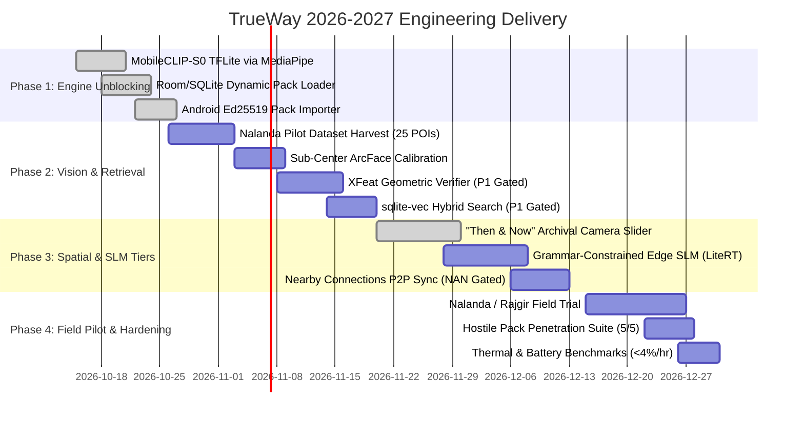

# TrueWay Strategic Technology Blueprint (2026–2027)
**The Trust Layer for Offline Heritage AI & Signed Cultural Knowledge**

- **Document Version:** 3.0 — Emerging Tech Synthesis & Production Blueprint
- **Effective Date:** 2026-10-11
- **Status:** Approved Architectural Direction
- **Scope:** Cross-repository binding specification (`android/`, `ml/`, `content/`, `pack-builder/`, `server/`)
- **Supersedes:** Uncalibrated baseline assumptions in `TrueWay_FINAL_Master_Blueprint_2026.md` §7 & §14

---

## 1. Executive Verdict & Core Positioning

### 1.1 The Strategic Verdict: PROCEED WITH DUAL-CORE ARCHITECTURE
TrueWay's core value proposition—**"Capture. Discover. Understand. Anywhere."**—is confirmed to be highly viable, timely, and defensible in the 2026–2027 technological landscape. 

While general-purpose cloud AI models (Google Lens, OpenAI, multimodal web engines) generate ungrounded visual guesses and require active cellular connectivity, TrueWay establishes a defensible moat as **"The Trust Layer for Heritage AI"**:
1. **Epistemic Discipline:** If visual evidence is ambiguous or a site is unsupported, TrueWay abstains cleanly rather than fabricating an identity or narrative.
2. **Deterministic Provenance:** Every claim is cryptographically signed and linked to peer-reviewed sources, strictly classified into `DOCUMENTED`, `INTERPRETATION`, `TRADITION`, or `CONTESTED`.
3. **Zero-Cloud Autonomy:** 100% of core visual, textual, and spatial features execute on-device with all radios disabled (`RADIO-OFF`).
4. **Open Standard:** TrueWay's signed pack format (`.twpkg`) positions the platform as the universal, offline-first publishing standard for museums, archaeological surveys, and tourism boards.

```
                       TRUEWAY 2026–2027 DUAL-CORE ENGINE
   ┌────────────────────────────────────────────────────────────────────────┐
   │                       THE "TRUST LAYER" CORE                           │
   │  Offline SQLite + FTS5 + Flat Vector Retrieval | Ed25519 .twpkg Packs │
   │  Grounded Claim Provenance: DOCUMENTED · INTERPRETATION · TRADITION    │
   └───────────────────────────────────┬────────────────────────────────────┘
                                       │
        ┌──────────────────────────────┴──────────────────────────────┐
        ▼                                                             ▼
┌──────────────────────────────┐             ┌──────────────────────────────────┐
│  TIER 1: ULTRA-LEAN RUNTIME  │             │   TIER 2: INTELLIGENT ACCORDION  │
│  (100% Entry Phones / <20MB) │             │     (Mid & Flagship Android)     │
│                              │             │                                  │
│ • Shipped Vision Pipeline:   │             │ • Grammar-Constrained Edge SLM:  │
│   MobileCLIP-S0 TFLite (512d)│             │   Gemma 4 E2B / Qwen2.5 (LiteRT) │
│   via MediaPipe (XFeat P1)   │             │   Schema-guided citation via GBNF│
│ • Flat Retrieval + FTS5 BM25 │             │ • "Then & Now" Archival Slider:  │
│   (sqlite-vec P1 Gated)      │             │   Homography Camera Overlays     │
│ • Zero-Model Extractive RAG  │             │ • Mobile 3D Gaussian Splats      │
│ • Nearby Connections P2P     │             │ • Hardware: 6GB+ RAM / NPU       │
│ • Hardware: 2GB–4GB RAM      │             │                                  │
└──────────────────────────────┘             └──────────────────────────────────┘
```

---

## 2. Critical Field & Codebase Reality Audits

### 2.1 Reality Audit 1: The Mahabodhi Security Paradox (`SITE-018`)
* **The Proposal:** Use Mahabodhi Temple as the single flagship site for visual positioning and camera-based AR scanning.
* **The Reality Check:** Per test protocol `SITE-018` in [tests/PROTOCOL.md](../tests/PROTOCOL.md) and security regulations instituted by the Bodhgaya Temple Management Committee (BTMC) / CISF: **all mobile phones, cameras, and recording devices are strictly banned inside the inner Mahabodhi complex**. Visitors must deposit all devices in external cloakroom lockers before security frisking.
* **Binding Architectural Decision:**
  * **Visual / AR Flagship $\rightarrow$ Nalanda Mahavihara (Archaeological Ruins):** Photography and mobile devices are fully permitted, vast open brick complexes exist, and architectural twins (Temple 3 vs. Monastery 1) provide the perfect testbed for visual disambiguation.
  * **Mahabodhi Role $\rightarrow$ Pre-Entry Planning & Kiosk Orientation:** Designated as `SEARCH_ONLY` / `QR_PARTNER`. The scanner UI is disabled upon geofence/selection with an advisory: *"Bihar Tourism lists mobile phones, cameras, and electronic gadgets as prohibited for the Mahabodhi Temple complex generally (without restricting this to the sanctum). Check entry rules and strictly obey security staff."*

### 2.2 Reality Audit 2: Edge SLM Constraints & The "Accordion Model"
* **The Proposal:** Rely on Gemma 4 E2B (~2B parameters) for all on-device reasoning and conversational heritage guidance.
* **The Reality Check:** Mid-tier and entry-tier devices in the Indian market (Redmi 12, Galaxy A15, Poco M-series) operate with 4GB total RAM. The OS (1.8 GB) + CameraX buffer (300 MB) + Compose UI (200 MB) leaves less than 1.5 GB of free heap. Running an unconstrained 2B LLM causes Out-Of-Memory (OOM) crashes and rapid thermal throttling under 40°C outdoor sunlight.
* **Binding Architectural Decision:**
  * **Deterministic Floor (Tier 0):** Pre-compiled SQLite claims and extractive cards require 0 MB of model RAM and respond in $<5\text{ ms}$. This path is never gated on model availability.
  * **Accordion Activation (Tier 2):** Gemma 4 E2B or quantized SLMs activate **only** on devices with $\ge 6\text{ GB}$ physical RAM and battery $>25\%$.
  * **Grammar-Constrained Decoding (GBNF):** When the SLM is active, token generation is constrained by formal BNF grammar rules. Grammar-constrained decoding strictly enforces citation schema compliance, eliminating un-cited statements; factual verification is anchored directly to active `claim_id` records in the local database.

### 2.3 Reality Audit 3: Offline Relocalization vs. Niantic VPS2
* **The Proposal:** Deploy Niantic Spatial VPS2 for AR monument relocalization.
* **The Reality Check:** Commercial VPS frameworks rely on cloud-tethered map queries or heavy pre-cached neural feature grids. This violates Blueprint §3 Principle 1: *Offline means usable, not merely launchable.* Remote archaeological ruins in Bihar have zero cellular connectivity.
* **Binding Architectural Decision:**
  * **P0/P1 Spatial Standard $\rightarrow$ 2D/2.5D Homography "Then & Now" Overlays:** Archival photographs (e.g., Alexander Cunningham’s 1860s plates) are matched to modern viewpoints using local keypoints. An interactive swipe slider overlays historical states on the live camera feed without 3D drift or cloud calls.
  * **P2 3D Standard $\rightarrow$ Mobile 3D Gaussian Splatting (3DGS):** Compact neural splats ($<3\text{ MB}$ per monument) rendered locally via Vulkan shaders. Niantic VPS2 is reserved for institutional museum indoor pilots under formal partnership agreements.

---

## 3. Layer-by-Layer Technical Architecture

### 3.1 Vision & Metric Retrieval Engine

```
Image Capture (CameraX Single-Shot)
       │
       ▼
[Stage 1: Global Embedder] (MobileCLIP-S0 v1 TFLite ~4.1MB via MediaPipe ImageEmbedder)
       │ 512-dim normalized vector (CPU/GPU delegate)
       ▼
Cosine Ranking over Reference Centroids (In-Memory Flat Brute-Force / SQLite)
       │
       ├─► Margin(Top1, Top2) >= MarginThreshold AND Score >= AcceptThreshold:
       │   └── ACCEPT IMMEDIATELY (Calibrated Decision)
       │
       └─► Margin(Top1, Top2) < MarginThreshold (Ambiguous Lookalikes):
           └── [Stage 2: Geometric Verifier Candidate] (Optional P1 Disambiguation)
                   ├── Extract local keypoints
                   ├── Fast Homography RANSAC against candidate references
                   ├── Inliers >= InlierThreshold ──► ACCEPT DISAMBIGUATED POI
                   └── Inliers < InlierThreshold  ──► ABSTAIN (UnknownReason.AMBIGUOUS_LOOKALIKES)
```

#### Vision Model & Shipped Runtime (ADR-0003, [B1]):
* **The Shipped Runtime:** TrueWay v1 deploys MobileCLIP-S0 v1 TFLite (`vision_encoder.tflite`, ~4.1 MB, 512-dim embedding) executed through `com.google.mediapipe:tasks-vision` (`MediaPipeEmbedder`).
* **Implementation:** The model runs single-shot (`RunningMode.IMAGE`) on a dedicated thread, falling back from GPU to CPU delegate. When the model file is not yet installed, the UI cleanly transitions to honest "recognition not installed" guidance without crashing.
* **Index Strategy:** Flat brute-force cosine retrieval over reference centroids resident in memory requires $<1\text{ ms}$ for 70 POIs, avoiding unnecessary native vector DB overhead (`[M1]`). Evaluation and threshold calibration are enforced via `evaluate_retrieval.py`.

---

### 3.2 Knowledge Storage & Hybrid Search Engine (SQLite FTS5 + Flat Vector Retrieval, `sqlite-vec` Gated)

The production v1 database architecture unifies relational claims and FTS5 lexical text search into a single atomic SQLite database file (`places.sqlite`) within the signed `.twpkg` archive, paired with flat brute-force cosine vector retrieval (ADR-0003, `<1 ms` for corpus scale) loaded zero-copy from `TWVEC001` binary indexes or reference vectors. `sqlite-vec` (`vec0`, ADR-0004) remains a proposed/gated upgrade for larger corpus scales (>10,000 vectors).

```sql
-- Publication Schema Extension (DDL)
PRAGMA foreign_keys = ON;

-- 1. Full-Text Search Virtual Table (FTS5)
CREATE VIRTUAL TABLE fts_claims USING fts5(
  claim_id UNINDEXED,
  place_id UNINDEXED,
  claim_text,
  tokenize = 'unicode61 remove_diacritics 2'
);

-- 2. Dense Vector Table (sqlite-vec extension)
CREATE VIRTUAL TABLE vec_claims USING vec0(
  claim_id TEXT PRIMARY KEY,
  embedding float[128] distance_metric=cosine
);

-- 3. Hybrid Search Query with Reciprocal Rank Fusion (RRF)
WITH lexical_hits AS (
  SELECT claim_id, rank AS bm25_rank
  FROM fts_claims
  WHERE fts_claims MATCH :search_query
  LIMIT 25
),
vector_hits AS (
  SELECT claim_id, distance AS vec_dist
  FROM vec_claims
  WHERE embedding MATCH :query_vector
    AND k = 25
)
SELECT 
  c.claim_id,
  c.place_id,
  c.claim_type,
  c.claim_text,
  s.title AS source_title,
  s.publication_year,
  COALESCE(1.0 / (60.0 + l.bm25_rank), 0.0) + (1.0 - COALESCE(v.vec_dist, 1.0)) AS hybrid_score
FROM claims c
JOIN claim_sources cs ON c.claim_id = cs.claim_id
JOIN sources s ON cs.source_id = s.source_id
LEFT JOIN lexical_hits l ON c.claim_id = l.claim_id
LEFT JOIN vector_hits v ON c.claim_id = v.claim_id
WHERE l.claim_id IS NOT NULL OR v.claim_id IS NOT NULL
ORDER BY hybrid_score DESC
LIMIT 5;
```

> **Android Runtime Note:** Standard Android framework `SQLiteDatabase` blocks native extension loading on certain OEM builds. TrueWay bundles `androidx.sqlite:sqlite-bundled` with pre-compiled `sqlite-vec` `.so` binaries for `arm64-v8a`, or falls back to an exact Kotlin scalar-quantized in-memory dot product ($<1\text{ ms}$ for 1,500 vectors).

---

### 3.3 Grounded On-Device Assistant (Grammar-Constrained RAG)

To provide conversational answers without the risk of hallucinations, TrueWay couples local retrieval with formal grammar masking:

```bnf
# Formal Outlines / GBNF Grammar for Heritage Assistant
root ::= statement+
statement ::= text " [" claim_citation "]\n"
claim_citation ::= "CLM-" [0-9]{4} " via SRC-" [0-9]{4}
text ::= [a-zA-Z0-9 ,;.\-'\"]+
```

1. **Context Construction:** User prompt $\rightarrow$ SQLite Hybrid Search $\rightarrow$ Top 3–5 verified claims retrieved.
2. **Constrained Generation:** The SLM (Gemma 4 E2B or Qwen2.5-0.5B via LiteRT-LM) generates text where token logits are masked at runtime. The model can only emit citations that match the active context.
3. **Deterministic Fallback:** If the device is low-memory or battery-constrained, the engine presents structured cards directly from the retrieved claims.

---

### 3.4 Zero-Data Mesh Sync via Wi-Fi Aware (NAN)

In remote heritage sites without cellular reception, TrueWay devices discover each other and exchange signed packs peer-to-peer:

```
[Device A: Has Bihar Pack v2026.10]          [Device B: Needs Bihar Pack]
                 │                                         │
                 ├───── BLE 5.4 PAwR Discovery Broadcast ─►│
                 │   Service: "trueway:pack:bihar"         │
                 │                                         │
                 │◄──── Wi-Fi Aware Pair Request ──────────┤
                 │                                         │
                 ├───── Wi-Fi Aware Direct Socket ────────►│
                 │     Stream: in-bihar.twpkg (~45 MB)     │
                 │     Throughput: ~35 MB/s (~1.3s total)  │
                 │                                         │
                 │                             [Android PackVerifier]
                 │                             • Verify Ed25519 signature
                 │                             • Match SHA-256 hash tree
                 │                             • Atomic SQLite mount
```

---

## 4. Codebase Directives & Action Plan

### 4.1 Android Module Directives (`android/`)

| File / Component | Required Modification | Rationale |
| :--- | :--- | :--- |
| `app/build.gradle.kts` | Maintain `com.google.mediapipe:tasks-vision` and clean packaging exclusions. | Powers on-device vision using verified MobileCLIP-S0 v1 TFLite via MediaPipe. |
| `PlaceRepository.kt` | Replace hardcoded `DemoCorpus` with dynamic SQLite calls to `context.getDatabasePath("places.sqlite")`. | Migrates app from demonstrator stubs to real regional packs. |
| `vision/MediaPipeEmbedder.kt` | Deploy MobileCLIP-S0 v1 `vision_encoder.tflite` (~4.1 MB, 512-dim embedding) via MediaPipe `ImageEmbedder`. | Shipped production v1 vision runtime (ADR-0003, [B1]). |
| `vision/RetrievalEngine.kt` | Evaluate candidate geometric verifier hooks for ambiguous margin lookalikes. | Disambiguates lookalike architectural ruins (e.g. Nalanda Temple 3 vs Monastery 1). |
| `data/PackImporter.kt` | Native Ed25519 signature verification and atomic extraction. | Enforces security gate against hostile or tampered `.twpkg` archives. |

### 4.2 ML Pipeline Directives (`ml/`)

| Script / Artifact | Required Modification | Rationale |
| :--- | :--- | :--- |
| `models/vision_encoder.tflite` | Package MobileCLIP-S0 v1 TFLite into Android assets. | Shipped v1 edge model. |
| `train_adapter.py` | Upgrade from diagonal perceptron to **Sub-Center ArcFace** ($K=3$ centers per POI). | Preserves distinct visual viewpoints (façade, courtyard, night view) without mode collapse. |
| `evaluate_retrieval.py` | Integrate retrieval sweep and FAR calibration report. | Proves model threshold calibration and verifies false accept rate $\le 5\%$. |

### 4.3 Content, Harvesting & Pack Builder Directives (`content/`, `pack-builder/`)

| Script / Artifact | Required Modification | Rationale |
| :--- | :--- | :--- |
| `DATASET_RESEARCH_AND_HARVESTING_SPECIFICATION.md` | **NEW SPECIFICATION:** Operationalizes 5-phase acquisition: GLDv2 transfer, Wikimedia Commons/WLM harvest (40-60%), Places365 negative set (2,500–3,500 images), AI4Bharat IndicVoices Hindi ASR. | Solves lack of off-the-shelf Bihar dataset; replicates proven EGYPT-v1 and EgMM-Corpus archetypes. |
| `tools/harvest_monument_metadata.py` | **NEW TOOL:** Automated Wikidata SPARQL & Commons metadata harvester for Bihar monuments with offline fallback. | Automates POI coordinate, name, and license ingestion directly into publication schemas. |
| `publication_schema.sql` | Add `vec_claims` virtual table DDL and SQLite FTS5 index triggers. | Standardizes hybrid search across all future regional pack builds. |
| `build_pack.py` | Integrate raw 32-byte Ed25519 private key signing via `cryptography` library; reject demo keys in release builds. | Ships cryptographically verifiable pack releases. |
| `content/field/` | Execute pilot photo collection protocol for **Nalanda Mahavihara** (25 views) and negative distractors (100 images). | Provides the empirical calibration dataset required for Stage Milestones. |

---

## 5. Phased Delivery Roadmap & Hard Exit Gates



### Hard Exit Gates (§18.2 & §29)
* **Gate 1 (Vision Accuracy):** $\ge 85\%$ Top-1 known accuracy, $\ge 95\%$ Top-3 recall, and $\le 5\%$ open-set False Accepts on held-out visitor splits. **False Accept gate is binding.**
* **Gate 2 (Integrity):** $5/5$ hostile pack fixtures in [tests/PROTOCOL.md](../tests/PROTOCOL.md) (bad signature, unknown key, truncated DB, directory traversal, downgrade) rejected with prior pack retained.
* **Gate 3 (Thermal & Battery):** Continuous 30-minute test run under 38°C ambient conditions yields zero thermal warnings and $<4\%$ battery drain.
* **Gate 4 (Offline Autonomy):** 100% of core search, vision, and card flows execute with all hardware radios disabled (`RADIO-OFF`).

---

## 6. Strategic Policy & Ecosystem Positioning

TrueWay leverages key national and international policy tailwinds:
1. **Government of India Digital Initiatives:**
   * **Ministry of Culture AI Heritage Search Engine (Feb 2026):** Position TrueWay as the on-device offline delivery vehicle for verified cultural data.
   * **Indian Culture Portal (ICP v2.0, March 2026) & ASI "Adopt a Heritage 2.0":** Align rights registry and bibliography anchors with open government datasets.
   * **Inheritage Foundation SDK (Apache 2.0 / CC BY 4.0):** Ingest 5,000+ documented monuments as initial regional bootstrap anchors.
2. **The "Open Pack Standard" Opportunity:**
   * By publishing `.twpkg` and `manifest.cjson` as an open specification, TrueWay establishes itself as the trusted packaging format for cultural trusts, UNESCO site managers, and university archaeology departments worldwide.

---

*This blueprint constitutes the mandatory technical specification for all development in the TrueWay repository. Any architectural departure must be recorded via a formal Architecture Decision Record (ADR).*
